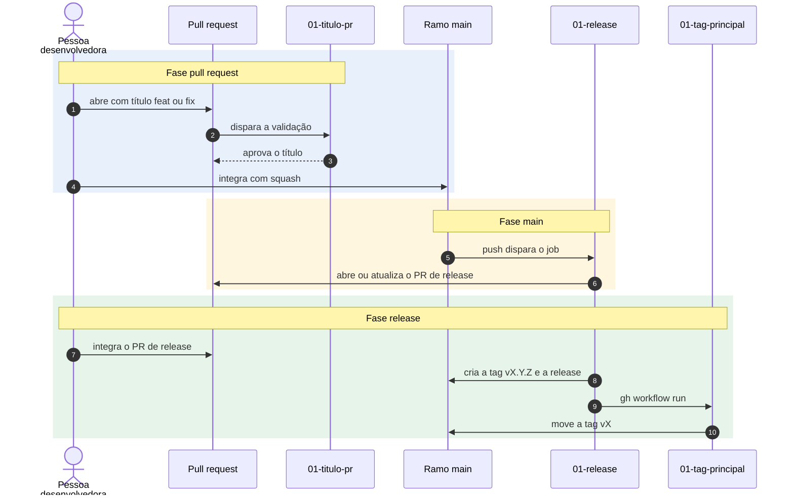
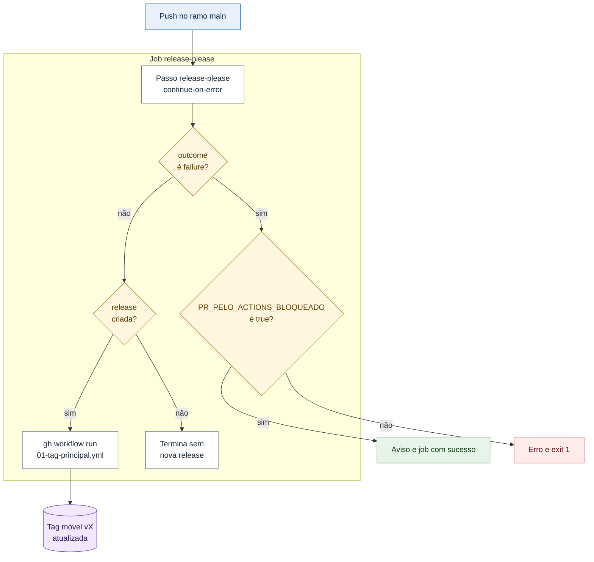

# Mensagens de commit convencionais e versionamento semântico automático

## Problema que a prática resolve

Um *commit* é o registro de uma alteração no histórico do repositório. Sem regra para as mensagens, o histórico mistura correções, novidades e ajustes internos sob textos livres como "atualiza arquivos". Ninguém consegue dizer, a partir desse histórico, se a última alteração exige cuidado dos consumidores ao atualizar. A numeração das versões depende da memória de uma pessoa. O registro de mudanças entregue ao usuário é escrito à mão e tende a ficar desatualizado.

Duas convenções resolvem essa dependência. A primeira delas é o *Conventional Commits*, uma especificação em que toda mensagem começa por um tipo seguido de dois-pontos e de uma descrição curta. O tipo `feat` indica nova funcionalidade e o tipo `fix` indica correção, como no exemplo deste repositório `feat(api): aplicação mínima com versão por ambiente e cabeçalhos de segurança`. A segunda convenção é o versionamento semântico, abreviado como *SemVer*, em que a versão tem a forma `MAJOR.MINOR.PATCH` e cada número sobe conforme o tipo da mudança. A tabela a seguir relaciona o tipo da mensagem ao número que sobe. Como essa relação é determinística, uma ferramenta consegue calcular a versão sem decisão humana.

A tabela mostra a relação entre o tipo da mensagem e o efeito sobre a versão.

| Mensagem | Efeito sobre a versão |
| --- | --- |
| `fix(web): corrige a leitura da versão da API` | Sobe o `PATCH`, por exemplo de 1.2.3 para 1.2.4 |
| `feat(api): expõe a versão por ambiente` | Sobe o `MINOR`, por exemplo de 1.2.3 para 1.3.0 |
| `feat(api)!: remove o campo antigo da resposta` | Sobe o `MAJOR`, por exemplo de 1.2.3 para 2.0.0 |
| `docs`, `chore`, `ci`, `test` e `refactor` | Não alteram a versão, mas aparecem no histórico |

O ponto de exclamação depois do tipo, ou um rodapé `BREAKING CHANGE:` no corpo da mensagem, marca a quebra de compatibilidade.

## Workflow do cenário

O cenário usa três *workflows*, que são arquivos YAML em `.github/workflows/` executados pelo GitHub Actions para reagir a eventos do repositório. Um *pull request* é a proposta de integrar uma alteração ao ramo principal. O diagrama a seguir mostra a sequência entre a pessoa desenvolvedora, o *pull request* e cada um dos três *workflows*, desde a abertura do *pull request* até a movimentação da *tag* móvel.



### Validação do título do pull request

O primeiro *workflow* é o `01-titulo-pr.yml`, que valida o título de cada *pull request* com a ação `amannn/action-semantic-pull-request`. A validação recai sobre o título porque a integração com a opção *squash* reúne todos os *commits* em um só. Isso vale somente quando o repositório está configurado para usar o título do *pull request* como mensagem desse *commit*, pré-requisito descrito na seção sobre execução. O trecho a seguir mostra o gatilho, a permissão mínima e a lista de tipos aceitos.

Arquivo completo: [`.github/workflows/01-titulo-pr.yml`, linhas 4 a 28](https://github.com/arkhibr/devops-fluxos-c3dm/blob/main/.github/workflows/01-titulo-pr.yml#L4-L28).

```yaml
# Sem filtro de paths: o título vale para todo pull request.
on:
  pull_request:
    types: [opened, edited, synchronize, reopened]

permissions:
  pull-requests: read

jobs:
  titulo:
    runs-on: ubuntu-latest
    steps:
      - name: Validar o título pelo padrão Conventional Commits
        uses: amannn/action-semantic-pull-request@c5e23b7e584519ee15caa684cf60d056aa9f035f  # v6.1.3
        env:
          GITHUB_TOKEN: ${{ secrets.GITHUB_TOKEN }}
        with:
          types: |
            feat
            fix
            docs
            chore
            ci
            test
            refactor
```

O gatilho `pull_request` com o tipo `edited` revalida o título sempre que ele é editado, o que permite corrigir uma reprovação sem enviar novo *commit*. A permissão `pull-requests: read` basta para a ação ler o título. A chave `types` é a lista fechada dos sete tipos aceitos, de modo que qualquer outro tipo reprova a verificação. O nome do job, `titulo`, é o contexto exigido pelo *ruleset* do cenário 02.

### Cálculo da versão e release

O segundo é o `01-release.yml`, que roda a cada *push* no ramo `main` e executa a ferramenta `release-please`. *Push* é o envio de *commits* ao repositório remoto. A ferramenta lê as mensagens desde a última versão, calcula a próxima e mantém aberto um *pull request* de *release* que atualiza o arquivo `version.txt` e o `CHANGELOG.md`. Quando esse *pull request* é integrado, ela cria a *tag* `vX.Y.Z` e a *release* correspondente. O trecho mostra o passo principal e o passo que aciona a *tag* móvel. O tratamento da falha, nas linhas 31 a 44, aparece no diagrama seguinte.

Arquivo completo: [`.github/workflows/01-release.yml`, linhas 4 a 52](https://github.com/arkhibr/devops-fluxos-c3dm/blob/main/.github/workflows/01-release.yml#L4-L52).

```yaml
on:
  push:
    branches: [main]
# ...
jobs:
  release-please:
    runs-on: ubuntu-latest
    steps:
      - name: Calcular a versão e manter o pull request de release
        id: release
        # A política da organização pode impedir o Actions de abrir pull requests.
        # O passo seguinte decide se a falha é essa limitação conhecida ou um erro real.
        continue-on-error: true
        uses: googleapis/release-please-action@5c625bfb5d1ff62eadeeb3772007f7f66fdcf071  # v4.4.1
        with:
          config-file: release-please-config.json
          manifest-file: .release-please-manifest.json
      # ...
      # Releases criadas com o GITHUB_TOKEN não disparam o evento release.published
      # em outros workflows. Por isso a atualização da tag móvel é acionada aqui.
      - name: Acionar a atualização da tag de versão maior
        if: steps.release.outputs.release_created == 'true'
        env:
          GH_TOKEN: ${{ github.token }}
          TAG: ${{ steps.release.outputs.tag_name }}
        run: gh workflow run 01-tag-principal.yml --repo "$GITHUB_REPOSITORY" --ref "$TAG"
```

A chave `continue-on-error: true` do passo `release` impede que a falha conhecida da política da organização derrube o job de imediato. O passo seguinte, omitido do trecho, testa `steps.release.outcome` e decide entre aviso e erro conforme a variável `PR_PELO_ACTIONS_BLOQUEADO`. A condição `steps.release.outputs.release_created == 'true'` faz o último passo rodar somente quando uma *release* foi de fato criada. O comando `gh workflow run` usa a *tag* recém-criada como referência da execução. O grupo de `concurrency` serializa as execuções para que dois *pushes* seguidos não disputem o mesmo *pull request* de *release*.



A ferramenta recebe a configuração de dois arquivos. O primeiro declara um único pacote na raiz do repositório, com o tipo `simple` e o caminho do registro de mudanças. O segundo é o manifesto, que guarda a última versão publicada como ponto de partida do cálculo.

Arquivo completo: [`release-please-config.json`, linhas 1 a 10](https://github.com/arkhibr/devops-fluxos-c3dm/blob/main/release-please-config.json#L1-L10).

```json
{
  "$schema": "https://raw.githubusercontent.com/googleapis/release-please/main/schemas/config.json",
  "include-v-in-tag": true,
  "packages": {
    ".": {
      "release-type": "simple",
      "changelog-path": "CHANGELOG.md"
    }
  }
}
```

Arquivo completo: [`.release-please-manifest.json`, linhas 1 a 3](https://github.com/arkhibr/devops-fluxos-c3dm/blob/main/.release-please-manifest.json#L1-L3).

```json
{
  ".": "1.0.1"
}
```

A chave `include-v-in-tag` produz *tags* no formato `v1.0.1`, enquanto a chave `"."` do pacote indica que a versão vale para o repositório inteiro. O valor `1.0.1` do manifesto é a versão a partir da qual os próximos *commits* são contados pelo `release-please`.

### Tag móvel da versão maior

O terceiro é o `01-tag-principal.yml`, que mantém uma *tag* móvel com apenas o número maior da versão, como `v1`. Os cenários seguintes referenciam os *workflows* reutilizáveis deste repositório por `@v1`, de modo que os consumidores recebem as correções sem alterar a referência. Releases criadas com o `GITHUB_TOKEN` não disparam o evento `release` em outros *workflows*. Por isso o `01-release.yml` executa `gh workflow run 01-tag-principal.yml` logo depois de criar cada *release*, usando a *tag* recém-criada como referência da execução.

Arquivo completo: [`.github/workflows/01-tag-principal.yml`, linhas 7 a 25](https://github.com/arkhibr/devops-fluxos-c3dm/blob/main/.github/workflows/01-tag-principal.yml#L7-L25).

```yaml
on:
  release:
    types: [published]
  workflow_dispatch:

permissions:
  contents: write

jobs:
  tag-principal:
    runs-on: ubuntu-latest
    steps:
      - uses: actions/checkout@11bd71901bbe5b1630ceea73d27597364c9af683  # v4.2.2
      - name: Mover a tag da versão maior para esta release
        run: |
          [[ $GITHUB_REF_NAME =~ ^v[0-9]+\. ]] || { echo "A referência $GITHUB_REF_NAME não é uma tag de versão"; exit 1; }
          principal="${GITHUB_REF_NAME%%.*}"
          git tag -f "$principal"
          git push -f origin "refs/tags/$principal"
```

O gatilho `workflow_dispatch` é o caminho usado pelo `01-release.yml` para acionar o *workflow*, enquanto o gatilho `release` cobre as *releases* publicadas manualmente, como a `v1.0.0` deste repositório. A expressão regular `^v[0-9]+\.` recusa qualquer referência que não seja uma *tag* de versão. A expansão `${GITHUB_REF_NAME%%.*}` remove tudo a partir do primeiro ponto, de modo que `v1.2.3` resulta em `v1`. Os dois comandos `git` reposicionam a *tag* no *commit* da *release* com `-f` e `push -f`, razão pela qual o *ruleset* do cenário 02 não contém regras de *tag*.

### Arquivos do cenário

| Arquivo | Papel |
| --- | --- |
| [`.github/workflows/01-titulo-pr.yml`](https://github.com/arkhibr/devops-fluxos-c3dm/blob/main/.github/workflows/01-titulo-pr.yml) | Valida o título do *pull request* pelo padrão *Conventional Commits*. |
| [`.github/workflows/01-release.yml`](https://github.com/arkhibr/devops-fluxos-c3dm/blob/main/.github/workflows/01-release.yml) | Calcula a versão e mantém o *pull request* de *release*. |
| [`.github/workflows/01-tag-principal.yml`](https://github.com/arkhibr/devops-fluxos-c3dm/blob/main/.github/workflows/01-tag-principal.yml) | Move a *tag* móvel da versão maior. |
| [`release-please-config.json`](https://github.com/arkhibr/devops-fluxos-c3dm/blob/main/release-please-config.json) | Declara o pacote e o tipo de *release*. |
| [`.release-please-manifest.json`](https://github.com/arkhibr/devops-fluxos-c3dm/blob/main/.release-please-manifest.json) | Registra a última versão publicada. |
| [`version.txt`](https://github.com/arkhibr/devops-fluxos-c3dm/blob/main/version.txt) | Arquivo de versão atualizado pelo `release-please`. |
| [`tests/pipelines/test_01_versionamento.py`](https://github.com/arkhibr/devops-fluxos-c3dm/blob/main/tests/pipelines/test_01_versionamento.py) | Testes estruturais dos três *workflows*. |

## Como executar

1. Abra um *pull request* com um título fora do padrão, como `atualiza arquivos`. A verificação `01 Título do pull request` reprova e informa os tipos aceitos.
2. Edite o título para `fix: corrige a mensagem de erro` e confirme que a verificação passa.
3. Integre o *pull request* com *squash*. Em seguida abra a aba *Pull requests* e localize o *pull request* de título `chore(main): release 1.0.0`, mantido pelo `release-please`.
4. Integre esse *pull request*. Confira em *Releases* a versão `v1.0.0`. Confira também em *Tags* a *tag* móvel `v1`, que passa a apontar para o mesmo *commit*. Nas *releases* seguintes um `fix` produz `v1.0.1` e um `feat` produz `v1.1.0`. Uma mudança com `!` produz `v2.0.0`, caso em que a *tag* móvel passa a ser `v2`.

O primeiro pré-requisito da prática é que o repositório use o título do *pull request* como mensagem do *commit* de *squash*, com as opções de *merge commit* e de *rebase* desativadas. Neste repositório isso foi configurado pela API do GitHub com `squash_merge_commit_title=PR_TITLE` e `squash_merge_commit_message=PR_BODY`.

A versão `v1.0.0` deste repositório foi publicada manualmente, porque a organização bloqueia que o GitHub Actions abra *pull requests*. Como o `release-please` não conseguia abrir o *pull request* de *release*, a *release* foi criada com `gh release create v1.0.0` e o *workflow* `01-tag-principal.yml` moveu em seguida a *tag* móvel `v1` para o mesmo *commit*. O manifesto `.release-please-manifest.json` registra a última versão publicada, hoje `1.0.1`. A opção `release-as` saiu de `release-please-config.json`. Quando a política da organização permitir, o `release-please` retoma a partir da última versão registrada e calcula as versões seguintes pelos tipos das mensagens de *commit*.

A criação do *pull request* de *release* exige que o repositório permita ao GitHub Actions criar *pull requests*. A opção fica na seção *Workflow permissions* de *Settings*, *Actions* e *General*. Em repositórios de organizações a política da organização pode bloquear essa opção, caso em que a ferramenta falha ao abrir o *pull request* de *release* com a mensagem de que o Actions não pode criar *pull requests*. Na organização `arkhibr` essa política está bloqueada hoje e a liberação depende de um administrador da organização.

O *workflow* `01-release.yml` não deve ficar reprovado a cada *push* enquanto a política estiver bloqueada. Por isso o passo do `release-please` usa `continue-on-error: true` e o passo seguinte testa `steps.release.outcome`. O texto do erro do `release-please` fica no log do passo, fora das saídas. A API que informa a política da organização exige permissão de administração, que o `GITHUB_TOKEN` não possui. O repositório registra então o bloqueio na variável `PR_PELO_ACTIONS_BLOQUEADO`, criada com o comando `gh variable set PR_PELO_ACTIONS_BLOQUEADO --body true`. Com a variável igual a `true`, a falha gera apenas um aviso `::warning::` e a execução termina com sucesso. Sem a variável ou com outro valor, toda falha do `release-please` continua reprovando a execução. A variável deve ser apagada com `gh variable delete PR_PELO_ACTIONS_BLOQUEADO` quando a organização liberar a opção, para que os erros voltem a aparecer.

Os *pull requests* abertos com o `GITHUB_TOKEN` não disparam outros *workflows*. Por isso as verificações obrigatórias não rodam sobre o *pull request* de *release*. Neste repositório os administradores têm permissão de contorno nas regras de proteção, apresentadas no cenário 02. Os administradores integram esse *pull request*. Em produção a alternativa é gerar o *token* de um GitHub App e passá-lo ao `release-please`, o que faz as verificações rodarem normalmente. Se o passo que aciona o `01-tag-principal.yml` falhar, a *tag* móvel pode ser atualizada manualmente em *Actions*, executando esse *workflow* com a *tag* da *release* como referência.

## Como levar a prática a um sistema existente

Em um sistema que já tem histórico, a adoção ocorre em etapas que não exigem reescrever o passado.

1. Crie a *tag* da versão atual no *commit* que está em produção, por exemplo `v2.4.0`. Registre o mesmo valor em `.release-please-manifest.json`. Assim o cálculo parte da numeração real do sistema.
2. Copie `release-please-config.json` e os *workflows* `01-release.yml` e `01-tag-principal.yml`. Em sistemas com mais de um componente versionado, declare um pacote por pasta em `packages`.
3. Ative primeiro apenas a validação do título, sem torná-la obrigatória, durante duas ou três semanas. O período permite que a equipe aprenda os tipos e que os títulos se ajustem antes de a regra bloquear integrações.
4. Torne a verificação obrigatória nas regras de proteção do ramo `main`, tema do cenário 02.
5. Informe aos consumidores que, a partir de uma data, a versão segue o *SemVer* e que a *tag* móvel de versão maior é o ponto de referência estável.

Os *commits* anteriores à primeira *release* não precisam seguir o padrão, pois o `release-please` considera apenas o que vem depois da última *tag*. Quando o sistema ainda não tem nenhuma *tag*, vale criar a versão inicial manualmente antes de ativar a ferramenta, para evitar que ela tente analisar todo o histórico.

## Nível C3DM e fontes

O cenário pertence ao nível Fundacional deste repositório, no qual o modelo C3DM situa o controle de versão centralizado do domínio de integração. O repositório estende essa base com a padronização das mensagens e com o cálculo automático de versão, extensão que é uma escolha didática do roteiro e que o modelo não exige.

As fontes são a especificação *Conventional Commits* 1.0.0 (https://www.conventionalcommits.org/pt-br/v1.0.0/), a especificação do versionamento semântico 2.0.0 (https://semver.org/lang/pt-BR/) e a documentação do `release-please` (https://github.com/googleapis/release-please). O texto do modelo está na [bibliografia](../../docs/referencia/bibliografia.md).
