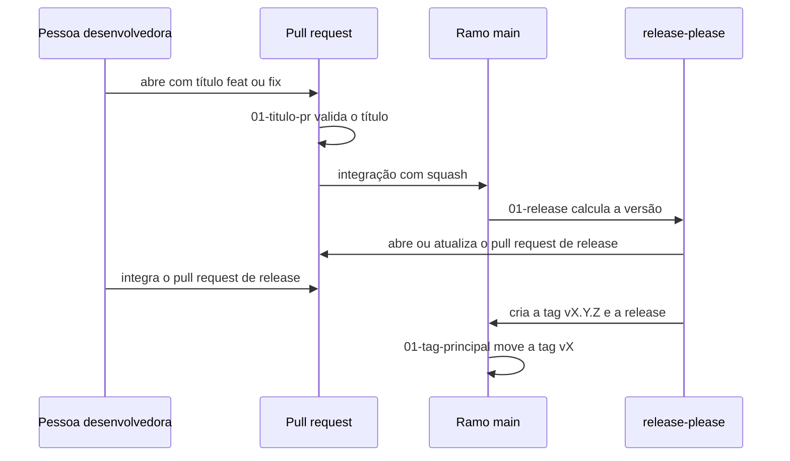

# Mensagens de commit convencionais e versionamento semântico automático

## Problema que a prática resolve

Um *commit* é o registro de uma alteração no histórico do repositório. Sem regra para as mensagens, o histórico mistura correções, novidades e ajustes internos sob textos livres como "atualiza arquivos". Ninguém consegue dizer, a partir desse histórico, se a última alteração exige cuidado dos consumidores ao atualizar. A numeração das versões depende da memória de uma pessoa. O registro de mudanças entregue ao usuário é escrito à mão e tende a ficar desatualizado.

Duas convenções resolvem essa dependência. A primeira delas é o *Conventional Commits*, uma especificação em que toda mensagem começa por um tipo seguido de dois-pontos e de uma descrição curta. O tipo `feat` indica nova funcionalidade e o tipo `fix` indica correção, como no exemplo deste repositório `feat(api): aplicação mínima com versão por ambiente e cabeçalhos de segurança`. A segunda convenção é o versionamento semântico, abreviado como *SemVer*, em que a versão tem a forma `MAJOR.MINOR.PATCH` e cada número sobe conforme o tipo da mudança. A tabela a seguir relaciona o tipo da mensagem ao número que sobe. Como essa relação é determinística, uma ferramenta consegue calcular a versão sem decisão humana.

A tabela mostra a relação entre o tipo da mensagem e o efeito sobre a versão.

| Mensagem | Efeito sobre a versão |
| --- | --- |
| `fix(web): corrige a leitura da versão da API` | Sobe o `PATCH`, por exemplo de 1.2.3 para 1.2.4 |
| `feat(api): expõe a versão por ambiente` | Sobe o `MINOR`, por exemplo de 1.2.3 para 1.3.0 |
| `feat(api)!: remove o campo antigo da resposta` | Sobe o `MAJOR`, por exemplo de 1.2.3 para 2.0.0 |
| `docs`, `chore`, `ci`, `test` e `refactor` | Não alteram a versão, mas aparecem no histórico |

O ponto de exclamação depois do tipo, ou um rodapé `BREAKING CHANGE:` no corpo da mensagem, marca a quebra de compatibilidade.

## Workflow do cenário

O cenário usa três *workflows*, que são arquivos YAML em `.github/workflows/` executados pelo GitHub Actions para reagir a eventos do repositório. O primeiro é o `01-titulo-pr.yml`, que valida o título de cada *pull request* com a ação `amannn/action-semantic-pull-request` e aceita sete tipos, listados na configuração do próprio arquivo. Um *pull request* é a proposta de integrar uma alteração ao ramo principal. A validação recai sobre o título porque a integração com a opção *squash* reúne todos os *commits* em um só. Isso vale somente quando o repositório está configurado para usar o título do *pull request* como mensagem desse *commit*, pré-requisito descrito na seção sobre execução.

O segundo é o `01-release.yml`, que roda a cada *push* no ramo `main` e executa a ferramenta `release-please`, sendo *push* o envio de *commits* ao repositório remoto. A ferramenta lê as mensagens desde a última versão, calcula a próxima e mantém aberto um *pull request* de *release* que atualiza o arquivo `version.txt` e o `CHANGELOG.md`. Quando esse *pull request* é integrado, ela cria a *tag* `vX.Y.Z` e a *release* correspondente a partir da configuração de `release-please-config.json`, que declara um único pacote na raiz do repositório com ponto de partida `0.0.0` em `.release-please-manifest.json`.

O terceiro é o `01-tag-principal.yml`, que mantém uma *tag* móvel com apenas o número maior da versão, como `v1`. O *workflow* extrai esse número do nome da *tag* publicada e move a *tag* móvel para o mesmo *commit*. Os cenários seguintes referenciam os *workflows* reutilizáveis deste repositório por `@v1`, de modo que os consumidores recebem as correções sem alterar a referência. Releases criadas com o `GITHUB_TOKEN` não disparam o evento `release` em outros *workflows*. Por isso o `01-release.yml` executa `gh workflow run 01-tag-principal.yml` logo depois de criar cada *release*, usando a *tag* recém-criada como referência da execução.

## Como executar

1. Abra um *pull request* com um título fora do padrão, como `atualiza arquivos`. A verificação `01 Título do pull request` reprova e informa os tipos aceitos.
2. Edite o título para `fix: corrige a mensagem de erro` e confirme que a verificação passa.
3. Integre o *pull request* com *squash*. Em seguida abra a aba *Pull requests* e localize o *pull request* de título `chore(main): release 1.0.0`, mantido pelo `release-please`.
4. Integre esse *pull request*. Confira em *Releases* a versão `v1.0.0`. Confira também em *Tags* a *tag* móvel `v1`, que passa a apontar para o mesmo *commit*. Nas *releases* seguintes um `fix` produz `v1.0.1` e um `feat` produz `v1.1.0`. Uma mudança com `!` produz `v2.0.0`, caso em que a *tag* móvel passa a ser `v2`.

O primeiro pré-requisito da prática é que o repositório use o título do *pull request* como mensagem do *commit* de *squash*, com as opções de *merge commit* e de *rebase* desativadas. Neste repositório isso foi configurado pela API do GitHub com `squash_merge_commit_title=PR_TITLE` e `squash_merge_commit_message=PR_BODY`.

A versão `v1.0.0` deste repositório foi publicada manualmente, porque a organização bloqueia que o GitHub Actions abra *pull requests*. Como o `release-please` não conseguia abrir o *pull request* de *release*, a *release* foi criada com `gh release create v1.0.0` e o *workflow* `01-tag-principal.yml` moveu em seguida a *tag* móvel `v1` para o mesmo *commit*. O manifesto `.release-please-manifest.json` registra agora a versão `1.0.0` e a opção `release-as` saiu de `release-please-config.json`. Quando a política da organização permitir, o `release-please` retoma a partir da `1.0.0` e calcula as versões seguintes pelos tipos das mensagens de *commit*.

A criação do *pull request* de *release* exige que o repositório permita ao GitHub Actions criar *pull requests*. A opção fica na seção *Workflow permissions* de *Settings*, *Actions* e *General*. Em repositórios de organizações a política da organização pode bloquear essa opção, caso em que a ferramenta falha ao abrir o *pull request* de *release* com a mensagem de que o Actions não pode criar *pull requests*. Na organização `arkhibr` essa política está bloqueada hoje e a liberação depende de um administrador da organização.

Os *pull requests* abertos com o `GITHUB_TOKEN` não disparam outros *workflows*. Por isso as verificações obrigatórias não rodam sobre o *pull request* de *release*. Neste repositório os administradores têm permissão de contorno nas regras de proteção, apresentadas no cenário 02. Os administradores integram esse *pull request*. Em produção a alternativa é gerar o *token* de um GitHub App e passá-lo ao `release-please`, o que faz as verificações rodarem normalmente. Se o passo que aciona o `01-tag-principal.yml` falhar, a *tag* móvel pode ser atualizada manualmente em *Actions*, executando esse *workflow* com a *tag* da *release* como referência.

## Como levar a prática a um sistema existente

Em um sistema que já tem histórico, a adoção ocorre em etapas que não exigem reescrever o passado.

1. Crie a *tag* da versão atual no *commit* que está em produção, por exemplo `v2.4.0`. Registre o mesmo valor em `.release-please-manifest.json`. Assim o cálculo parte da numeração real do sistema.
2. Copie `release-please-config.json` e os *workflows* `01-release.yml` e `01-tag-principal.yml`. Em sistemas com mais de um componente versionado, declare um pacote por pasta em `packages`.
3. Ative primeiro apenas a validação do título, sem torná-la obrigatória, durante duas ou três semanas. O período permite que a equipe aprenda os tipos e que os títulos se ajustem antes de a regra bloquear integrações.
4. Torne a verificação obrigatória nas regras de proteção do ramo `main`, tema do cenário 02.
5. Informe aos consumidores que, a partir de uma data, a versão segue o *SemVer* e que a *tag* móvel de versão maior é o ponto de referência estável.

Os *commits* anteriores à primeira *release* não precisam seguir o padrão, pois o `release-please` considera apenas o que vem depois da última *tag*. Quando o sistema ainda não tem nenhuma *tag*, vale criar a versão inicial manualmente antes de ativar a ferramenta, para evitar que ela tente analisar todo o histórico.

## Nível C3DM e fontes

O cenário pertence ao nível Fundacional deste repositório, no qual o modelo C3DM situa o controle de versão centralizado do domínio de integração. O repositório estende essa base com a padronização das mensagens e com o cálculo automático de versão, extensão que é uma escolha didática do roteiro e que o modelo não exige.

As fontes são a especificação *Conventional Commits* 1.0.0 (https://www.conventionalcommits.org/pt-br/v1.0.0/), a especificação do versionamento semântico 2.0.0 (https://semver.org/lang/pt-BR/) e a documentação do `release-please` (https://github.com/googleapis/release-please). O texto do modelo está na [bibliografia](../../docs/referencia/bibliografia.md).
