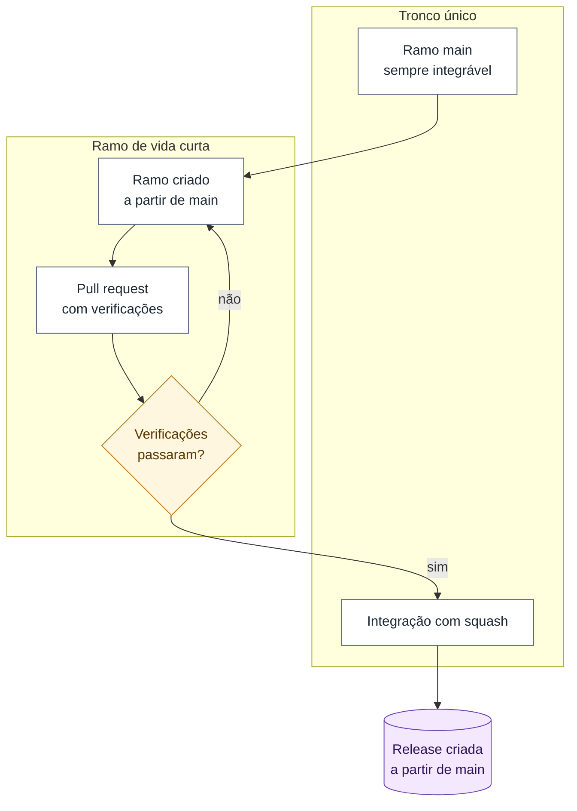
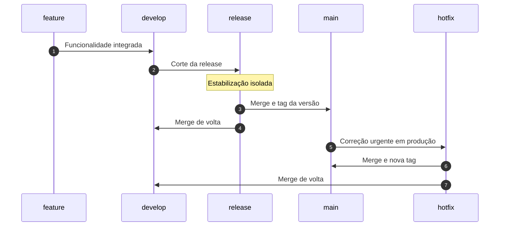
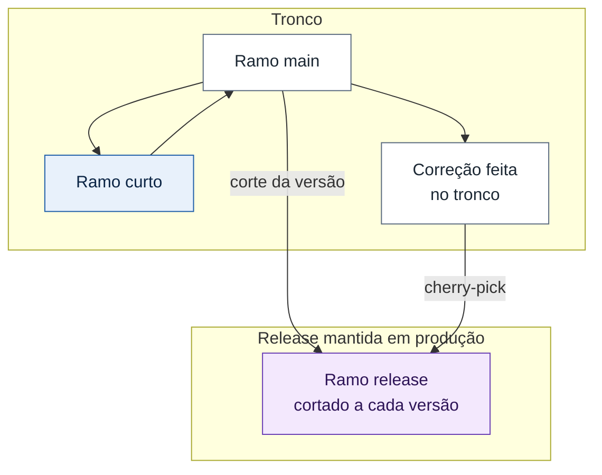
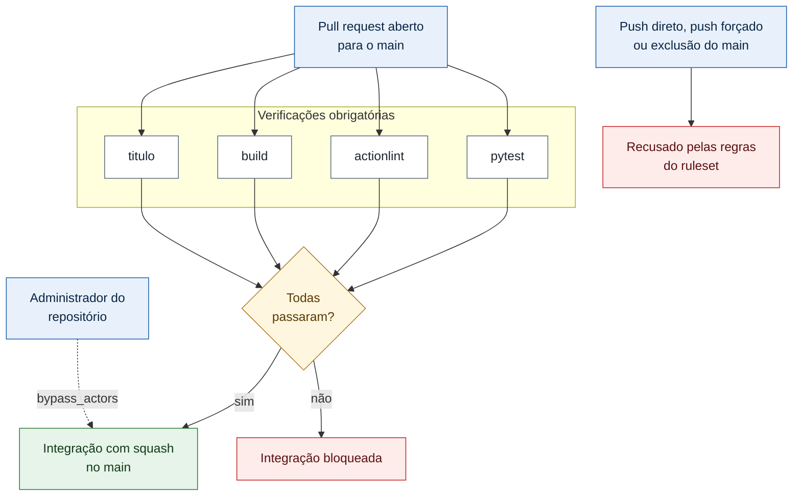

# Estratégia de branches e rulesets de proteção versionados

## Problema que a prática resolve

Um *branch*, também chamado de ramo, é uma linha independente de desenvolvimento dentro do repositório. Quando cada pessoa decide sozinha como criar, integrar e apagar ramos, o ramo principal recebe alterações sem revisão. O histórico fica ilegível porque uma correção urgente disputa espaço com trabalho inacabado. A estratégia de ramificação é o conjunto de regras que define quais ramos existem, quanto tempo duram e como o trabalho chega ao ramo principal.

A literatura descreve com frequência três estratégias. A primeira é o *trunk-based development*, abreviado como TBD, em que todo trabalho entra em um único ramo principal por alterações pequenas e frequentes. Os ramos auxiliares duram horas ou poucos dias, como mostra o diagrama a seguir, que resume o fluxo do TBD.



A segunda é o *Git Flow*, que mantém dois ramos permanentes, o `develop` para o desenvolvimento e o `main` para a produção. Ramos de funcionalidade, de *release* e de correção urgente partem desses dois. Cada ramo de *release* é estabilizado separadamente e depois integrado aos dois ramos permanentes.



A terceira é o *Release Flow*, praticado pela Microsoft, que combina o desenvolvimento no tronco com um ramo de *release* cortado a partir do `main` a cada versão publicada. Na Microsoft o corte ocorre a cada *sprint*. O ramo de *release* é mantido enquanto aquela versão estiver em produção. Toda correção é feita primeiro no `main` e levada ao ramo de *release* por uma operação chamada *cherry-pick*, que copia um *commit* de um ramo para outro.



A escolha deste repositório é o TBD. O repositório tem um único ramo de longa duração, uma única linha de versões e uma esteira que valida cada alteração antes da integração, condições em que os ramos permanentes do Git Flow acrescentam custo de integração sem reduzir risco. O Release Flow passa a ser considerado quando mais de uma versão ficar em produção ao mesmo tempo e cada uma precisar de correções isoladas. A pesquisa que originou as métricas DORA associa o desenvolvimento no tronco, com ramos de vida curta, a melhor desempenho de entrega.

## Workflow do cenário

O cenário traduz a estratégia em regras executáveis. Um *ruleset* é um conjunto de regras de proteção que o GitHub aplica a ramos ou a *tags* e que pode ser exportado como JSON. O arquivo `ruleset-main.json` descreve a proteção do ramo padrão e fica versionado junto ao código, de modo que qualquer mudança nas regras passa por *pull request* e fica registrada no histórico. O diagrama a seguir mostra o efeito do conjunto sobre uma alteração que chega ao `main`.



### Ruleset do ramo main

O trecho a seguir mostra o cabeçalho do arquivo, que define o alvo, o modo de aplicação e o ator de contorno.

Arquivo completo: [`cenarios/02-estrategia-branches/ruleset-main.json`, linhas 1 a 17](https://github.com/arkhibr/devops-fluxos-c3dm/blob/main/cenarios/02-estrategia-branches/ruleset-main.json#L1-L17).

```json
{
  "name": "protecao-main",
  "target": "branch",
  "enforcement": "active",
  "conditions": {
    "ref_name": {
      "include": ["~DEFAULT_BRANCH"],
      "exclude": []
    }
  },
  "bypass_actors": [
    {
      "actor_id": 5,
      "actor_type": "RepositoryRole",
      "bypass_mode": "always"
    }
  ],
```

O valor `~DEFAULT_BRANCH` em `include` aplica o *ruleset* ao ramo padrão sem citar seu nome. O campo `enforcement` igual a `active` bloqueia de fato, em vez de apenas registrar violações. O bloco `bypass_actors` declara o papel de administrador do repositório, com `actor_id` igual a 5, como ator de contorno. A razão vem do cenário 01. O *pull request* de *release* é aberto com o `GITHUB_TOKEN` e eventos gerados por esse *token* não disparam outros *workflows*. Sem o contorno, as verificações obrigatórias jamais rodariam nesse *pull request* e ele ficaria bloqueado. A consequência é que administradores podem integrar sem verificações, o que reduz a garantia da regra. Esse custo é aceito aqui porque o conteúdo do *pull request* de *release* é gerado pela ferramenta e o contorno só vale para quem já administra o repositório. Em produção a alternativa é gerar o *token* de um GitHub App, que dispara as verificações normalmente e dispensa o contorno.

A tabela relaciona cada uma das cinco regras do arquivo ao efeito que ela produz sobre o ramo `main`.

| Regra | Efeito |
| --- | --- |
| `deletion` | Impede apagar o ramo `main`. |
| `non_fast_forward` | Impede reescrever o histórico do `main` com *push* forçado. |
| `required_linear_history` | Exige histórico sem *commits* de integração, compatível com o *squash*. |
| `pull_request` | Exige *pull request* para alterar o `main`, com zero aprovações obrigatórias e descarte de aprovações antigas quando chegam novos *commits*. |
| `required_status_checks` | Exige que passem as verificações `pytest`, `actionlint`, `build` e `titulo`. |

O trecho seguinte mostra a regra de *pull request* e a regra das verificações obrigatórias.

Arquivo completo: [`cenarios/02-estrategia-branches/ruleset-main.json`, linhas 22 a 43](https://github.com/arkhibr/devops-fluxos-c3dm/blob/main/cenarios/02-estrategia-branches/ruleset-main.json#L22-L43).

```json
    {
      "type": "pull_request",
      "parameters": {
        "required_approving_review_count": 0,
        "dismiss_stale_reviews_on_push": true,
        "require_code_owner_review": false,
        "require_last_push_approval": false,
        "required_review_thread_resolution": false
      }
    },
    {
      "type": "required_status_checks",
      "parameters": {
        "strict_required_status_checks_policy": false,
        "required_status_checks": [
          { "context": "pytest" },
          { "context": "actionlint" },
          { "context": "build" },
          { "context": "titulo" }
        ]
      }
    }
```

O valor `required_approving_review_count: 0` dispensa aprovação humana, de modo que o bloqueio vem apenas das verificações automáticas. O campo `strict_required_status_checks_policy: false` não exige que o ramo esteja atualizado com o `main` antes da integração. Cada `context` é o nome de um job que já existe. O `pytest` e o `actionlint` pertencem ao `00-repositorio.yml`, o `build` compila o portal em modo estrito no `portal.yml` e o `titulo` valida o título do *pull request* no `01-titulo-pr.yml`. O nome de uma verificação obrigatória é o nome do job, de modo que renomear um job sem atualizar o *ruleset* deixa o *pull request* à espera de uma verificação que nunca roda. O teste `test_status_checks_existem` impede essa divergência. O *ruleset* também não contém regras de *tag*, porque o `01-tag-principal.yml` move a *tag* móvel `v1` com *push* forçado e uma regra de *tag* bloquearia essa operação.

### Aplicação idempotente do ruleset

O arquivo `aplicar-ruleset.sh` lê o JSON e usa o GitHub CLI (`gh api`) para criar o *ruleset* no endpoint `/rulesets` do repositório. Se já existir um *ruleset* com o mesmo nome, o *script* o atualiza com uma requisição `PUT`. Por isso ele pode ser executado quantas vezes for necessário sem criar duplicatas. O trecho a seguir mostra a decisão entre atualizar e criar, que usa o mesmo arquivo JSON nos dois casos.

Arquivo completo: [`cenarios/02-estrategia-branches/aplicar-ruleset.sh`, linhas 13 a 21](https://github.com/arkhibr/devops-fluxos-c3dm/blob/main/cenarios/02-estrategia-branches/aplicar-ruleset.sh#L13-L21).

```bash
id="$(gh api --paginate "repos/${repo}/rulesets" | jq -r --arg nome "${nome}" '.[] | select(.name == $nome) | .id' | head -n 1)"

if [ -n "${id}" ]; then
  echo "Atualizando o ruleset ${nome} (id ${id}) em ${repo}"
  gh api --method PUT "repos/${repo}/rulesets/${id}" --input "${arquivo}" --silent
else
  echo "Criando o ruleset ${nome} em ${repo}"
  gh api --method POST "repos/${repo}/rulesets" --input "${arquivo}" --silent
fi
```

A primeira linha consulta os *rulesets* existentes e filtra pelo nome com `jq`. A condição `[ -n "${id}" ]` escolhe entre `PUT` no identificador encontrado e `POST` para criar. As duas chamadas leem o corpo do arquivo com `--input`, de modo que o JSON versionado é a única fonte da configuração.

### Teste e modelo de pull request

O *workflow* `02-rulesets.yml` roda os testes deste cenário sempre que o JSON, o teste ou o próprio *workflow* mudam.

Arquivo completo: [`.github/workflows/02-rulesets.yml`, linhas 4 a 29](https://github.com/arkhibr/devops-fluxos-c3dm/blob/main/.github/workflows/02-rulesets.yml#L4-L29).

```yaml
on:
  pull_request:
    paths:
      - cenarios/02-estrategia-branches/**
      - tests/pipelines/test_02_rulesets.py
      - .github/workflows/02-rulesets.yml
  push:
    branches: [main]
    paths:
      - cenarios/02-estrategia-branches/**
      - tests/pipelines/test_02_rulesets.py
      - .github/workflows/02-rulesets.yml
# ...
jobs:
  rulesets:
    runs-on: ubuntu-latest
    steps:
      - uses: actions/checkout@11bd71901bbe5b1630ceea73d27597364c9af683  # v4.2.2
      - uses: actions/setup-python@a26af69be951a213d495a4c3e4e4022e16d87065  # v5.6.0
        with:
          python-version: "3.13"
      - run: pip install -r requirements-dev.txt
      - run: pytest tests/pipelines/test_02_rulesets.py -q
```

O filtro `paths` lista o próprio arquivo do *workflow*, convenção que o `pytest` do cenário 05 verifica. O job instala as dependências de desenvolvimento e executa somente `tests/pipelines/test_02_rulesets.py`, que confere as cinco regras, a ausência de regras de *tag* e a existência de cada job citado nas verificações obrigatórias.

O modelo `.github/pull_request_template.md` orienta quem abre o *pull request* a informar o que muda, o motivo e a verificação realizada.

O GitHub preenche a descrição de todo *pull request* novo com quatro seções que se chamam `O que muda`, `Por que muda`, `Como foi verificado` e `Lista de conferência`. O trecho a seguir reproduz os itens da lista de conferência extraídos do modelo pelo próprio GitHub.

Arquivo completo: [`.github/pull_request_template.md`, linhas 15 a 17](https://github.com/arkhibr/devops-fluxos-c3dm/blob/main/.github/pull_request_template.md#L15-L17).

```markdown
- [ ] O título segue o padrão Conventional Commits, como `fix: corrige a leitura da versão`.
- [ ] As verificações obrigatórias passaram.
- [ ] A documentação afetada foi atualizada.
```

O primeiro item lembra o padrão do título, que a verificação `titulo` cobra. O segundo remete às verificações obrigatórias e o terceiro à atualização da documentação afetada.

### Arquivos do cenário

| Arquivo | Papel |
| --- | --- |
| [`cenarios/02-estrategia-branches/ruleset-main.json`](https://github.com/arkhibr/devops-fluxos-c3dm/blob/main/cenarios/02-estrategia-branches/ruleset-main.json) | Descreve a proteção do ramo `main` em JSON. |
| [`cenarios/02-estrategia-branches/aplicar-ruleset.sh`](https://github.com/arkhibr/devops-fluxos-c3dm/blob/main/cenarios/02-estrategia-branches/aplicar-ruleset.sh) | Cria ou atualiza o *ruleset* pela API do GitHub. |
| [`.github/workflows/02-rulesets.yml`](https://github.com/arkhibr/devops-fluxos-c3dm/blob/main/.github/workflows/02-rulesets.yml) | Executa os testes do *ruleset* a cada mudança. |
| [`.github/pull_request_template.md`](https://github.com/arkhibr/devops-fluxos-c3dm/blob/main/.github/pull_request_template.md) | Modelo de descrição do *pull request*. |
| [`tests/pipelines/test_02_rulesets.py`](https://github.com/arkhibr/devops-fluxos-c3dm/blob/main/tests/pipelines/test_02_rulesets.py) | Testes das regras, do ator de contorno e dos nomes das verificações. |

## Como executar

1. Instale o GitHub CLI e o `jq`, ambos usados pelo *script*. Autentique o GitHub CLI como administrador do repositório. Depois execute `cenarios/02-estrategia-branches/aplicar-ruleset.sh arkhibr/devops-fluxos-c3dm`. O *script* informa se criou ou atualizou o ruleset e lista os rulesets existentes.
2. Confira o resultado com `gh api repos/arkhibr/devops-fluxos-c3dm/rulesets` ou na página *Rulesets* da seção *Rules* em *Settings*.
3. Crie um ramo, faça uma alteração pequena e abra um *pull request*. O modelo de descrição aparece preenchido com quatro seções. Elas pedem o que muda, o motivo, a verificação realizada e uma lista de conferência.
4. Observe que, para quem não é administrador, o botão de integração só é liberado quando as quatro verificações passam. Quem tem permissão de contorno vê o botão de integração com a opção de contornar as regras, mesmo com verificações pendentes. Integre com *squash* e apague o ramo.
5. Tente um *push* direto no `main` com uma conta que não seja administradora. A operação é recusada. Contas administradoras contornam a regra, conforme descrito na seção anterior.

## Como levar a prática a um sistema existente

1. Mapeie os ramos de longa duração existentes e a razão de cada um. Ramos de ambiente, como `homologacao`, podem ser substituídos por implantações feitas a partir do `main`. Esse tema é tratado nos cenários 09 a 11.
2. Escolha o ramo padrão e copie `ruleset-main.json`, ajustando os nomes das verificações obrigatórias para os jobs do sistema.
3. Aplique o ruleset primeiro com `enforcement` igual a `evaluate`, modo que registra as violações sem bloquear. Esse modo só existe nos planos GitHub Enterprise. Nos demais planos, ajuste o campo `include` para um ramo de teste e só depois o amplie para o ramo padrão. Depois de uma ou duas semanas sem ocorrências inesperadas, passe a `active`.
4. Reduza gradualmente a vida dos ramos de funcionalidade. Esconder trabalho incompleto atrás de *feature flags*, chaves de configuração que ativam ou desativam uma funcionalidade em execução, permite integrar com frequência sem expor o que não está pronto.
5. Revise o ator de contorno. Se não houver *pull requests* gerados por *token* de *workflow*, remova o bloco `bypass_actors` e submeta também os administradores às regras.

## Nível C3DM e fontes

O cenário pertence ao nível Fundacional deste repositório, no qual o modelo C3DM situa o controle de versão centralizado do domínio de integração. A proteção do ramo principal por regras versionadas e verificações obrigatórias é uma extensão didática do roteiro e o modelo não a exige.

As fontes são a documentação de *rulesets* do GitHub (https://docs.github.com/pt/repositories/configuring-branches-and-merges-in-your-repository/managing-rulesets), o site *Trunk Based Development* (https://trunkbaseddevelopment.com), a descrição do Git Flow por Vincent Driessen (https://nvie.com/posts/a-successful-git-branching-model/) e a descrição do Release Flow da Microsoft (https://learn.microsoft.com/pt-br/devops/develop/how-microsoft-develops-devops). O texto do modelo está na [bibliografia](../../docs/referencia/bibliografia.md).
