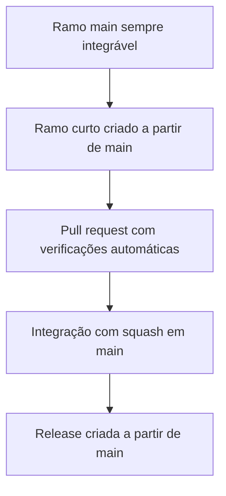
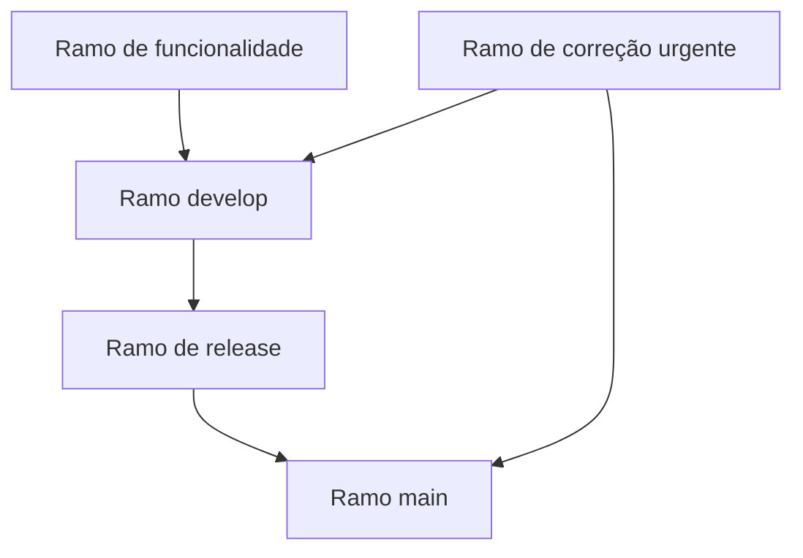
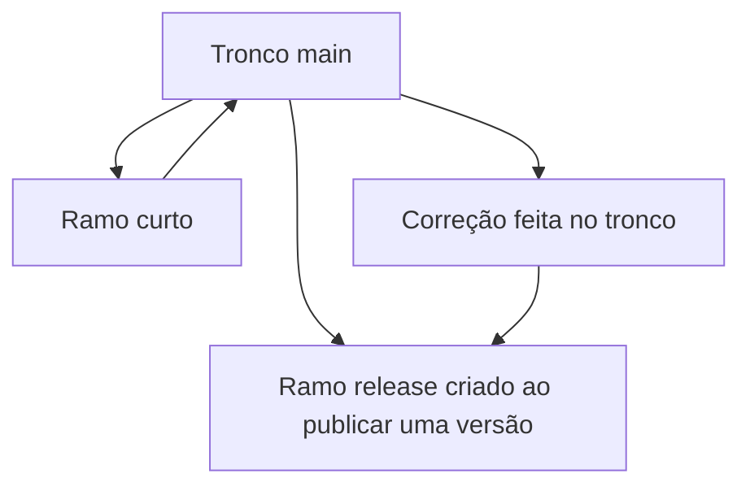

# Estratégia de branches e rulesets de proteção versionados

## Problema que a prática resolve

Um *branch*, ou ramo, é uma linha independente de desenvolvimento dentro do repositório. Quando cada pessoa decide sozinha como criar, integrar e apagar ramos, o ramo principal recebe alterações sem revisão. O histórico fica ilegível porque uma correção urgente disputa espaço com trabalho inacabado. A estratégia de ramificação é o conjunto de regras que define quais ramos existem, quanto tempo duram e como o trabalho chega ao ramo principal.

A literatura descreve com frequência três estratégias. A primeira é o *trunk-based development*, abreviado como TBD, em que todo trabalho entra em um único ramo principal por alterações pequenas e frequentes. Os ramos auxiliares duram horas ou poucos dias, como mostra o diagrama a seguir, que resume o fluxo do TBD.

A segunda é o *Git Flow*, que mantém dois ramos permanentes, o `develop` para o desenvolvimento e o `main` para a produção. Ramos de funcionalidade, de *release* e de correção urgente partem desses dois. Cada ramo de *release* é estabilizado separadamente e depois integrado aos dois ramos permanentes.

A terceira é o *Release Flow*, praticado pela Microsoft, que combina o desenvolvimento no tronco com ramos de *release* criados somente quando uma versão precisa de manutenção. Correções são feitas no tronco e trazidas ao ramo de *release* por uma operação chamada *cherry-pick*, que copia um *commit* de um ramo para outro.

A escolha deste repositório é o TBD. O repositório tem um único ramo de longa duração, uma única linha de versões e uma esteira que valida cada alteração antes da integração, condições em que os ramos permanentes do Git Flow acrescentam custo de integração sem reduzir risco. O Release Flow passa a ser considerado quando existirem versões antigas que precisem de correções isoladas. A pesquisa que originou as métricas DORA associa o desenvolvimento no tronco, com ramos de vida curta, a melhor desempenho de entrega.

## Workflow do cenário

O cenário traduz a estratégia em regras executáveis. Um *ruleset* é um conjunto de regras de proteção que o GitHub aplica a ramos ou a *tags* e que pode ser exportado como JSON. O arquivo `ruleset-main.json` descreve a proteção do ramo padrão e fica versionado junto ao código, de modo que qualquer mudança nas regras passa por *pull request* e fica registrada no histórico. A tabela relaciona cada uma das cinco regras do arquivo ao efeito que ela produz sobre o ramo `main`.

| Regra | Efeito |
| --- | --- |
| `deletion` | Impede apagar o ramo `main`. |
| `non_fast_forward` | Impede reescrever o histórico do `main` com *push* forçado. |
| `required_linear_history` | Exige histórico sem *commits* de integração, compatível com o *squash*. |
| `pull_request` | Exige *pull request* para alterar o `main`, com zero aprovações obrigatórias e descarte de aprovações antigas quando chegam novos *commits*. |
| `required_status_checks` | Exige que passem as verificações `pytest`, `actionlint`, `build` e `titulo`. |

As quatro verificações vêm de jobs que já existem. O `pytest` e o `actionlint` pertencem ao `00-repositorio.yml`, o `build` compila o portal em modo estrito no `portal.yml` e o `titulo` valida o título do *pull request* no `01-titulo-pr.yml`. O nome de uma verificação obrigatória é o nome do job, de modo que renomear um job sem atualizar o ruleset deixa o *pull request* à espera de uma verificação que nunca roda. O teste `test_status_checks_existem` impede essa divergência. O ruleset também não contém regras de *tag*, porque o `01-tag-principal.yml` move a *tag* móvel `v1` com *push* forçado e uma regra de *tag* bloquearia essa operação.

O arquivo `aplicar-ruleset.sh` lê o JSON e usa o GitHub CLI (`gh api`) para criar o ruleset no endpoint `/rulesets` do repositório. Se já existir um ruleset com o mesmo nome, o *script* o atualiza com uma requisição `PUT`. Por isso ele pode ser executado quantas vezes for necessário sem criar duplicatas. O *workflow* `02-rulesets.yml` roda os testes deste cenário sempre que o JSON, o teste ou o próprio *workflow* mudam. O modelo `.github/pull_request_template.md` orienta quem abre o *pull request* a informar o que muda, o motivo e a verificação realizada.

O ruleset declara um ator de contorno, que é o papel de administrador do repositório, com `actor_id` igual a 5 e tipo `RepositoryRole`. A razão vem do cenário 01. O *pull request* de *release* é aberto com o `GITHUB_TOKEN` e eventos gerados por esse *token* não disparam outros *workflows*. Sem o contorno, as verificações obrigatórias jamais rodariam nesse *pull request* e ele ficaria bloqueado. A consequência é que administradores podem integrar sem verificações, o que reduz a garantia da regra. Esse custo é aceito aqui porque o conteúdo do *pull request* de *release* é gerado pela ferramenta e o contorno só vale para quem já administra o repositório. Em produção a alternativa é gerar o *token* de um GitHub App, que dispara as verificações normalmente e dispensa o contorno.

## Como executar

1. Com o GitHub CLI autenticado como administrador do repositório, execute `cenarios/02-estrategia-branches/aplicar-ruleset.sh arkhibr/devops-fluxos-c3dm`. O *script* informa se criou ou atualizou o ruleset e lista os rulesets existentes.
2. Confira o resultado com `gh api repos/arkhibr/devops-fluxos-c3dm/rulesets` ou na página *Rulesets* da seção *Rules* em *Settings*.
3. Crie um ramo, faça uma alteração pequena e abra um *pull request*. O modelo de descrição aparece preenchido com as três seções.
4. Observe que o botão de integração só é liberado quando as quatro verificações passam. Integre com *squash* e apague o ramo.
5. Tente um *push* direto no `main` com uma conta que não seja administradora. A operação é recusada. Contas administradoras contornam a regra, conforme descrito na seção anterior.

## Como levar a prática a um sistema existente

1. Mapeie os ramos de longa duração existentes e a razão de cada um. Ramos de ambiente, como `homologacao`, podem ser substituídos por implantações feitas a partir do `main`. Esse tema é tratado nos cenários 09 a 11.
2. Escolha o ramo padrão e copie `ruleset-main.json`, ajustando os nomes das verificações obrigatórias para os jobs do sistema.
3. Aplique o ruleset primeiro com `enforcement` igual a `evaluate`, modo que registra as violações sem bloquear. Depois de uma ou duas semanas sem ocorrências inesperadas, mude para `active`.
4. Reduza gradualmente a vida dos ramos de funcionalidade. Esconder trabalho incompleto atrás de *feature flags*, chaves de configuração que ativam ou desativam uma funcionalidade em execução, permite integrar com frequência sem expor o que não está pronto.
5. Revise o ator de contorno. Se não houver *pull requests* gerados por *token* de *workflow*, remova o bloco `bypass_actors` e submeta também os administradores às regras.

## Nível C3DM e fontes

O cenário pertence ao nível Fundacional deste repositório, no qual o modelo C3DM situa o controle de versão centralizado do domínio de integração. A proteção do ramo principal por regras versionadas e verificações obrigatórias é uma extensão didática do roteiro e o modelo não a exige.

As fontes são a documentação de *rulesets* do GitHub (https://docs.github.com/pt/repositories/configuring-branches-and-merges-in-your-repository/managing-rulesets), o site *Trunk Based Development* (https://trunkbaseddevelopment.com), a descrição do Git Flow por Vincent Driessen (https://nvie.com/posts/a-successful-git-branching-model/) e a descrição do Release Flow da Microsoft (https://learn.microsoft.com/pt-br/devops/develop/how-microsoft-develops-devops). O texto do modelo está na [bibliografia](../../docs/referencia/bibliografia.md).
