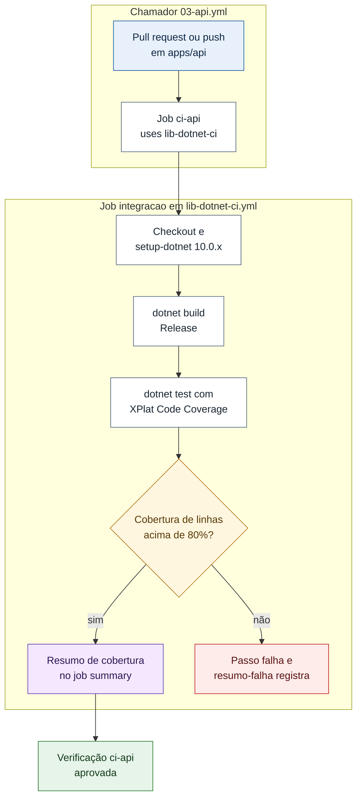

# Compilação e teste da API .NET com cobertura

## Problema que a prática resolve

A integração contínua, abreviada como CI, consiste em compilar e testar o código a cada alteração enviada ao repositório. O defeito é revelado poucos minutos após a alteração que o introduziu, o que antecipa a descoberta que antes ocorria na hora da implantação. Quando a compilação e os testes dependem de alguém lembrar de executá-los, uma alteração pode chegar ao ramo principal sem que a API compile em outra máquina. A prática elimina essa dependência com uma esteira automática que roda sempre da mesma forma em um ambiente limpo.

A cobertura de testes mede a proporção de linhas do código que os testes executam. O número não prova a qualidade dos testes porque uma linha executada sem nenhuma verificação conta como coberta. Ele indica quanto do código nunca foi exercitado, o que o torna útil como piso mínimo. Abaixo do limite combinado pela equipe a esteira recusa a alteração. Este cenário adota 80% das linhas, valor frequente na literatura de qualidade de *software*, aplicado somente ao projeto da API.

## Workflow do cenário

A API fica em `apps/api`, com a solução `Api.slnx` reunindo o projeto `Api` e o projeto de testes `Api.Tests`, escrito com xUnit. O *workflow* `03-api.yml` é apenas um chamador, enquanto o trabalho é feito pelo *workflow* reutilizável `lib-dotnet-ci.yml`, apresentado no [cenário 12](../../docs/cenarios/12.md). O diagrama a seguir mostra o caminho completo, do gatilho ao resultado da verificação `ci-api`.



### O chamador 03-api.yml

O *workflow* roda em *pull requests* e em *pushes* para o `main` que alterem `apps/api/**`, a biblioteca ou o próprio arquivo do *workflow*. O job `ci-api` não contém passos próprios e chama a biblioteca com quatro entradas.

Arquivo completo: [`.github/workflows/03-api.yml`, linhas 3 a 28](https://github.com/arkhibr/devops-fluxos-c3dm/blob/main/.github/workflows/03-api.yml#L3-L28).

```yaml
on:
  pull_request:
    paths:
      - apps/api/**
      - .github/workflows/03-api.yml
      - .github/workflows/lib-dotnet-ci.yml
      - .github/actions/resumo-falha/**
# ...
permissions:
  contents: read

jobs:
  ci-api:
    uses: ./.github/workflows/lib-dotnet-ci.yml
    with:
      solucao: apps/api/Api.slnx
      diretorio: apps/api
      cobertura-minima: 80
      incluir-cobertura: '[Api]*'
```

O filtro `paths` inclui `03-api.yml` e `lib-dotnet-ci.yml` para que uma mudança apenas em um dos dois YAML também seja verificada. A chave `uses` com caminho relativo chama a biblioteca da mesma versão do repositório. As entradas informam a solução, a pasta em que os relatórios de cobertura são procurados, o mínimo de 80% e o filtro `[Api]*`. O job se chama `ci-api` porque o nome `build` já pertence à verificação obrigatória do portal. Dois jobs com o mesmo nome tornariam ambíguo o contexto exigido pelo *ruleset* do cenário 02.

### A biblioteca lib-dotnet-ci.yml

Duas entradas da biblioteca definem o comportamento da cobertura. A entrada `cobertura-minima` tem valor padrão 80 e a entrada `incluir-cobertura` restringe a medição aos *assemblies* indicados, o que deixa de fora as bibliotecas de terceiros.

Arquivo completo: [`.github/workflows/lib-dotnet-ci.yml`, linhas 16 a 32](https://github.com/arkhibr/devops-fluxos-c3dm/blob/main/.github/workflows/lib-dotnet-ci.yml#L16-L32).

```yaml
      cobertura-minima:
        description: >-
          Percentual mínimo de cobertura de linhas. Abaixo dele o job falha. O limite superior do
          indicador verde é o maior valor entre este e 90. Cada projeto de testes do chamador precisa
          referenciar o pacote coverlet.collector.
        type: number
        default: 80
      # ...
      incluir-cobertura:
        description: >-
          Filtro de assemblies da cobertura, por exemplo [Api]*. Vazio mede todos os assemblies
          carregados nos testes, inclusive bibliotecas de terceiros e os próprios projetos de teste.
        type: string
        default: ''
```

O passo de testes usa o coletor `XPlat Code Coverage`, fornecido pelo pacote `coverlet.collector`, que gera o arquivo `coverage.cobertura.xml` na pasta `TestResults` do projeto de testes. O passo seguinte aplica o limite e é o portão de cobertura do cenário.

Arquivo completo: [`.github/workflows/lib-dotnet-ci.yml`, linhas 49 a 69](https://github.com/arkhibr/devops-fluxos-c3dm/blob/main/.github/workflows/lib-dotnet-ci.yml#L49-L69).

```yaml
      - name: Testar com cobertura
        env:
          SOLUCAO: ${{ inputs.solucao }}
          INCLUIR: ${{ inputs.incluir-cobertura }}
        run: |
          args=(--configuration Release --no-build --collect:"XPlat Code Coverage")
          if [ -n "$INCLUIR" ]; then
            args+=(-- "DataCollectionRunSettings.DataCollectors.DataCollector.Configuration.Include=$INCLUIR")
          fi
          dotnet test "$SOLUCAO" "${args[@]}"
      - name: Resumir cobertura e reprovar abaixo do mínimo
        uses: irongut/CodeCoverageSummary@51cc3a756ddcd398d447c044c02cb6aa83fdae95  # v1.3.0
        with:
          filename: >-
            ${{ inputs.diretorio == '.' && '**/TestResults/**/coverage.cobertura.xml'
            || format('{0}/**/TestResults/**/coverage.cobertura.xml', inputs.diretorio) }}
          format: markdown
          output: both
          indicators: true
          thresholds: ${{ inputs.cobertura-minima }} ${{ inputs.cobertura-minima > 90 && inputs.cobertura-minima || 90 }}
          fail_below_min: true
```

A opção `--no-build` reaproveita a compilação feita no passo anterior, de modo que o código seja compilado uma única vez em todo o job. O parâmetro `Include=[Api]*` restringe a medição ao *assembly* `Api`, o que deixa o código dos testes fora do cálculo do percentual de cobertura.

A *action* `irongut/CodeCoverageSummary` lê o XML por um padrão de caminho com curinga e produz uma tabela em formato Markdown. A linha `thresholds` monta dois limites a partir da entrada. Com `cobertura-minima` igual a 80 ela resulta em `80 90`. O primeiro valor é o mínimo exigido da cobertura de linhas, abaixo do qual o passo falha por causa de `fail_below_min: true`. O segundo valor apenas altera o indicador de saúde que a tabela exibe ao lado do percentual de cada pacote. O valor `60 80` aparece em exemplos da documentação da *action*. Nele o limite que reprova seria 60%, que não corresponde ao piso de 80% adotado aqui.

Os dois últimos passos registram o resultado da execução no resumo do job.

Arquivo completo: [`.github/workflows/lib-dotnet-ci.yml`, linhas 70 a 80](https://github.com/arkhibr/devops-fluxos-c3dm/blob/main/.github/workflows/lib-dotnet-ci.yml#L70-L80).

```yaml
      - name: Publicar resumo no job summary
        if: ${{ !cancelled() }}
        run: |
          if [ -f code-coverage-results.md ]; then
            cat code-coverage-results.md >> "$GITHUB_STEP_SUMMARY"
          fi
      - name: Resumir a falha
        if: ${{ failure() }}
        uses: arkhibr/devops-fluxos-c3dm/.github/actions/resumo-falha@v1
        with:
          etapa: CI da solução ${{ inputs.solucao }}
```

O passo de publicação roda mesmo com a cobertura reprovada, por causa da condição `!cancelled()`, para que o resumo explique a falha ao leitor. Ele anexa a tabela ao *job summary*, a página de resumo da execução no GitHub, gravando no arquivo apontado por `GITHUB_STEP_SUMMARY`. O passo `Resumir a falha` chama a *composite action* `resumo-falha`, que acrescenta ao resumo a etapa, o job e o *link* da execução quando algum passo falha. O cenário não comenta no *pull request* porque isso exigiria a permissão `pull-requests: write`, ausente do *workflow*, que declara somente `contents: read`.

Os testes de `tests/pipelines/test_03_api.py` conferem a versão `10.0.x` do SDK, a reprovação por cobertura baixa e o filtro de caminhos com o próprio arquivo. Conferem também que o nome do job não colide com as verificações obrigatórias.

### Arquivos do cenário

| Arquivo | Papel |
| --- | --- |
| [`.github/workflows/03-api.yml`](https://github.com/arkhibr/devops-fluxos-c3dm/blob/main/.github/workflows/03-api.yml) | Chamador que aciona a biblioteca nos eventos da API. |
| [`.github/workflows/lib-dotnet-ci.yml`](https://github.com/arkhibr/devops-fluxos-c3dm/blob/main/.github/workflows/lib-dotnet-ci.yml) | Biblioteca que compila, testa e aplica o limite de cobertura. |
| [`.github/actions/resumo-falha/action.yml`](https://github.com/arkhibr/devops-fluxos-c3dm/blob/main/.github/actions/resumo-falha/action.yml) | *Composite action* que grava a falha no resumo da execução. |
| [`apps/api/Api.slnx`](https://github.com/arkhibr/devops-fluxos-c3dm/blob/main/apps/api/Api.slnx) | Solução com o projeto da API e o de testes. |
| [`tests/pipelines/test_03_api.py`](https://github.com/arkhibr/devops-fluxos-c3dm/blob/main/tests/pipelines/test_03_api.py) | Testes estruturais do chamador e da cobertura. |

## Como executar

1. Com o SDK do .NET 10 instalado, execute `dotnet test apps/api/Api.slnx --collect:"XPlat Code Coverage"` na raiz do repositório. Confira o arquivo `coverage.cobertura.xml` gerado dentro de `apps/api/Api.Tests/TestResults`.
2. Crie um ramo, altere algo em `apps/api` e abra um *pull request*. A verificação `ci-api` aparece na lista de verificações do *pull request*.
3. Abra a execução e leia o *job summary*. A tabela mostra a cobertura de linhas e de ramos do projeto `Api` com o indicador de saúde.
4. Para ver o limite funcionar, acrescente ao `Program.cs` vários *endpoints* sem teste correspondente. Faça isso até a cobertura de linhas cair abaixo de 80%. O passo de resumo falha e o *pull request* fica bloqueado. Escreva os testes faltantes no projeto `Api.Tests` para a verificação voltar a passar.

## Como levar a prática a um sistema existente

1. Meça primeiro. Execute os testes com o coletor de cobertura e registre o percentual atual de linhas, sem impor limite algum.
2. Defina o limite inicial um pouco abaixo do valor medido e ative `fail_below_min`. Um limite acima do valor atual bloqueia todos os *pull requests* até que alguém escreva testes. O resultado costuma ser testes sem verificações, escritos apenas para subir o número.
3. Eleve o limite em etapas pequenas de cinco pontos a cada ciclo de trabalho. Pare no patamar acordado pela equipe.
4. Exclua da medição somente o que não contém lógica, como código gerado. Registre a justificativa em um arquivo versionado.
5. Troque o caminho `apps/api/**` e o nome da solução pelos do sistema. Se a esteira precisar rodar em vários repositórios, o cenário 12 mostra como extrair estes passos para um *workflow* reutilizável.

## Nível C3DM e fontes

O cenário pertence ao nível Novato deste repositório. No modelo C3DM esse nível inclui a compilação automatizada no domínio de integração e a execução automatizada dos testes no domínio de teste. O limite de cobertura é uma extensão didática do roteiro que o modelo não exige.

As fontes são a documentação de cobertura de código do .NET (https://learn.microsoft.com/pt-br/dotnet/core/testing/unit-testing-code-coverage), o repositório do `coverlet` (https://github.com/coverlet-coverage/coverlet) e o repositório da *action* `CodeCoverageSummary` (https://github.com/irongut/CodeCoverageSummary). O texto do modelo está na [bibliografia](../../docs/referencia/bibliografia.md).
