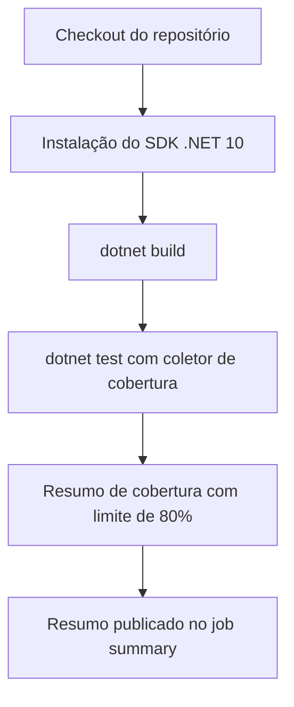

# Compilação e teste da API .NET com cobertura

## Problema que a prática resolve

A integração contínua, abreviada como CI, consiste em compilar e testar o código a cada alteração enviada ao repositório. O defeito é revelado poucos minutos após a alteração que o introduziu, o que antecipa a descoberta que antes ocorria na hora da implantação. Quando a compilação e os testes dependem de alguém lembrar de executá-los, uma alteração pode chegar ao ramo principal sem que a API compile em outra máquina. A prática elimina essa dependência com uma esteira automática que roda sempre da mesma forma em um ambiente limpo.

A cobertura de testes mede a proporção de linhas do código que os testes executam. O número não prova a qualidade dos testes porque uma linha executada sem nenhuma verificação conta como coberta. Ele indica quanto do código nunca foi exercitado, o que o torna útil como piso mínimo. Abaixo do limite combinado pela equipe a esteira recusa a alteração. Este cenário adota 80% das linhas, valor frequente na literatura de qualidade de *software*, aplicado somente ao projeto da API.

## Workflow do cenário

A API fica em `apps/api`, com a solução `Api.slnx` reunindo o projeto `Api` e o projeto de testes `Api.Tests`, escrito com xUnit. O *workflow* `03-api.yml` roda em *pull requests* e em *pushes* para o `main` que alterem `apps/api/**` ou o próprio arquivo do *workflow*. O filtro de caminhos inclui o próprio arquivo para que uma mudança apenas no YAML também seja verificada. O job `ci-api` não contém passos próprios. Ele chama o *workflow* reutilizável `lib-dotnet-ci.yml`, apresentado no [cenário 12](../../docs/cenarios/12.md). A chamada informa a solução `apps/api/Api.slnx`, a pasta `apps/api`, a cobertura mínima de 80 e o filtro `[Api]*`. O diagrama a seguir mostra a ordem dos passos que a biblioteca executa em nome do job.

O job do chamador se chama `ci-api` porque o nome `build` já pertence à verificação obrigatória do portal. Dois jobs com o mesmo nome tornariam ambíguo o contexto exigido pelo *ruleset* do cenário 02.

O passo de testes usa o coletor `XPlat Code Coverage`, fornecido pelo pacote `coverlet.collector`, que gera o arquivo `coverage.cobertura.xml` na pasta `TestResults` do projeto de testes em um formato XML aceito por muitas ferramentas de relatório. O parâmetro `Include="[Api]*"` restringe a medição ao assembly `Api`, de modo que o código dos testes fica fora do cálculo do percentual.

O passo seguinte usa a *action* `irongut/CodeCoverageSummary`, que lê o XML por um padrão de caminho com curinga e produz uma tabela em formato Markdown. O parâmetro `thresholds: '80 90'` define dois limites. O primeiro limite, de 80%, é o mínimo exigido da cobertura de linhas. Com `fail_below_min: true` o passo falha abaixo desse valor. O segundo limite, de 90%, apenas altera o indicador de saúde que a tabela exibe ao lado do percentual de cada pacote.

O valor `60 80` aparece em exemplos da documentação da *action*. Nele o limite que reprova seria 60%, valor que não corresponde ao piso de 80% adotado aqui.

O último passo anexa a tabela ao *job summary*, a página de resumo da execução no GitHub, gravando no arquivo apontado por `GITHUB_STEP_SUMMARY`. O passo roda mesmo com a cobertura reprovada, para que o resumo explique a falha ao leitor. O cenário não comenta no *pull request* porque isso exigiria a permissão `pull-requests: write`, ausente do *workflow*, que declara somente `contents: read` como permissão do `GITHUB_TOKEN`.

Os testes de `tests/pipelines/test_03_api.py` conferem a versão `10.0.x` do SDK, a reprovação por cobertura baixa e o filtro de caminhos com o próprio arquivo. Conferem também que o nome do job não colide com as verificações obrigatórias.

## Como executar

1. Com o SDK do .NET 10 instalado, execute `dotnet test apps/api/Api.slnx --collect:"XPlat Code Coverage"` na raiz do repositório. Confira o arquivo `coverage.cobertura.xml` gerado dentro de `apps/api/Api.Tests/TestResults`.
2. Crie um ramo, altere algo em `apps/api` e abra um *pull request*. A verificação `ci-api` aparece na lista de verificações do *pull request*.
3. Abra a execução e leia o *job summary*. A tabela mostra a cobertura de linhas e de ramos do projeto `Api` com o indicador de saúde.
4. Para ver o limite funcionar, acrescente ao `Program.cs` vários *endpoints* sem teste correspondente. Faça isso até a cobertura de linhas cair abaixo de 80%. O passo de resumo falha e o *pull request* fica bloqueado. Escreva os testes faltantes no projeto `Api.Tests` para a verificação voltar a passar.

## Como levar a prática a um sistema existente

1. Meça primeiro. Execute os testes com o coletor de cobertura e registre o percentual atual de linhas, sem impor limite algum.
2. Defina o limite inicial um pouco abaixo do valor medido e ative `fail_below_min`. Um limite acima do valor atual bloqueia todos os *pull requests* até que alguém escreva testes. O resultado costuma ser testes sem verificações, escritos apenas para subir o número.
3. Eleve o limite em etapas pequenas de cinco pontos a cada ciclo de trabalho. Pare no patamar acordado pela equipe.
4. Exclua da medição somente o que não contém lógica, como código gerado. Registre a justificativa em um arquivo versionado.
5. Troque o caminho `apps/api/**` e o nome da solução pelos do sistema. Se a esteira precisar rodar em vários repositórios, o cenário 12 mostra como extrair estes passos para um *workflow* reutilizável.

## Nível C3DM e fontes

O cenário pertence ao nível Novato deste repositório. No modelo C3DM esse nível inclui a compilação automatizada no domínio de integração e a execução automatizada dos testes no domínio de teste. O limite de cobertura é uma extensão didática do roteiro que o modelo não exige.

As fontes são a documentação de cobertura de código do .NET (https://learn.microsoft.com/pt-br/dotnet/core/testing/unit-testing-code-coverage), o repositório do `coverlet` (https://github.com/coverlet-coverage/coverlet) e o repositório da *action* `CodeCoverageSummary` (https://github.com/irongut/CodeCoverageSummary). O texto do modelo está na [bibliografia](../../docs/referencia/bibliografia.md).
