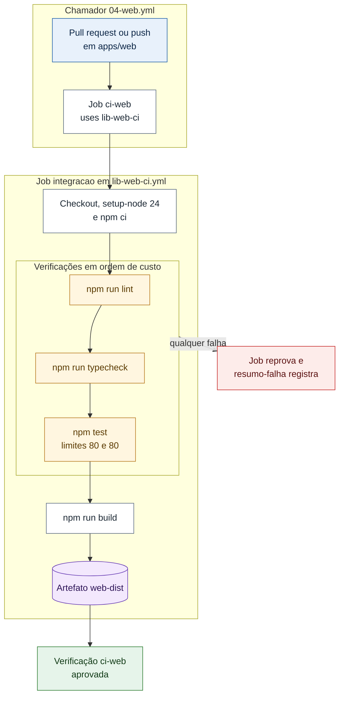

# Compilação e teste da aplicação React com lint e cobertura

## Problema que a prática resolve

A integração contínua, abreviada como CI, consiste em compilar e testar o código a cada alteração enviada ao repositório. Em uma aplicação web escrita em TypeScript a verificação precisa cobrir mais do que a compilação, porque os defeitos de estilo, de tipos e de lógica chegam por caminhos diferentes. Quando cada verificação depende de alguém lembrar de executá-la, uma alteração pode alcançar o ramo principal com erros que só outra máquina revelaria. A prática elimina essa dependência com uma esteira automática, que repete as mesmas verificações em um ambiente limpo e na mesma ordem.

O *lint* é a análise estática que aponta erros prováveis e desvios de estilo sem executar o código. A verificação de tipos confere se os valores trocados entre as funções respeitam as declarações do TypeScript. A cobertura de testes mede a proporção do código que os testes executam. Um número alto não prova que os testes verificam algo, porque uma linha executada sem nenhuma verificação conta como coberta. Este cenário adota o limite de 80% para linhas e para ramos, valor definido neste repositório como piso didático e configurado no arquivo `vitest.config.ts` da aplicação.

## Workflow do cenário

A aplicação fica em `apps/web` e usa React, Vite, Vitest e ESLint. O diagrama a seguir mostra o caminho completo e a ordem das verificações. O *workflow* `04-web.yml` é apenas um chamador, enquanto o trabalho é feito pelo *workflow* reutilizável `lib-web-ci.yml`, apresentado no [cenário 12](../../docs/cenarios/12.md).



### O chamador 04-web.yml

O *workflow* roda em *pull requests* e em *pushes* para o `main` que alterem `apps/web/**`, a biblioteca ou o próprio arquivo do *workflow*.

Arquivo completo: [`.github/workflows/04-web.yml`, linhas 3 a 26](https://github.com/arkhibr/devops-fluxos-c3dm/blob/main/.github/workflows/04-web.yml#L3-L26).

```yaml
on:
  pull_request:
    paths:
      - apps/web/**
      - .github/workflows/04-web.yml
      - .github/workflows/lib-web-ci.yml
      - .github/actions/resumo-falha/**
# ...
permissions:
  contents: read

jobs:
  ci-web:
    uses: ./.github/workflows/lib-web-ci.yml
    with:
      diretorio: apps/web
      node-version: '24'
```

O filtro `paths` inclui o próprio arquivo e a biblioteca para que uma mudança apenas no YAML também seja verificada. As entradas informam a pasta da aplicação e o Node 24. O job se chama `ci-web` porque o nome `build` já pertence à verificação obrigatória do portal. Dois jobs com o mesmo nome tornariam ambíguo o contexto exigido pelo *ruleset* do cenário 02.

### A biblioteca lib-web-ci.yml

O primeiro trecho mostra o diretório de trabalho, a instalação do Node e a instalação das dependências.

Arquivo completo: [`.github/workflows/lib-web-ci.yml`, linhas 24 a 37](https://github.com/arkhibr/devops-fluxos-c3dm/blob/main/.github/workflows/lib-web-ci.yml#L24-L37).

```yaml
  integracao:
    runs-on: ubuntu-latest
    defaults:
      run:
        working-directory: ${{ inputs.diretorio }}
    steps:
      - uses: actions/checkout@11bd71901bbe5b1630ceea73d27597364c9af683  # v4.2.2
      - uses: actions/setup-node@949feb2413d6458794dcd2491c4babbbce0c15c1  # v7.1.0
        with:
          node-version: ${{ inputs.node-version }}
          cache: npm
          cache-dependency-path: ${{ inputs.diretorio }}/package-lock.json
      - name: Instalar dependências a partir do lockfile
        run: npm ci
```

O bloco `defaults.run.working-directory` faz todos os comandos `run` rodarem em `apps/web`. A *action* `actions/setup-node` usa `cache: npm`. O parâmetro `cache-dependency-path` aponta para o `package-lock.json` da pasta informada, porque o arquivo de dependências não está na raiz do repositório e a *action* o procuraria ali. A chave do *cache* deriva do conteúdo desse arquivo, de modo que os pacotes baixados são reaproveitados enquanto as dependências não mudam. O comando `npm ci` instala exatamente as versões registradas no `package-lock.json` e falha se o arquivo divergir do `package.json`. O comando `npm install` pode atualizar o arquivo de travamento e produzir instalações diferentes entre execuções, o que contraria o objetivo de repetibilidade da esteira.

O segundo trecho mostra as verificações, a compilação e o envio do artefato.

Arquivo completo: [`.github/workflows/lib-web-ci.yml`, linhas 38 a 56](https://github.com/arkhibr/devops-fluxos-c3dm/blob/main/.github/workflows/lib-web-ci.yml#L38-L56).

```yaml
      - name: Analisar o código com ESLint
        run: npm run lint
      - name: Verificar tipos com o TypeScript
        run: npm run typecheck
      - name: Testar com os limites de cobertura do projeto
        run: npm test
      - name: Compilar para produção
        run: npm run build
      - name: Publicar o resultado da compilação
        uses: actions/upload-artifact@cf430e030ddbb5b0abf93d22962f4752f3646cd9  # v7.0.2
        with:
          name: web-dist
          path: ${{ inputs.diretorio }}/dist
          if-no-files-found: error
      - name: Resumir a falha
        if: ${{ failure() }}
        uses: arkhibr/devops-fluxos-c3dm/.github/actions/resumo-falha@v1
        with:
          etapa: CI da aplicação web em ${{ inputs.diretorio }}
```

A ordem segue o custo e a natureza de cada falha, das mais baratas de detectar para as mais caras. O *lint* e a verificação de tipos não executam código e costumam terminar antes dos testes, enquanto a compilação de produção vem depois deles. O passo de envio publica `apps/web/dist` como artefato de nome `web-dist`. O parâmetro `if-no-files-found: error` impede que o envio de uma pasta vazia seja aceito como sucesso. O último passo, condicionado a `failure()`, grava no resumo da execução qual etapa falhou.

### Limites de cobertura no Vitest

O script `npm test` executa `vitest run --coverage`. Os limites ficam na configuração do projeto, fora do *workflow*, de modo que valem também para quem roda os testes localmente.

Arquivo completo: [`apps/web/vitest.config.ts`, linhas 4 a 16](https://github.com/arkhibr/devops-fluxos-c3dm/blob/main/apps/web/vitest.config.ts#L4-L16).

```typescript
export default defineConfig({
  plugins: [react()],
  test: {
    environment: 'jsdom',
    coverage: {
      provider: 'v8',
      include: ['src/**/*.{ts,tsx}'],
      exclude: ['src/**/*.test.{ts,tsx}', 'src/main.tsx'],
      reporter: ['text', 'lcov'],
      thresholds: { lines: 80, branches: 80 },
    },
  },
})
```

O bloco `thresholds` com `lines: 80` e `branches: 80` faz o Vitest terminar com erro quando a cobertura de linhas ou de ramos fica abaixo de 80%. Esse erro reprova o passo de testes da biblioteca. A lista `include` mede apenas o código de `src` e a lista `exclude` retira os arquivos de teste e o ponto de entrada `main.tsx` do cálculo. O reporte `lcov` gera um arquivo que ferramentas externas podem ler para montar relatórios próprios.

O *workflow* declara somente `contents: read` como permissão do `GITHUB_TOKEN`, suficiente para obter o código. O envio de artefatos usa um serviço interno do GitHub Actions e dispensa permissão adicional. Os testes de `tests/pipelines/test_04_web.py` conferem a ordem dos passos, o uso do Node 24 com o *cache* do arquivo de travamento correto, o envio de `apps/web/dist` como `web-dist` e o filtro de caminhos com o próprio arquivo.

### Arquivos do cenário

| Arquivo | Papel |
| --- | --- |
| [`.github/workflows/04-web.yml`](https://github.com/arkhibr/devops-fluxos-c3dm/blob/main/.github/workflows/04-web.yml) | Chamador que aciona a biblioteca nos eventos da aplicação web. |
| [`.github/workflows/lib-web-ci.yml`](https://github.com/arkhibr/devops-fluxos-c3dm/blob/main/.github/workflows/lib-web-ci.yml) | Biblioteca que instala, analisa, testa, compila e publica o artefato. |
| [`apps/web/vitest.config.ts`](https://github.com/arkhibr/devops-fluxos-c3dm/blob/main/apps/web/vitest.config.ts) | Configuração do Vitest com os limites de cobertura. |
| [`apps/web/package.json`](https://github.com/arkhibr/devops-fluxos-c3dm/blob/main/apps/web/package.json) | Declara os *scripts* `lint`, `typecheck`, `test` e `build`. |
| [`.github/actions/resumo-falha/action.yml`](https://github.com/arkhibr/devops-fluxos-c3dm/blob/main/.github/actions/resumo-falha/action.yml) | *Composite action* que grava a falha no resumo da execução. |
| [`tests/pipelines/test_04_web.py`](https://github.com/arkhibr/devops-fluxos-c3dm/blob/main/tests/pipelines/test_04_web.py) | Testes estruturais do chamador e da ordem dos passos. |

## Como executar

1. Com o Node 24 instalado, entre em `apps/web` e execute `npm ci`. Depois rode os scripts `lint`, `typecheck`, `test` e `build` com `npm run`. A tabela de cobertura aparece ao fim do teste e a pasta `dist` surge após a compilação.
2. Crie um ramo, altere algo em `apps/web` e abra um *pull request*. A verificação `ci-web` aparece na lista de verificações do *pull request*.
3. Abra a execução e baixe o artefato `web-dist` na seção de artefatos da página. Ele contém os arquivos estáticos gerados pela compilação.
4. Para ver o limite funcionar, acrescente em `src` uma função com vários ramos condicionais e nenhum teste. Faça isso até a cobertura cair abaixo de 80%. O passo de testes falha e o *pull request* fica bloqueado. Escreva os testes faltantes para a verificação voltar a passar.

## Como levar a prática a um sistema existente

1. Execute os cinco comandos localmente antes de criar a esteira e corrija o que falhar, porque uma esteira que nasce reprovada é ignorada pela equipe.
2. Meça a cobertura atual e defina o limite inicial um pouco abaixo do valor medido. Um limite acima do valor atual bloqueia todos os *pull requests* até que alguém escreva testes. O risco é a escrita de testes sem verificações, feitos apenas para subir o número.
3. Eleve o limite em etapas pequenas a cada ciclo de trabalho e pare no patamar acordado pela equipe.
4. Versione o `package-lock.json` e use `npm ci` na esteira. Sem o arquivo de travamento no repositório o comando não funciona.
5. Troque o caminho `apps/web` e a versão do Node pelos do sistema. Se a esteira precisar rodar em vários repositórios, o cenário 12 mostra como extrair estes passos para um *workflow* reutilizável.

## Nível C3DM e fontes

O cenário pertence ao nível Novato deste repositório. No modelo C3DM esse nível inclui a compilação automatizada no domínio de integração e a execução automatizada dos testes no domínio de teste. O *lint*, a verificação de tipos e o limite de cobertura são extensões didáticas do roteiro que o modelo não exige.

As fontes são a documentação da *action* `actions/setup-node` (https://github.com/actions/setup-node), a documentação do comando `npm ci` (https://docs.npmjs.com/cli/commands/npm-ci), a documentação de cobertura do Vitest (https://vitest.dev/guide/coverage) e a do ESLint (https://eslint.org/docs/latest/). O texto do modelo está na [bibliografia](../../docs/referencia/bibliografia.md).
