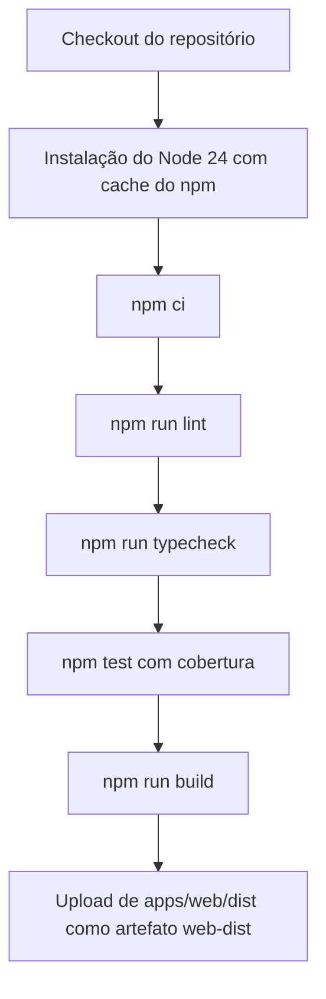

# Compilação e teste da aplicação React com lint e cobertura

## Problema que a prática resolve

A integração contínua, abreviada como CI, consiste em compilar e testar o código a cada alteração enviada ao repositório. Em uma aplicação web escrita em TypeScript a verificação precisa cobrir mais do que a compilação, porque os defeitos de estilo, de tipos e de lógica chegam por caminhos diferentes. Quando cada verificação depende de alguém lembrar de executá-la, uma alteração pode alcançar o ramo principal com erros que só outra máquina revelaria. A prática elimina essa dependência com uma esteira automática, que repete as mesmas verificações em um ambiente limpo e na mesma ordem.

O *lint* é a análise estática que aponta erros prováveis e desvios de estilo sem executar o código. A verificação de tipos confere se os valores trocados entre as funções respeitam as declarações do TypeScript. A cobertura de testes mede a proporção do código que os testes executam. Um número alto não prova que os testes verificam algo, porque uma linha executada sem nenhuma verificação conta como coberta. Este cenário adota o limite de 80% para linhas e para ramos, valor definido neste repositório como piso didático e configurado no arquivo `vitest.config.ts` da aplicação.

## Workflow do cenário

A aplicação fica em `apps/web` e usa React, Vite, Vitest e ESLint. O *workflow* `04-web.yml` roda em *pull requests* e em *pushes* para o `main` que alterem `apps/web/**` ou o próprio arquivo do *workflow*. O filtro de caminhos inclui o próprio arquivo para que uma mudança apenas no YAML também seja verificada. O diagrama a seguir mostra a ordem dos passos executados pelo job de CI da aplicação.

O job se chama `ci-web` porque o nome `build` já pertence à verificação obrigatória do portal. Dois jobs com o mesmo nome tornariam ambíguo o contexto exigido pelo *ruleset* do cenário 02.

O passo de instalação do Node usa a *action* `actions/setup-node` com `node-version: 24` e `cache: npm`. O parâmetro `cache-dependency-path` aponta para `apps/web/package-lock.json`, porque o arquivo de dependências não está na raiz do repositório e a *action* o procuraria ali. A chave do *cache* deriva do conteúdo desse arquivo, de modo que a pasta de pacotes baixados é reaproveitada enquanto as dependências não mudam.

O comando `npm ci` instala exatamente as versões registradas no `package-lock.json` e falha se o arquivo divergir do `package.json`. O comando `npm install` pode atualizar o arquivo de travamento e produzir instalações diferentes entre execuções, o que contraria o objetivo de repetibilidade da esteira.

A ordem dos passos segue o custo e a natureza de cada falha, das mais baratas de detectar para as mais caras. O *lint* e a verificação de tipos não executam código e costumam terminar antes dos testes, razão pela qual vêm antes deles. Os testes rodam com `vitest run --coverage`. O Vitest termina com erro quando a cobertura de linhas ou de ramos fica abaixo de 80%, pois o limite está em `thresholds` na configuração. A compilação de produção vem depois dos testes. O passo final envia a pasta `apps/web/dist` como artefato de nome `web-dist`. O parâmetro `if-no-files-found: error` impede que o envio de uma pasta vazia passe despercebido como sucesso.

O *workflow* declara somente `contents: read` como permissão do `GITHUB_TOKEN`, suficiente para obter o código. O envio de artefatos usa um serviço interno do GitHub Actions e dispensa permissão adicional.

Os testes de `tests/pipelines/test_04_web.py` conferem a ordem dos passos, o uso do Node 24 com o *cache* do arquivo de travamento correto, o envio de `apps/web/dist` como `web-dist` e o filtro de caminhos com o próprio arquivo. Conferem também que o nome do job não colide com as verificações obrigatórias.

## Como executar

1. Com o Node 24 instalado, entre em `apps/web` e execute `npm ci`. Depois rode os scripts `lint`, `typecheck`, `test` e `build` com `npm run`. A tabela de cobertura aparece ao fim do teste e a pasta `dist` surge após a compilação.
2. Crie um ramo, altere algo em `apps/web` e abra um *pull request*. A verificação `ci-web` aparece na lista de verificações do *pull request*.
3. Abra a execução e baixe o artefato `web-dist` na seção de artefatos da página. Ele contém os arquivos estáticos gerados pela compilação.
4. Para ver o limite funcionar, acrescente em `src` uma função com vários ramos condicionais e nenhum teste. Faça isso até a cobertura cair abaixo de 80%. O passo de testes falha e o *pull request* fica bloqueado. Escreva os testes faltantes para a verificação voltar a passar.

## Como levar a prática a um sistema existente

1. Execute os cinco comandos localmente antes de criar a esteira e corrija o que falhar, porque uma esteira que nasce reprovada é ignorada pela equipe.
2. Meça a cobertura atual e defina o limite inicial um pouco abaixo do valor medido. Um limite acima do valor atual bloqueia todos os *pull requests* até que alguém escreva testes. O risco é a escrita de testes sem verificações, feitos apenas para subir o número.
3. Eleve o limite em etapas pequenas a cada ciclo de trabalho e pare no patamar acordado pela equipe.
4. Versione o `package-lock.json` e use `npm ci` na esteira. Sem o arquivo de travamento no repositório o comando não funciona.
5. Troque o caminho `apps/web` e a versão do Node pelos do sistema. Se a esteira precisar rodar em vários repositórios, o cenário 12 mostra como extrair estes passos para um *workflow* reutilizável.

## Nível C3DM e fontes

O cenário pertence ao nível Novato deste repositório. No modelo C3DM esse nível inclui a compilação automatizada no domínio de integração e a execução automatizada dos testes no domínio de teste. O *lint*, a verificação de tipos e o limite de cobertura são extensões didáticas do roteiro que o modelo não exige.

As fontes são a documentação da *action* `actions/setup-node` (https://github.com/actions/setup-node), a documentação do comando `npm ci` (https://docs.npmjs.com/cli/commands/npm-ci), a documentação de cobertura do Vitest (https://vitest.dev/guide/coverage) e a do ESLint (https://eslint.org/docs/latest/). O texto do modelo está na [bibliografia](../../docs/referencia/bibliografia.md).
