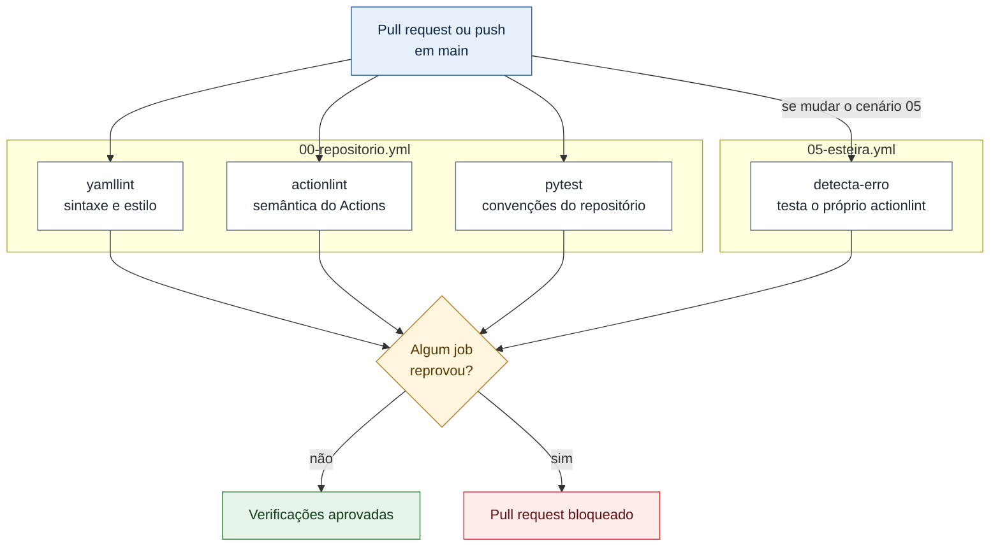
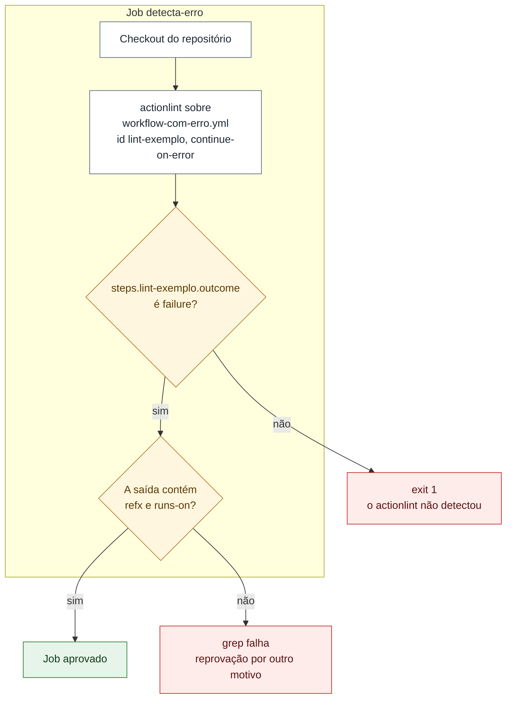

# Verificação automática dos workflows com actionlint, yamllint e pytest

## Problema que a prática resolve

Um *workflow* do GitHub Actions é um arquivo YAML que descreve a esteira de entrega. A esteira é a sequência automatizada de compilação, teste e implantação. Esse arquivo é código e recebe alterações como qualquer outro, porém costuma ser o único código do repositório sem verificação própria. Um erro de digitação em uma expressão, um job sem máquina de execução ou um filtro de caminhos que ignora o próprio arquivo só aparecem quando a esteira falha em uma execução real. Nesse momento o custo de corrigir já é maior, porque a falha pode atingir a implantação em produção.

A prática consiste em aplicar à esteira as mesmas ideias de teste automatizado que a esteira aplica à aplicação. Este cenário combina três camadas, cada uma com um alcance diferente:

1. O *lint* de sintaxe, feito pelo `yamllint`, confere se o arquivo é um YAML bem formado e segue o estilo definido em `.yamllint.yml`. *Lint* é a análise estática que aponta erros prováveis sem executar o código.
2. O *lint* semântico, feito pelo `actionlint`, entende o formato dos *workflows* do GitHub Actions. Ele confere nomes de propriedades em expressões, chaves obrigatórias de cada job e a sintaxe de `needs` e `uses`. Também analisa o código dos *scripts* de cada passo.
3. O teste estrutural, feito pelo `pytest`, confere as convenções próprias deste repositório. Nenhuma ferramenta genérica conhece essas convenções. Um exemplo é a exigência de que toda *action* externa seja fixada por SHA de 40 caracteres.

## Workflow do cenário

O *workflow* `00-repositorio.yml` executa as três camadas a cada *pull request* e a cada *push* para o `main`, com um job para cada ferramenta. Os jobs `actionlint` e `pytest` são verificações obrigatórias do *ruleset* do cenário 02. O *workflow* `05-esteira.yml` acrescenta uma quarta verificação, que testa o próprio `actionlint`. O diagrama a seguir mostra como as quatro verificações chegam ao resultado do *pull request*.



### Jobs do 00-repositorio.yml

O trecho a seguir mostra o job do `actionlint` e o job do `pytest`. O job do `yamllint` tem a mesma forma do `pytest`, com `pip install yamllint` e o comando `yamllint -c .yamllint.yml .`.

Arquivo completo: [`.github/workflows/00-repositorio.yml`, linhas 12 a 40](https://github.com/arkhibr/devops-fluxos-c3dm/blob/main/.github/workflows/00-repositorio.yml#L12-L40).

```yaml
jobs:
  actionlint:
    runs-on: ubuntu-latest
    steps:
      - uses: actions/checkout@11bd71901bbe5b1630ceea73d27597364c9af683  # v4.2.2
      - name: Verificar workflows com actionlint
        run: >-
          docker run --rm -v "$PWD":/repo -w /repo
          rhysd/actionlint@sha256:b1934ee5f1c509618f2508e6eb47ee0d3520686341fec936f3b79331f9315667
  # ...
  pytest:
    runs-on: ubuntu-latest
    steps:
      - uses: actions/checkout@11bd71901bbe5b1630ceea73d27597364c9af683  # v4.2.2
      - uses: actions/setup-python@a26af69be951a213d495a4c3e4e4022e16d87065  # v5.6.0
        with:
          python-version: "3.13"
      - run: pip install -r requirements-dev.txt
      - run: pytest tests/pipelines -q
```

A imagem do `actionlint` é fixada por *digest*, o identificador criptográfico do conteúdo da imagem, indicado após `@sha256:`. Por isso a versão da ferramenta só muda por decisão registrada em um *commit*. O comando monta a raiz do repositório em `/repo` e roda sem argumentos, caso em que o `actionlint` examina apenas `.github/workflows`. O job do `pytest` executa toda a pasta `tests/pipelines`, onde vivem as convenções do repositório.

### O job detecta-erro

Uma ferramenta que deixa de detectar erros produz uma esteira verde sem proteção alguma, sem que nenhum alerta avise sobre isso. O job `detecta-erro` roda a ferramenta sobre o arquivo `exemplos/workflow-com-erro.yml`. Esse arquivo contém dois erros conhecidos e o job só passa se a ferramenta o reprovar.

Arquivo completo: [`.github/workflows/05-esteira.yml`, linhas 17 a 40](https://github.com/arkhibr/devops-fluxos-c3dm/blob/main/.github/workflows/05-esteira.yml#L17-L40).

```yaml
jobs:
  detecta-erro:
    runs-on: ubuntu-latest
    steps:
      - uses: actions/checkout@11bd71901bbe5b1630ceea73d27597364c9af683  # v4.2.2
      - name: Rodar o actionlint sobre o exemplo com erro
        id: lint-exemplo
        continue-on-error: true
        run: >-
          docker run --rm -v "$PWD":/repo -w /repo
          rhysd/actionlint@sha256:b1934ee5f1c509618f2508e6eb47ee0d3520686341fec936f3b79331f9315667
          cenarios/05-teste-da-esteira/exemplos/workflow-com-erro.yml
          > "$RUNNER_TEMP/actionlint-exemplo.txt" 2>&1
      - name: Exigir que o actionlint tenha reprovado o exemplo
        if: steps.lint-exemplo.outcome != 'failure'
        run: |
          echo "O actionlint deveria reprovar o exemplo, mas terminou com resultado '${{ steps.lint-exemplo.outcome }}'."
          exit 1
      - name: Exigir que a reprovação seja pelos dois erros esperados
        if: steps.lint-exemplo.outcome == 'failure'
        run: |
          cat "$RUNNER_TEMP/actionlint-exemplo.txt"
          grep -q 'refx' "$RUNNER_TEMP/actionlint-exemplo.txt"
          grep -q 'runs-on' "$RUNNER_TEMP/actionlint-exemplo.txt"
```

O passo com `id: lint-exemplo` usa `continue-on-error: true` porque a falha é o resultado esperado nesse caso. A regra do repositório permite essa chave somente em um passo com `id` que seja seguido de outro passo testando `steps.<id>.outcome`. O primeiro passo posterior executa `exit 1` quando o resultado não é `failure`, de modo que o job só passa se o exemplo foi de fato reprovado. O segundo exige que a saída gravada em `$RUNNER_TEMP` contenha `refx` e `runs-on`. Assim uma falha por outro motivo, como a ausência da imagem, não passa por reprovação esperada. O nome `detecta-erro` evita colisão com os nomes das verificações obrigatórias `pytest`, `actionlint`, `build` e `titulo`.



### O exemplo com erro

O exemplo fica em `cenarios/05-teste-da-esteira/exemplos/`, fora de `.github/workflows`.

Arquivo completo: [`cenarios/05-teste-da-esteira/exemplos/workflow-com-erro.yml`, linhas 1 a 15](https://github.com/arkhibr/devops-fluxos-c3dm/blob/main/cenarios/05-teste-da-esteira/exemplos/workflow-com-erro.yml#L1-L15).

```yaml
# Exemplo didático com dois erros semânticos que o actionlint detecta.
# O arquivo fica fora de .github/workflows para que o GitHub nunca o execute.
name: Exemplo com erro

on:
  push:

permissions:
  contents: read

jobs:
  exemplo:
    steps:
      - name: Mostrar o ramo
        run: echo "ramo ${{ github.refx }}"
```

O GitHub só executa arquivos da pasta de *workflows*, de modo que o exemplo nunca roda como esteira. Pelo mesmo motivo o `actionlint` do job do repositório, chamado sem argumentos, não o examina e a verificação obrigatória não reprova. O arquivo é YAML válido e passa pelo `yamllint`, porque os dois erros são semânticos. A expressão `${{ github.refx }}` na linha 15 usa uma propriedade que não existe no contexto `github`. O job `exemplo` também não declara a chave `runs-on`, indispensável para escolher a máquina de execução.

### Testes de convenção em tests/pipelines

A terceira camada vive na pasta `tests/pipelines/`, onde o módulo `workflows.py` carrega cada arquivo de `.github/workflows` com o PyYAML e oferece funções como `jobs`, `passos` e `usos` para inspecionar o resultado. O módulo `test_convencoes.py` define uma função para cada regra do repositório. O trecho a seguir mostra o teste que exige *actions* fixadas por SHA.

Arquivo completo: [`tests/pipelines/test_convencoes.py`, linhas 139 a 142](https://github.com/arkhibr/devops-fluxos-c3dm/blob/main/tests/pipelines/test_convencoes.py#L139-L142).

```python
@pytest.mark.parametrize("nome", NOMES)
def test_usos_fixados_por_sha(nome):
    assert not violacoes_sha(carregar_workflow(nome))

```

A anotação `@pytest.mark.parametrize` repete o teste para todos os *workflows*, de modo que cada arquivo reprovado aparece como um caso separado na saída do `pytest`. A tabela seguinte relaciona cinco testes do módulo ao erro que cada um impede.

| Teste | Erro que ele impede |
| --- | --- |
| `test_usos_fixados_por_sha` | Uma *action* referenciada por tag móvel, como `actions/checkout@v4`, que pode mudar de conteúdo sem aviso. |
| `test_permissions_no_topo` | Um *workflow* sem a chave `permissions`, que herdaria as permissões padrão do repositório, mais amplas que o necessário. |
| `test_paths_inclui_o_proprio_workflow` | Um filtro `paths:` que não lista o próprio arquivo, caso em que uma alteração apenas no YAML não dispara a verificação. |
| `test_jobs_que_escrevem_nao_rodam_em_pull_request` | Um job que publica pacote ou escreve no repositório e pode rodar em *pull request* de *fork*, onde o `GITHUB_TOKEN` é somente leitura. |
| `test_implantacoes_serializadas` | Um job com `environment:` sem `concurrency` de grupo `implantacao-<ambiente>`, que permitiria duas implantações simultâneas. |

Uma regra de teste também precisa ser testada, pois uma regra que nunca reprova não protege nada. O dicionário `CASOS_VIOLACAO` guarda para cada regra um YAML mínimo que a viola. O teste `test_regras_detectam_violacoes` exige que a regra aponte a violação de cada caso. Esse mecanismo aplica à camada de `pytest` o mesmo raciocínio do job `detecta-erro`, como mostra o trecho a seguir.

Arquivo completo: [`tests/pipelines/test_convencoes.py`, linhas 186 a 227](https://github.com/arkhibr/devops-fluxos-c3dm/blob/main/tests/pipelines/test_convencoes.py#L186-L227).

```python

CASOS_VIOLACAO = {
    "sha": ("on: push\njobs:\n  a:\n    runs-on: x\n    steps:\n      - uses: actions/checkout@v4\n",
# ...
@pytest.mark.parametrize("caso", CASOS_VIOLACAO)
def test_regras_detectam_violacoes(caso, tmp_path, monkeypatch):
    texto, regra = CASOS_VIOLACAO[caso]
    assert regra(_carregar_texto(tmp_path, monkeypatch, texto)), f"regra não reprovou o caso {caso}"
```

O primeiro caso, `sha`, é um *workflow* mínimo que referencia `actions/checkout@v4`. A função `violacoes_sha` precisa devolver ao menos uma violação para esse caso, pois se alguém afrouxar a regra a ponto de aceitar o caso, o teste reprova a alteração.

O teste `test_05_exemplo_tem_erro_esperado`, do arquivo `tests/pipelines/test_05_esteira.py`, repete a verificação do job no computador do aluno. Ele roda o `actionlint` por Docker e envia o conteúdo do exemplo pela entrada padrão do contêiner, exige código de saída diferente de zero e as palavras `refx` e `runs-on` na mensagem. Ele é pulado quando o Docker não está disponível. O envio pela entrada padrão evita o uso de volumes, porque em ambientes de contêiner do macOS como o Colima os volumes montados a partir de certos discos chegam vazios ao contêiner.

### Arquivos do cenário

| Arquivo | Papel |
| --- | --- |
| [`.github/workflows/00-repositorio.yml`](https://github.com/arkhibr/devops-fluxos-c3dm/blob/main/.github/workflows/00-repositorio.yml) | Jobs `actionlint`, `yamllint` e `pytest` sobre todo o repositório. |
| [`.github/workflows/05-esteira.yml`](https://github.com/arkhibr/devops-fluxos-c3dm/blob/main/.github/workflows/05-esteira.yml) | Job `detecta-erro`, que testa o próprio `actionlint`. |
| [`cenarios/05-teste-da-esteira/exemplos/workflow-com-erro.yml`](https://github.com/arkhibr/devops-fluxos-c3dm/blob/main/cenarios/05-teste-da-esteira/exemplos/workflow-com-erro.yml) | Exemplo com dois erros conhecidos, fora da pasta de *workflows*. |
| [`.yamllint.yml`](https://github.com/arkhibr/devops-fluxos-c3dm/blob/main/.yamllint.yml) | Configuração do `yamllint`, que estende as regras padrão. |
| [`tests/pipelines/workflows.py`](https://github.com/arkhibr/devops-fluxos-c3dm/blob/main/tests/pipelines/workflows.py) | Módulo que carrega os *workflows* para os testes. |
| [`tests/pipelines/test_convencoes.py`](https://github.com/arkhibr/devops-fluxos-c3dm/blob/main/tests/pipelines/test_convencoes.py) | Convenções do repositório e casos de violação de cada regra. |
| [`tests/pipelines/test_05_esteira.py`](https://github.com/arkhibr/devops-fluxos-c3dm/blob/main/tests/pipelines/test_05_esteira.py) | Testes do exemplo com erro e do job `detecta-erro`. |

## Como executar

1. Crie um ambiente virtual Python, instale as dependências com `pip install -r requirements-dev.txt` e execute `pytest tests/pipelines -q`. Todos os testes devem passar. O teste do exemplo é pulado se o Docker estiver indisponível.
2. Rode o `actionlint` sobre o exemplo com `docker run --rm -i rhysd/actionlint@sha256:b1934ee5f1c509618f2508e6eb47ee0d3520686341fec936f3b79331f9315667 - < cenarios/05-teste-da-esteira/exemplos/workflow-com-erro.yml`. A saída lista as duas mensagens de erro e o comando termina com código diferente de zero.
3. Quebre uma convenção de propósito. Em um ramo novo, troque o SHA de um `uses:` em qualquer *workflow* por `@v4` e rode o `pytest`. O teste `test_usos_fixados_por_sha` falha para aquele arquivo e informa qual `uses` viola a regra.
4. Corrija o exemplo acrescentando `runs-on: ubuntu-latest` ao job e trocando `github.refx` por `github.ref`. Abra um *pull request* e observe o job `detecta-erro` falhar, pois o `actionlint` deixou de reprovar o arquivo. Desfaça a correção para a verificação voltar a passar.
5. Abra um *pull request* que altere qualquer arquivo de `.github/workflows`. Na lista de verificações aparecem os jobs `actionlint`, `yamllint` e `pytest` do *workflow* `00 Repositório`.

## Como levar a prática a um sistema existente

1. Rode o `actionlint` na raiz do repositório e corrija o que ele apontar antes de torná-lo obrigatório. O primeiro resultado costuma listar erros antigos. Uma verificação que nasce reprovada é ignorada pela equipe.
2. Crie um `.yamllint.yml` com a configuração `extends: default` e ajuste apenas as regras que gerem ruído, como o tamanho máximo de linha. Cada regra desligada deve ter justificativa escrita no próprio arquivo.
3. Escolha duas ou três convenções que a equipe já pratica e escreva um teste para cada uma. Fixação de *actions* por SHA e declaração de `permissions` são pontos de partida baratos. Para cada regra, escreva também um YAML mínimo que a viole.
4. Fixe por *digest* a imagem do `actionlint` e as versões do `yamllint` e do `pytest`, para que uma atualização da ferramenta não reprove *pull requests* sem relação com ela.
5. Torne os jobs verificações obrigatórias do *ruleset* do ramo principal, conforme o cenário 02. Troque os nomes de arquivo e de pasta usados aqui pelos do sistema, mantendo o exemplo com erro fora da pasta de *workflows*.

## Nível C3DM e fontes

O cenário pertence ao nível Novato deste repositório. No modelo C3DM esse nível inclui a execução automatizada dos testes no domínio de teste. A verificação da própria esteira, com *lint* e testes estruturais dos *workflows*, é uma extensão didática que o modelo não exige.

As fontes são a documentação do `actionlint` (https://github.com/rhysd/actionlint), a do `yamllint` (https://yamllint.readthedocs.io/), a do `pytest` (https://docs.pytest.org/) e as recomendações de segurança do GitHub Actions (https://docs.github.com/actions/security-for-github-actions/security-guides/security-hardening-for-github-actions). O texto do modelo está na [bibliografia](../../docs/referencia/bibliografia.md).
