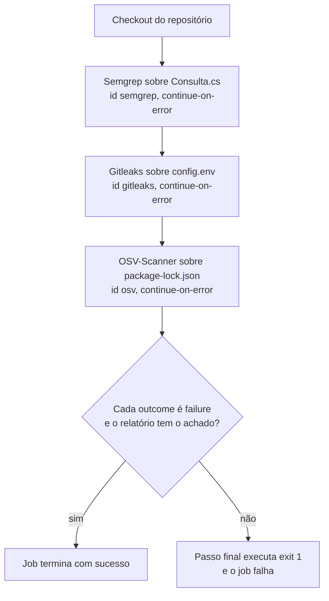

# Análise estática, análise de dependências e varredura de segredos

## Problema que a prática resolve

Três tipos de falha de segurança entram no repositório sem que o compilador ou os testes funcionais os percebam. O primeiro está no código escrito pela equipe, como a montagem de uma consulta SQL por concatenação de texto digitado pelo usuário. O segundo está nas bibliotecas de terceiros, que podem ter vulnerabilidades publicadas depois que a versão foi escolhida. O terceiro está nos segredos, como senhas e chaves de acesso, que um desenvolvedor grava em um arquivo por descuido e que permanecem no histórico mesmo depois de apagados.

Cada falha pede uma ferramenta própria, com um nome e uma sigla que reaparecem ao longo do texto. A análise estática de segurança, conhecida pela sigla SAST, lê o código-fonte sem executá-lo e procura padrões associados a vulnerabilidades. A análise de composição de software, conhecida pela sigla SCA, compara as dependências declaradas com bases públicas de vulnerabilidades conhecidas. A varredura de segredos procura em arquivos e no histórico de *commits* textos com o formato de credenciais.

## Workflow do cenário

O *workflow* `06-seguranca.yml` roda em todo *pull request* e em todo *push* para o `main`, sem filtro de caminhos. Um segredo ou uma dependência vulnerável pode surgir em qualquer arquivo. Ele contém quatro jobs cujos nomes diferem dos das verificações obrigatórias `pytest`, `actionlint`, `build` e `titulo`.

O job `codeql` executa o CodeQL, o mecanismo de SAST do GitHub. Ele usa uma matriz com as linguagens `csharp` e `javascript-typescript`, que correspondem à API e à aplicação web. O parâmetro `build-mode: none` faz o CodeQL extrair o código sem compilar o projeto, o que dispensa instalar o SDK e reduz o tempo da execução. Esse job é o único com `permissions: security-events: write`, necessária para publicar os resultados na aba de alertas de segurança do repositório. Os demais jobs herdam apenas `contents: read`. O arquivo `.github/codeql/codeql-config.yml` exclui a pasta `cenarios/**/fixtures/` da análise. Sem essa exclusão o CodeQL registraria a injeção de SQL proposital do cenário como alerta aberto. A lista de alertas deixaria de refletir o código real, o que esconde os problemas novos entre os propositais.

O job `dependencias` usa a *action* `actions/dependency-review-action` com `fail-on-severity: high`. A revisão de dependências compara o grafo de dependências do *pull request* com o da base e reprova quando a mudança introduz uma dependência com vulnerabilidade de severidade alta ou crítica. Por depender dessa comparação, o job só roda em eventos do tipo `pull_request`, que fornecem as duas versões do grafo. O *lockfile* dos *fixtures* também entra nessa comparação, pois o `lodash 4.17.15` é vulnerável de propósito. Por isso o parâmetro `allow-ghsas` lista os três avisos de severidade alta já conhecidos para essa versão. Um aviso de severidade alta publicado depois para outro pacote continua reprovando o *pull request*.

O job `segredos` instala o Gitleaks, um detector de segredos de código aberto, a partir do arquivo compactado de uma versão fixa. O *workflow* confere o *checksum* SHA-256 do arquivo baixado contra o valor registrado no próprio YAML e interrompe o job se os valores diferirem. Em seguida executa `gitleaks detect --source . --config .gitleaks.toml --redact --exit-code 1` sobre o histórico completo, obtido com `fetch-depth: 0`. A opção `--redact` omite o valor do segredo na saída. A *action* oficial do Gitleaks exige licença para organizações e por isso não é usada. O arquivo `.gitleaks.toml` estende as regras padrão com `useDefault = true` e define uma única exceção, restrita à pasta `cenarios/06-seguranca-estatica/fixtures/`. Nenhum outro caminho do repositório é ignorado, de modo que um segredo real em `apps/` ou em qualquer outra pasta reprova o job.

O job `fixtures-devem-reprovar` prova que as ferramentas funcionam. Um verificador que deixa de detectar problemas produz uma esteira verde sem proteção, de modo que o cenário mantém três arquivos com defeitos conhecidos na pasta `fixtures/`:

| Arquivo | Defeito | Ferramenta | Achado exigido |
| --- | --- | --- | --- |
| `Consulta.cs` | Concatenação de entrada do usuário em uma consulta SQL | Semgrep com `--config p/csharp --error` | Regra `csharp-sqli` no relatório JSON |
| `config.env` | Linha `API_TOKEN=` seguida de 40 caracteres aleatórios | Gitleaks com `--no-git` e configuração padrão | Regra `generic-api-key` no relatório JSON |
| `package-lock.json` | Dependência `lodash 4.17.15`, com vulnerabilidades publicadas | OSV-Scanner sobre o *lockfile* | Pacote `lodash` no relatório JSON |

Os três passos de varredura usam `continue-on-error: true`. Os identificadores desses passos são `semgrep`, `gitleaks` e `osv`, nessa ordem. O passo final lê o resultado de cada um e falha se algum `outcome` for diferente de `failure`. Ele também falha quando o relatório da ferramenta não contém o achado da tabela. Essa segunda exigência impede que um caminho errado, uma falha de rede ou uma regra baixada incorretamente façam o job passar por um motivo que não é o esperado. O Semgrep é instalado com `pip` na versão fixada. O OSV-Scanner é baixado de uma versão fixa com verificação de *checksum*, como o Gitleaks.

O segredo de `config.env` é uma sequência aleatória sem prefixo de provedor, como `ghp_` ou `AKIA`. Essa escolha evita que a proteção de *push* do GitHub bloqueie o envio do arquivo e não dá acesso a nenhum serviço. A regra genérica do Gitleaks, baseada em entropia e no nome da variável, ainda o detecta.

## Como executar

1. Instale o Gitleaks e rode `gitleaks detect --source . --config .gitleaks.toml`. A saída informa que nenhum vazamento foi encontrado, porque a configuração ignora a pasta de *fixtures*.
2. Rode `gitleaks detect --no-git --source cenarios/06-seguranca-estatica/fixtures`. O comando relata um vazamento da regra `generic-api-key` e termina com código 1.
3. Rode o Semgrep com `semgrep scan --config p/csharp --error cenarios/06-seguranca-estatica/fixtures`. O comando aponta a regra `csharp-sqli` em `Consulta.cs`.
4. Rode `osv-scanner scan source --lockfile cenarios/06-seguranca-estatica/fixtures/package-lock.json`. A tabela lista as vulnerabilidades publicadas para o `lodash` 4.17.15.
5. Abra um *pull request* que altere qualquer arquivo e observe os quatro jobs do *workflow*. Depois da execução no `main`, a aba Security do repositório exibe em Code scanning os alertas do CodeQL para `apps/`.
6. Para ver a exceção em ação, acrescente em um arquivo fora de `fixtures/` uma linha com `API_TOKEN=` e 40 caracteres aleatórios. O job `segredos` falha e a saída identifica a regra e o arquivo, sem mostrar o valor.

## Como levar a prática a um sistema existente

1. Habilite o grafo de dependências e o *code scanning* nas configurações do repositório. A revisão de dependências e a publicação dos alertas do CodeQL precisam desses recursos.
2. Adicione o job `codeql` com as linguagens do sistema. Prefira `build-mode: none` quando a linguagem permitir. Use o modo `autobuild` ou `manual` apenas quando a análise sem compilação perder resultados relevantes.
3. Execute o Gitleaks uma vez sobre todo o histórico antes de tornar o job obrigatório. Cada achado real exige revogar a credencial no provedor, pois apagar o arquivo não remove o valor do histórico. Registre cada falso positivo como exceção por linha, com `regexes` e justificativa em comentário, sem ignorar arquivos inteiros.
4. Comece a revisão de dependências com `fail-on-severity: critical` se o sistema já tiver muitas vulnerabilidades altas. Reduza o limite para `high` depois que o passivo for tratado.
5. Mantenha o job de *fixtures* com um defeito de cada tipo, em pasta excluída das varreduras reais. Ele avisa quando uma atualização de ferramenta ou de regras deixa de detectar um problema conhecido.
6. Torne os jobs verificações obrigatórias do *ruleset* do ramo principal, conforme o cenário 02.

## Nível C3DM e fontes

O repositório agrupa o cenário no nível Intermediário, que reúne as verificações de segurança do ciclo de desenvolvimento. O modelo C3DM situa os testes de segurança no nível Avançado do domínio de teste. O roteiro trata a gestão de segredos nos tópicos de segurança desse mesmo nível, o que justifica a inclusão da varredura de segredos neste cenário.

As fontes são a documentação do CodeQL (https://codeql.github.com/docs/), a da revisão de dependências (https://docs.github.com/code-security/supply-chain-security/understanding-your-software-supply-chain/about-dependency-review), a do Gitleaks (https://github.com/gitleaks/gitleaks), a do Semgrep (https://semgrep.dev/docs/) e a do OSV-Scanner (https://google.github.io/osv-scanner/). O texto do modelo está na [bibliografia](../../docs/referencia/bibliografia.md).
