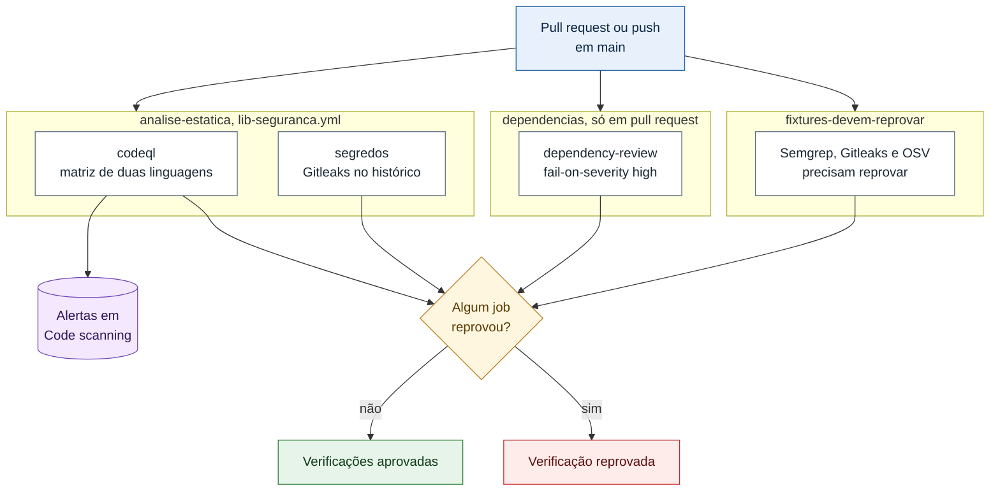
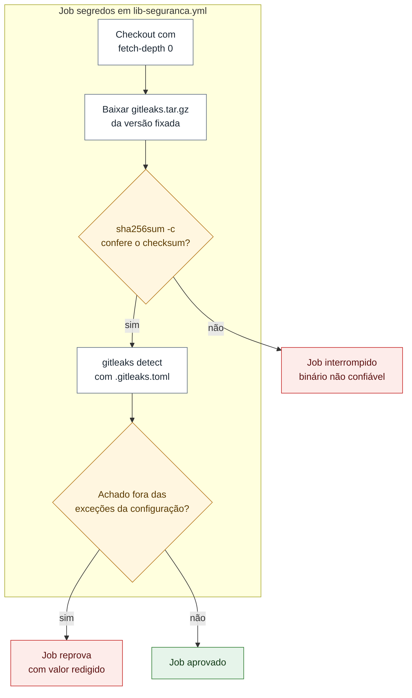
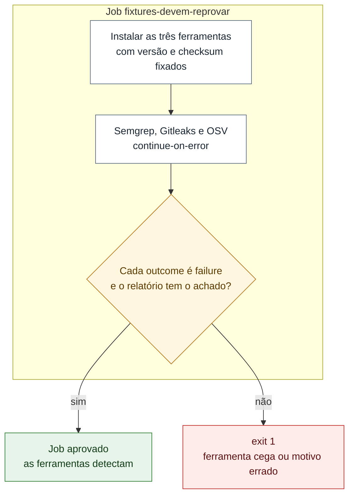

# Análise estática, análise de dependências e varredura de segredos

## Problema que a prática resolve

Três tipos de falha de segurança entram no repositório sem que o compilador ou os testes funcionais os percebam. O primeiro está no código escrito pela equipe, como a montagem de uma consulta SQL por concatenação de texto digitado pelo usuário. O segundo está nas bibliotecas de terceiros, que podem ter vulnerabilidades publicadas depois que a versão foi escolhida. O terceiro está nos segredos, como senhas e chaves de acesso, que um desenvolvedor grava em um arquivo por descuido e que permanecem no histórico mesmo depois de apagados.

Cada falha pede uma ferramenta própria, com um nome e uma sigla que reaparecem ao longo do texto. A análise estática de segurança, conhecida pela sigla SAST, lê o código-fonte sem executá-lo e procura padrões associados a vulnerabilidades. A análise de composição de software, conhecida pela sigla SCA, compara as dependências declaradas com bases públicas de vulnerabilidades conhecidas. A varredura de segredos procura em arquivos e no histórico de *commits* textos com o formato de credenciais.

## Workflow do cenário

Os nomes dos três jobs do *workflow* `06-seguranca.yml` diferem dos das verificações obrigatórias `pytest`, `actionlint`, `build` e `titulo`. O *workflow* roda em todo *pull request* e em todo *push* para o `main`, sem filtro de caminhos, porque um segredo ou uma dependência vulnerável pode surgir em qualquer arquivo. O diagrama a seguir mostra os jobs e o resultado da verificação, que reprova quando qualquer um deles falha.



### O chamador e a revisão de dependências

O job `analise-estatica` chama o *workflow* reutilizável `lib-seguranca.yml`, apresentado no [cenário 12](../../docs/cenarios/12.md). O job `dependencias` usa a *action* `actions/dependency-review-action` diretamente.

Arquivo completo: [`.github/workflows/06-seguranca.yml`, linhas 15 a 33](https://github.com/arkhibr/devops-fluxos-c3dm/blob/main/.github/workflows/06-seguranca.yml#L15-L33).

```yaml
jobs:
  analise-estatica:
    permissions:
      contents: read
      security-events: write
    uses: ./.github/workflows/lib-seguranca.yml
    with:
      linguagens: '["csharp", "javascript-typescript"]'
      config-codeql: ./.github/codeql/codeql-config.yml
      config-gitleaks: .gitleaks.toml

  dependencias:
    if: github.event_name == 'pull_request'
    runs-on: ubuntu-latest
    steps:
      - uses: actions/checkout@11bd71901bbe5b1630ceea73d27597364c9af683  # v4.2.2
      - uses: actions/dependency-review-action@bbc44d14a204704ccc493733616cd1e93a0321ec  # v5.0.1
        with:
          fail-on-severity: high
```

O chamador concede `security-events: write` ao job, pois um *workflow* chamado não pode ter mais permissões do que o chamador lhe dá. Ele informa as linguagens como uma lista JSON e os arquivos de configuração das duas ferramentas. A condição `github.event_name == 'pull_request'` restringe o job `dependencias` a esse evento, porque a revisão compara o grafo de dependências do *pull request* com o da base e precisa das duas versões. O parâmetro `fail-on-severity: high` reprova quando a mudança introduz uma dependência com vulnerabilidade de severidade alta ou crítica. O job não usa lista de exceções por aviso, pois uma exceção por identificador valeria para todo o repositório e deixaria passar o mesmo pacote vulnerável em `apps/`. O *lockfile* dos *fixtures* se chama `lockfile-vulneravel.json` e não `package-lock.json`, de modo que o grafo de dependências do GitHub e o Dependabot não o reconhecem como manifesto.

### CodeQL na biblioteca

O job `codeql` da biblioteca executa o CodeQL, o mecanismo de SAST do GitHub. Ele usa uma matriz com as linguagens `csharp` e `javascript-typescript`, que correspondem à API e à aplicação web.

Arquivo completo: [`.github/workflows/lib-seguranca.yml`, linhas 28 a 52](https://github.com/arkhibr/devops-fluxos-c3dm/blob/main/.github/workflows/lib-seguranca.yml#L28-L52).

```yaml
  codeql:
    if: github.event_name != 'pull_request' || github.event.pull_request.head.repo.full_name == github.repository
    runs-on: ubuntu-latest
    permissions:
      contents: read
      security-events: write
    strategy:
      fail-fast: false
      matrix:
        language: ${{ fromJSON(inputs.linguagens) }}
    steps:
      - uses: actions/checkout@11bd71901bbe5b1630ceea73d27597364c9af683  # v4.2.2
      - uses: github/codeql-action/init@1bd86f2fdb4b86187fa4059f16f31a3202acc9ea  # v4.39.4
        with:
          languages: ${{ matrix.language }}
          build-mode: none
          config-file: ${{ inputs.config-codeql }}
      - uses: github/codeql-action/analyze@1bd86f2fdb4b86187fa4059f16f31a3202acc9ea  # v4.39.4
        with:
          category: /language:${{ matrix.language }}
      - name: Resumir a falha
        if: ${{ failure() }}
        uses: arkhibr/devops-fluxos-c3dm/.github/actions/resumo-falha@v1
        with:
          etapa: CodeQL para ${{ matrix.language }}
```

A condição do job só deixa passar *push* ou *pull request* originado no próprio repositório, porque o `GITHUB_TOKEN` de um *fork* é somente leitura. Nesse caso a publicação dos resultados falharia. A matriz com `fromJSON(inputs.linguagens)` cria um job por linguagem. O parâmetro `build-mode: none` faz o CodeQL extrair o código sem compilar o projeto, o que dispensa instalar o SDK e reduz o tempo da execução. Esse job é o único com `permissions: security-events: write`, necessária para publicar os resultados na aba de alertas de segurança do repositório. O arquivo `.github/codeql/codeql-config.yml` exclui a pasta `cenarios/06-seguranca-estatica/fixtures/` da análise. Sem essa exclusão o CodeQL registraria a injeção de SQL proposital do cenário como alerta aberto. A lista de alertas deixaria de refletir o código real, que só contém os alertas da pasta `apps/`.

### Varredura de segredos com Gitleaks

O job `segredos` instala o Gitleaks, um detector de segredos de código aberto, a partir do arquivo compactado de uma versão fixa. A *action* oficial do Gitleaks exige licença para organizações e por isso não é usada.

Arquivo completo: [`.github/workflows/lib-seguranca.yml`, linhas 54 a 70](https://github.com/arkhibr/devops-fluxos-c3dm/blob/main/.github/workflows/lib-seguranca.yml#L54-L70).

```yaml
  segredos:
    runs-on: ubuntu-latest
    env:
      GITLEAKS_VERSION: 8.30.1
      GITLEAKS_SHA256: 551f6fc83ea457d62a0d98237cbad105af8d557003051f41f3e7ca7b3f2470eb
    steps:
      - uses: actions/checkout@11bd71901bbe5b1630ceea73d27597364c9af683  # v4.2.2
        with:
          fetch-depth: 0
      - name: Instalar o Gitleaks com verificação de checksum
        run: |
          curl -sSfL -o "$RUNNER_TEMP/gitleaks.tar.gz" \
            "https://github.com/gitleaks/gitleaks/releases/download/v${GITLEAKS_VERSION}/gitleaks_${GITLEAKS_VERSION}_linux_x64.tar.gz"
          echo "${GITLEAKS_SHA256}  $RUNNER_TEMP/gitleaks.tar.gz" | sha256sum -c -
          mkdir "$RUNNER_TEMP/gitleaks"
          tar -xzf "$RUNNER_TEMP/gitleaks.tar.gz" -C "$RUNNER_TEMP/gitleaks" gitleaks
          echo "$RUNNER_TEMP/gitleaks" >> "$GITHUB_PATH"
```

A linha com `sha256sum -c -` confere o *checksum* SHA-256 do arquivo baixado contra o valor registrado no próprio YAML e interrompe o job se os valores diferirem. Assim um binário adulterado ou substituído no servidor de origem não chega a ser executado. A opção `fetch-depth: 0` obtém o histórico completo, que a varredura percorre *commit* a *commit* até o primeiro registro do repositório.



O segundo trecho mostra a execução da varredura.

Arquivo completo: [`.github/workflows/lib-seguranca.yml`, linhas 71 a 81](https://github.com/arkhibr/devops-fluxos-c3dm/blob/main/.github/workflows/lib-seguranca.yml#L71-L81).

```yaml
      - name: Varrer o repositório e o histórico
        env:
          GITLEAKS_CONFIG: ${{ inputs.config-gitleaks }}
        run: |
          args=(detect --source . --redact --exit-code 1)
          if [ -n "$GITLEAKS_CONFIG" ] && [ -f "$GITLEAKS_CONFIG" ]; then
            args+=(--config "$GITLEAKS_CONFIG")
          else
            echo "::warning::Configuração '$GITLEAKS_CONFIG' ausente. Usando as regras padrão do Gitleaks."
          fi
          gitleaks "${args[@]}"
```

O comando `gitleaks detect --source . --redact --exit-code 1` varre o repositório e o histórico, omite o valor do segredo na saída e termina com código 1 quando encontra algum. O argumento `--config` só entra quando o arquivo existe no repositório chamador. Sem ele valem as regras padrão e o *workflow* emite um aviso no log, informando o caminho esperado da configuração.

O arquivo `.gitleaks.toml` estende as regras padrão e define duas exceções.

Arquivo completo: [`.gitleaks.toml`, linhas 4 a 16](https://github.com/arkhibr/devops-fluxos-c3dm/blob/main/.gitleaks.toml#L4-L16).

```toml
[extend]
useDefault = true

[[allowlists]]
description = "Fixtures do cenário 06, que devem ser reprovados pela varredura de segredos"
paths = ['''^cenarios/06-seguranca-estatica/fixtures/''']

[[allowlists]]
description = "Falso positivo: nome da imagem no teste do cenário 08"
condition = "AND"
targetRules = ["generic-api-key"]
paths = ['''^tests/pipelines/test_08_artefato\.py$''']
regexes = ['''devops-fluxos-c3dm-(api|web)''']
```

A diretiva `useDefault = true` mantém todas as regras padrão do Gitleaks no repositório inteiro, sem exceção de pasta. A primeira exceção ignora a pasta de *fixtures* do cenário 06, que reúne os arquivos com defeitos conhecidos usados pelo job de verificação das ferramentas.

A segunda exceção é por linha e vale somente para a regra `generic-api-key` no arquivo `tests/pipelines/test_08_artefato.py` com o texto `devops-fluxos-c3dm-api` ou `devops-fluxos-c3dm-web`. Esse texto é o nome das imagens do cenário 08, que a regra confunde com uma chave de API. As quatro condições precisam valer juntas, pois a exceção declara `condition = "AND"`. Um segredo real nesse mesmo arquivo continua reprovando o job, assim como o mesmo texto em outro arquivo. Essa forma é preferida a uma exceção por *commit*, porque a exceção por *commit* ignoraria todo o conteúdo daquele *commit* e esconderia qualquer segredo real nele.

A varredura percorre o histórico completo, de modo que reescrever a linha no arquivo atual não basta, pois o *commit* antigo que continha o nome permanece no histórico e continua gerando o achado. A exceção na configuração é necessária mesmo depois da reescrita. Nenhum outro caminho é ignorado, de modo que um segredo real em `apps/` ou em qualquer outra pasta reprova o job.

### Fixtures que devem reprovar

O job `fixtures-devem-reprovar` prova que as ferramentas funcionam. Um verificador que deixa de detectar problemas produz uma esteira verde sem proteção, de modo que o cenário mantém três arquivos com defeitos conhecidos na pasta `fixtures/`.

| Arquivo | Defeito | Ferramenta | Achado exigido |
| --- | --- | --- | --- |
| `Consulta.cs` | Concatenação de entrada do usuário em uma consulta SQL | Semgrep com `--config p/csharp --error` | Regra `csharp-sqli` no relatório JSON |
| `config.env` | Linha `API_TOKEN=` seguida de 40 caracteres aleatórios | Gitleaks com `--no-git` e configuração padrão | Regra `generic-api-key` no relatório JSON |
| `lockfile-vulneravel.json` | Cópia de um `package-lock.json` com a dependência `lodash 4.17.15`, com vulnerabilidades publicadas | OSV-Scanner sobre o *lockfile* | Pacote `lodash` no relatório JSON |

Os três passos de varredura usam `continue-on-error: true`. Seus identificadores são `semgrep`, `gitleaks` e `osv`, nessa ordem.

Arquivo completo: [`.github/workflows/06-seguranca.yml`, linhas 60 a 77](https://github.com/arkhibr/devops-fluxos-c3dm/blob/main/.github/workflows/06-seguranca.yml#L60-L77).

```yaml
      - name: Semgrep sobre o código com injeção de SQL
        id: semgrep
        continue-on-error: true
        run: >-
          "$RUNNER_TEMP/semgrep/bin/semgrep" scan --config p/csharp --error --metrics=off
          --json --output "$RUNNER_TEMP/semgrep.json" "$FIXTURES"
      - name: Gitleaks sobre o arquivo com segredo falso
        id: gitleaks
        continue-on-error: true
        run: >-
          gitleaks detect --no-git --source "$FIXTURES" --redact --exit-code 1
          --report-format json --report-path "$RUNNER_TEMP/gitleaks.json"
      - name: OSV-Scanner sobre o lockfile com lodash vulnerável
        id: osv
        continue-on-error: true
        run: >-
          osv-scanner scan source --lockfile "package-lock.json:$FIXTURES/lockfile-vulneravel.json"
          --format json > "$RUNNER_TEMP/osv.json"
```

Cada passo grava um relatório JSON em `$RUNNER_TEMP`. O Semgrep é instalado com `pip` na versão fixada. O conjunto de regras `p/csharp` é baixado do registro do Semgrep a cada execução, de modo que uma alteração nessas regras pode mudar o resultado sem que o repositório tenha mudado. O cenário aceita esse risco por motivo didático e não o mitiga com cópia local das regras. O OSV-Scanner é baixado de uma versão fixa com verificação de *checksum*, como o Gitleaks. O passo final lê o resultado de cada um e confere o relatório de cada ferramenta.

Arquivo completo: [`.github/workflows/06-seguranca.yml`, linhas 78 a 103](https://github.com/arkhibr/devops-fluxos-c3dm/blob/main/.github/workflows/06-seguranca.yml#L78-L103).

```yaml
      - name: Exigir que os três scanners tenham reprovado pelo motivo esperado
        env:
          SEMGREP_OUTCOME: ${{ steps.semgrep.outcome }}
          GITLEAKS_OUTCOME: ${{ steps.gitleaks.outcome }}
          OSV_OUTCOME: ${{ steps.osv.outcome }}
        run: |
          erros=0
          verificar() {
            # $1 nome, $2 resultado do passo, $3 arquivo de relatório, $4 filtro jq que deve ser verdadeiro
            if [ "$2" != "failure" ]; then
              echo "::error::$1 deveria reprovar os fixtures, mas terminou com resultado '$2'."
              erros=1
            elif ! jq -e "$4" "$3" > /dev/null; then
              echo "::error::$1 reprovou, mas o relatório $3 não contém o achado esperado."
              erros=1
            else
              echo "$1 reprovou pelo motivo esperado."
            fi
          }
          verificar Semgrep "$SEMGREP_OUTCOME" "$RUNNER_TEMP/semgrep.json" \
            'any(.results[]; .check_id | endswith("csharp-sqli"))'
          verificar Gitleaks "$GITLEAKS_OUTCOME" "$RUNNER_TEMP/gitleaks.json" \
            'any(.[]; .RuleID == "generic-api-key" and (.File | endswith("config.env")))'
          verificar OSV-Scanner "$OSV_OUTCOME" "$RUNNER_TEMP/osv.json" \
            'any(.results[].packages[]; .package.name == "lodash")'
          exit "$erros"
```

A função `verificar` falha em duas situações. Na primeira, o `outcome` do passo é diferente de `failure`, o que indica uma ferramenta que deixou de reprovar. Na segunda, o filtro `jq` não encontra o achado esperado no relatório. Essa segunda exigência impede que um caminho errado, uma falha de rede ou uma regra baixada incorretamente façam o job passar por um motivo que não é o esperado. A variável `erros` acumula as falhas para que as três ferramentas sejam avaliadas antes de o passo terminar com `exit "$erros"`.



O segredo de `config.env` é uma sequência aleatória sem prefixo de provedor, como `ghp_` ou `AKIA`. Essa escolha evita que a proteção de *push* do GitHub bloqueie o envio do arquivo e não dá acesso a nenhum serviço. A regra genérica do Gitleaks, baseada em entropia e no nome da variável, ainda o detecta.

### Arquivos do cenário

| Arquivo | Papel |
| --- | --- |
| [`.github/workflows/06-seguranca.yml`](https://github.com/arkhibr/devops-fluxos-c3dm/blob/main/.github/workflows/06-seguranca.yml) | Chamador, revisão de dependências e job dos *fixtures*. |
| [`.github/workflows/lib-seguranca.yml`](https://github.com/arkhibr/devops-fluxos-c3dm/blob/main/.github/workflows/lib-seguranca.yml) | Biblioteca com os jobs `codeql` e `segredos`. |
| [`.gitleaks.toml`](https://github.com/arkhibr/devops-fluxos-c3dm/blob/main/.gitleaks.toml) | Regras e exceções restritas do Gitleaks. |
| [`.github/codeql/codeql-config.yml`](https://github.com/arkhibr/devops-fluxos-c3dm/blob/main/.github/codeql/codeql-config.yml) | Exclui os *fixtures* da análise do CodeQL. |
| [`cenarios/06-seguranca-estatica/fixtures/Consulta.cs`](https://github.com/arkhibr/devops-fluxos-c3dm/blob/main/cenarios/06-seguranca-estatica/fixtures/Consulta.cs) | *Fixture* com injeção de SQL. |
| [`cenarios/06-seguranca-estatica/fixtures/config.env`](https://github.com/arkhibr/devops-fluxos-c3dm/blob/main/cenarios/06-seguranca-estatica/fixtures/config.env) | *Fixture* com segredo falso. |
| [`cenarios/06-seguranca-estatica/fixtures/lockfile-vulneravel.json`](https://github.com/arkhibr/devops-fluxos-c3dm/blob/main/cenarios/06-seguranca-estatica/fixtures/lockfile-vulneravel.json) | *Fixture* com dependência vulnerável. |
| [`tests/pipelines/test_06_seguranca.py`](https://github.com/arkhibr/devops-fluxos-c3dm/blob/main/tests/pipelines/test_06_seguranca.py) | Testes estruturais dos jobs, das exceções e dos *fixtures*. |

## Como executar

1. Instale o Gitleaks e rode `gitleaks detect --source . --config .gitleaks.toml`. A saída informa que nenhum vazamento foi encontrado, porque a configuração ignora a pasta de *fixtures* e o nome das imagens do cenário 08 no arquivo de teste.
2. Rode `gitleaks detect --no-git --source cenarios/06-seguranca-estatica/fixtures`. O comando relata um vazamento da regra `generic-api-key` e termina com código 1.
3. Rode o Semgrep com `semgrep scan --config p/csharp --error cenarios/06-seguranca-estatica/fixtures`. O comando aponta a regra `csharp-sqli` em `Consulta.cs`.
4. Rode `osv-scanner scan source --lockfile package-lock.json:cenarios/06-seguranca-estatica/fixtures/lockfile-vulneravel.json`. O prefixo `package-lock.json:` informa ao OSV-Scanner qual formato ler, já que o nome do arquivo foge do padrão. A tabela lista as vulnerabilidades publicadas para o `lodash` 4.17.15.
5. Abra um *pull request* que altere qualquer arquivo e observe os quatro jobs do *workflow*. Depois da execução no `main`, a aba Security do repositório exibe em Code scanning os alertas do CodeQL para `apps/`.
6. Para ver a exceção em ação, acrescente em um arquivo fora de `fixtures/` uma linha com `API_TOKEN=` e 40 caracteres aleatórios. O job `segredos` falha e a saída identifica a regra e o arquivo, sem mostrar o valor.

## Como levar a prática a um sistema existente

1. Habilite o grafo de dependências e o *code scanning* nas configurações do repositório. A revisão de dependências e a publicação dos alertas do CodeQL precisam desses recursos.
2. Chame a biblioteca `lib-seguranca.yml` com as linguagens do sistema. Prefira `build-mode: none` quando a linguagem permitir. Use o modo `autobuild` ou `manual` apenas quando a análise sem compilação perder resultados relevantes.
3. Execute o Gitleaks uma vez sobre todo o histórico antes de tornar o job obrigatório. Cada achado real exige revogar a credencial no provedor, pois apagar o arquivo não remove o valor do histórico. Registre cada falso positivo como exceção por linha, com `regexes` e justificativa em comentário, sem ignorar arquivos inteiros.
4. Comece a revisão de dependências com `fail-on-severity: critical` se o sistema já tiver muitas vulnerabilidades altas. Reduza o limite para `high` depois que o passivo for tratado.
5. Mantenha o job de *fixtures* com um defeito de cada tipo, em pasta excluída das varreduras reais. Ele avisa quando uma atualização de ferramenta ou de regras deixa de detectar um problema conhecido.
6. Torne os jobs verificações obrigatórias do *ruleset* do ramo principal, conforme o cenário 02.

## Nível C3DM e fontes

O repositório agrupa o cenário no nível Intermediário, que reúne as verificações de segurança do ciclo de desenvolvimento. O modelo C3DM situa os testes de segurança no nível Avançado do domínio de teste. O roteiro trata a gestão de segredos nos tópicos de segurança desse mesmo nível, o que justifica a inclusão da varredura de segredos neste cenário.

As fontes são a documentação do CodeQL (https://codeql.github.com/docs/), a da revisão de dependências (https://docs.github.com/code-security/supply-chain-security/understanding-your-software-supply-chain/about-dependency-review), a do Gitleaks (https://github.com/gitleaks/gitleaks), a do Semgrep (https://semgrep.dev/docs/) e a do OSV-Scanner (https://google.github.io/osv-scanner/). O texto do modelo está na [bibliografia](../../docs/referencia/bibliografia.md).
