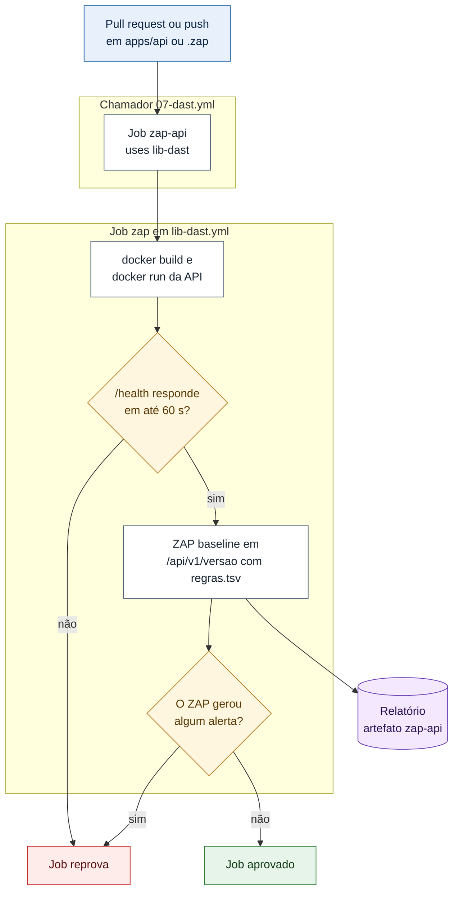
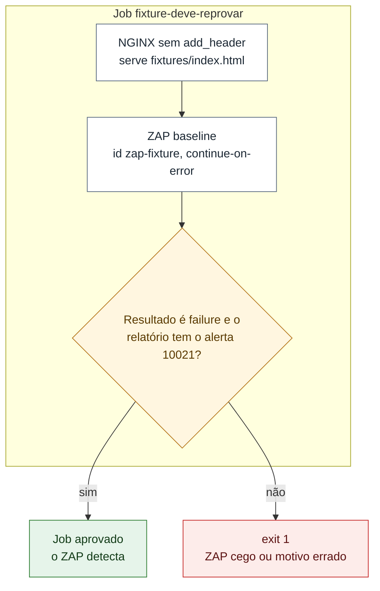

# Análise dinâmica de segurança com OWASP ZAP

## Problema que a prática resolve

A análise estática do cenário 06 lê o código-fonte e não enxerga o que só existe com a aplicação em execução. Um cabeçalho de segurança ausente na resposta HTTP depende da configuração do servidor e da imagem de contêiner, o que uma varredura do repositório não alcança. A análise dinâmica de segurança, conhecida pela sigla DAST e originada do termo inglês *dynamic application security testing*, envia requisições a uma instância em execução. Ela examina as respostas como um atacante externo faria e por isso depende de uma aplicação já iniciada pela esteira.

O OWASP ZAP, ferramenta de código aberto da fundação OWASP, oferece o modo *baseline*. Ele rastreia a aplicação por poucos minutos e executa apenas verificações passivas, que examinam as respostas sem enviar cargas de ataque. Esse modo é seguro para rodar em toda alteração, porque não altera dados nem sobrecarrega o serviço.

## Workflow do cenário

O diagrama a seguir mostra o caminho do job `zap-api`, do gatilho ao resultado. O *workflow* `07-dast.yml` roda em *pull request* e em *push* para o `main` quando mudam `apps/api/`, `.zap/`, a pasta do cenário ou o próprio arquivo. Ele declara apenas a permissão `contents: read` no nível superior e contém dois jobs, chamados `zap-api` e `fixture-deve-reprovar`. Nenhum desses nomes coincide com as verificações obrigatórias do *ruleset* do cenário 02.



### O chamador e a biblioteca lib-dast.yml

O job `zap-api` chama o *workflow* reutilizável `lib-dast.yml`, apresentado no [cenário 12](../../docs/cenarios/12.md).

Arquivo completo: [`.github/workflows/07-dast.yml`, linhas 4 a 37](https://github.com/arkhibr/devops-fluxos-c3dm/blob/main/.github/workflows/07-dast.yml#L4-L37).

```yaml
  pull_request:
    paths:
      - apps/api/**
      - .zap/**
      - cenarios/07-seguranca-dinamica/**
      - .github/workflows/07-dast.yml
      - .github/workflows/lib-dast.yml
      - .github/actions/resumo-falha/**
  push:
# ...
permissions:
  contents: read

concurrency:
  group: 07-dast-${{ github.ref }}
  cancel-in-progress: true

jobs:
  zap-api:
    uses: ./.github/workflows/lib-dast.yml
    with:
      contexto-docker: apps/api
      porta: 8080
      caminho-health: /health
      alvo: http://localhost:8080/api/v1/versao
      regras-zap: .zap/regras.tsv
```

O filtro de caminhos inclui o próprio arquivo e a biblioteca, de modo que uma alteração só em um dos YAML dispara a execução. O grupo de `concurrency` com `cancel-in-progress` cancela a varredura anterior da mesma referência quando chega um novo *push*. As entradas informam a pasta do `Dockerfile`, a porta e o caminho de *health*, além do alvo da varredura e do arquivo de regras. Em nome do job, a biblioteca constrói a imagem de `apps/api` e inicia o contêiner.

Arquivo completo: [`.github/workflows/lib-dast.yml`, linhas 42 a 65](https://github.com/arkhibr/devops-fluxos-c3dm/blob/main/.github/workflows/lib-dast.yml#L42-L65).

```yaml
      - uses: actions/checkout@11bd71901bbe5b1630ceea73d27597364c9af683  # v4.2.2
      - name: Construir a imagem da aplicação
        env:
          CONTEXTO: ${{ inputs.contexto-docker }}
        run: docker build -t app-dast "$CONTEXTO"
      - name: Subir a aplicação no executor
        env:
          PORTA: ${{ inputs.porta }}
        run: docker run -d --name app-dast -p "${PORTA}:${PORTA}" app-dast
      - name: Esperar o health por até 60 segundos
        env:
          PORTA: ${{ inputs.porta }}
          CAMINHO: ${{ inputs.caminho-health }}
        run: |
          for tentativa in $(seq 1 60); do
            if curl -sf "http://localhost:${PORTA}${CAMINHO}" > /dev/null; then
              echo "Aplicação saudável após ${tentativa} tentativa(s)."
              exit 0
            fi
            sleep 1
          done
          echo "::error::A aplicação não ficou saudável em 60 segundos. Logs do contêiner:"
          docker logs app-dast
          exit 1
```

O passo de espera tenta o endereço de *health* uma vez por segundo, por até 60 segundos. Se a API não responder nesse prazo, o passo imprime os registros do contêiner com `docker logs` e falha. Esse comportamento separa uma API que não subiu de uma varredura sem alertas. A varredura em si ocorre no passo apresentado a seguir, que monta o alvo, as regras e a opção de reprovação a partir das entradas da biblioteca.

Arquivo completo: [`.github/workflows/lib-dast.yml`, linhas 66 a 89](https://github.com/arkhibr/devops-fluxos-c3dm/blob/main/.github/workflows/lib-dast.yml#L66-L89).

```yaml
      - name: Verificar o arquivo de regras do ZAP
        id: regras
        env:
          REGRAS: ${{ inputs.regras-zap }}
        run: |
          if [ -n "$REGRAS" ] && [ ! -f "$REGRAS" ]; then
            echo "::warning::Arquivo de regras '$REGRAS' ausente. O ZAP roda sem regras."
            echo "arquivo=" >> "$GITHUB_OUTPUT"
          else
            echo "arquivo=$REGRAS" >> "$GITHUB_OUTPUT"
          fi
      - name: ZAP baseline contra a aplicação em execução
        uses: zaproxy/action-baseline@de8ad967d3548d44ef623df22cf95c3b0baf8b25  # v0.15.0
        with:
          target: ${{ inputs.alvo }}
          rules_file_name: ${{ steps.regras.outputs.arquivo }}
          fail_action: true
          allow_issue_writing: false
          artifact_name: ${{ inputs.nome-artefato }}
      - name: Resumir a falha
        if: ${{ failure() }}
        uses: arkhibr/devops-fluxos-c3dm/.github/actions/resumo-falha@v1
        with:
          etapa: ZAP baseline contra ${{ inputs.alvo }}
```

O passo `regras` emite um aviso e roda sem regras quando o caminho informado não existe, sem interromper a execução. A *action* `zaproxy/action-baseline` é fixada por SHA e varre o endereço `http://localhost:8080/api/v1/versao`. A opção `fail_action: true` reprova o job quando o ZAP gera qualquer alerta. O parâmetro `allow_issue_writing: false` impede que a *action* abra *issues* no repositório e dispensa a permissão `issues: write`. O relatório da varredura permanece anexado à execução com o nome de artefato `zap-api`.

### Regras rebaixadas com justificativa

O arquivo `.zap/regras.tsv` permite rebaixar uma regra do ZAP. Cada linha tem três colunas separadas por tabulação, que são o identificador da regra, a ação e a justificativa.

Arquivo completo: [`.zap/regras.tsv`, linhas 1 a 3](https://github.com/arkhibr/devops-fluxos-c3dm/blob/main/.zap/regras.tsv#L1-L3).

```text
# Regras do ZAP baseline, uma por linha, separadas por tabulação: id, ação, justificativa.
# Só se rebaixa uma regra com justificativa no terceiro campo da mesma linha.
10049	IGNORE	Alerta informativo de conteúdo não armazenável em cache. A API responde Cache-Control no-store de propósito, e corrigir seria enfraquecer o cabeçalho.
```

A única regra rebaixada é a `10049`, um alerta informativo sobre conteúdo não armazenável em cache. A API responde `Cache-Control: no-store` de propósito, motivo pelo qual corrigir o alerta enfraqueceria esse cabeçalho de segurança do serviço. O teste `test_regras_tem_justificativa` exige que toda linha ativa traga a justificativa no terceiro campo da mesma linha do arquivo.

A preferência do cenário é corrigir a API em vez de rebaixar a regra. Por isso o *middleware* `CabecalhosSeguranca` acrescenta a toda resposta seis cabeçalhos de segurança, com cobertura de teste no projeto `Api.Tests`.

### Fixture que deve reprovar

O job `fixture-deve-reprovar` prova que o ZAP detecta o problema. Ele serve `fixtures/index.html` com um NGINX configurado sem nenhum `add_header` e roda o mesmo ZAP baseline em um passo com `id: zap-fixture` e `continue-on-error: true`.

Arquivo completo: [`cenarios/07-seguranca-dinamica/fixtures/nginx-sem-cabecalhos.conf`, linhas 1 a 6](https://github.com/arkhibr/devops-fluxos-c3dm/blob/main/cenarios/07-seguranca-dinamica/fixtures/nginx-sem-cabecalhos.conf#L1-L6).

```text
# Servidor propositalmente sem cabeçalhos de segurança.
server {
    listen 80;
    root /usr/share/nginx/html;
    index index.html;
}
```

A configuração define a porta, a pasta raiz e a página inicial sem nenhum cabeçalho de segurança, o que dá ao ZAP defeitos garantidos para apontar durante a varredura. O trecho do *workflow* a seguir mostra a varredura e a verificação que exige o alerta esperado.

Arquivo completo: [`.github/workflows/07-dast.yml`, linhas 60 a 81](https://github.com/arkhibr/devops-fluxos-c3dm/blob/main/.github/workflows/07-dast.yml#L60-L81).

```yaml
      - name: ZAP baseline contra o fixture
        id: zap-fixture
        continue-on-error: true
        uses: zaproxy/action-baseline@de8ad967d3548d44ef623df22cf95c3b0baf8b25  # v0.15.0
        with:
          target: http://localhost:8080/
          fail_action: true
          allow_issue_writing: false
          artifact_name: zap-fixture
      - name: Exigir que o ZAP tenha reprovado pelo motivo esperado
        env:
          ZAP_OUTCOME: ${{ steps.zap-fixture.outcome }}
        run: |
          if [ "$ZAP_OUTCOME" != "failure" ]; then
            echo "::error::O ZAP deveria reprovar o fixture, mas terminou com resultado '$ZAP_OUTCOME'."
            exit 1
          fi
          if ! jq -e 'any(.site[].alerts[]; .pluginid == "10021")' report_json.json > /dev/null; then
            echo "::error::O ZAP reprovou, mas o relatório não contém o alerta 10021 (X-Content-Type-Options ausente)."
            exit 1
          fi
          echo "O ZAP reprovou pelo motivo esperado."
```

O passo final exige duas condições. A primeira é que o resultado do ZAP seja `failure`. A segunda é que o relatório JSON gravado pela *action* em `report_json.json` contenha o alerta de identificador `10021`, que indica a ausência do cabeçalho `X-Content-Type-Options`. A segunda condição impede que uma porta errada ou uma falha ao baixar a imagem do ZAP façam o job passar por um motivo inesperado. O resultado só vale quando o ZAP aponta o defeito que o *fixture* contém.



### Arquivos do cenário

| Arquivo | Papel |
| --- | --- |
| [`.github/workflows/07-dast.yml`](https://github.com/arkhibr/devops-fluxos-c3dm/blob/main/.github/workflows/07-dast.yml) | Chamador do ZAP sobre a API e job do *fixture*. |
| [`.github/workflows/lib-dast.yml`](https://github.com/arkhibr/devops-fluxos-c3dm/blob/main/.github/workflows/lib-dast.yml) | Biblioteca que sobe a aplicação, espera o *health* e roda o ZAP. |
| [`.zap/regras.tsv`](https://github.com/arkhibr/devops-fluxos-c3dm/blob/main/.zap/regras.tsv) | Regras rebaixadas, cada uma com justificativa. |
| [`cenarios/07-seguranca-dinamica/fixtures/nginx-sem-cabecalhos.conf`](https://github.com/arkhibr/devops-fluxos-c3dm/blob/main/cenarios/07-seguranca-dinamica/fixtures/nginx-sem-cabecalhos.conf) | Configuração do NGINX sem cabeçalhos de segurança. |
| [`cenarios/07-seguranca-dinamica/fixtures/index.html`](https://github.com/arkhibr/devops-fluxos-c3dm/blob/main/cenarios/07-seguranca-dinamica/fixtures/index.html) | Página servida pelo *fixture*. |
| [`tests/pipelines/test_07_dast.py`](https://github.com/arkhibr/devops-fluxos-c3dm/blob/main/tests/pipelines/test_07_dast.py) | Testes estruturais do *workflow*, das regras e do *fixture*. |

## Como executar

1. Construa e suba a API com `docker build -t api-dast apps/api` e `docker run -d -p 8080:8080 api-dast`. Confirme com `curl -i http://localhost:8080/health` que a resposta traz os cabeçalhos de segurança.
2. Rode o ZAP baseline com `docker run --rm --network host -v "$PWD:/zap/wrk:rw" ghcr.io/zaproxy/zaproxy:stable zap-baseline.py -t http://localhost:8080/api/v1/versao -c .zap/regras.tsv`. A saída lista as regras aprovadas e os alertas encontrados.
3. Pare a API e suba o fixture com `docker run -d -p 8080:80 -v "$PWD/cenarios/07-seguranca-dinamica/fixtures/nginx-sem-cabecalhos.conf:/etc/nginx/conf.d/default.conf:ro" -v "$PWD/cenarios/07-seguranca-dinamica/fixtures/index.html:/usr/share/nginx/html/index.html:ro" nginx:1.27-alpine`. Repita o comando do passo anterior sem o argumento `-c` e observe os alertas de cabeçalhos ausentes.
4. Abra um *pull request* que altere `apps/api/` e baixe o artefato `zap-api` da execução para ler o relatório em HTML.

## Como levar a prática a um sistema existente

1. Escolha um ambiente descartável criado pela própria esteira. Evite ambiente compartilhado ou de produção. O ZAP baseline é passivo. Ainda assim o rastreador segue *links* e pode gerar muitas requisições de leitura.
2. Rode o ZAP uma primeira vez sem `fail_action` e leia o relatório completo. Corrija na aplicação o que for defeito real, como um cabeçalho ausente. Ative a reprovação somente depois disso.
3. Registre em `.zap/regras.tsv` cada regra rebaixada com a justificativa na mesma linha, por exemplo uma regra que não se aplica a uma API sem HTML. Uma exceção sem justificativa esconde o risco.
4. Informe ao ZAP uma descrição da API em OpenAPI, usando o modo `zap-api-scan.py`, quando a aplicação for apenas uma API. O rastreamento de *links* não descobre rotas que nenhuma página referencia.
5. Mantenha um *fixture* com defeito conhecido para comprovar que a varredura continua detectando problemas depois de atualizações do ZAP.
6. Torne o job uma verificação obrigatória do *ruleset* do ramo principal, conforme o cenário 02.

## Nível C3DM e fontes

O repositório agrupa o cenário no nível Intermediário, junto das demais verificações de segurança do ciclo de desenvolvimento. O modelo C3DM situa os testes de segurança no nível Avançado do domínio de teste. A página da [trilha](../../docs/trilha.md) explica essa diferença de agrupamento na seção sobre o nível dos cenários de segurança.

As fontes são a documentação do ZAP baseline (https://www.zaproxy.org/docs/docker/baseline-scan/), a da *action* `zaproxy/action-baseline` (https://github.com/zaproxy/action-baseline) e o projeto OWASP Web Security Testing Guide (https://owasp.org/www-project-web-security-testing-guide/). O texto do modelo está na [bibliografia](../../docs/referencia/bibliografia.md).
