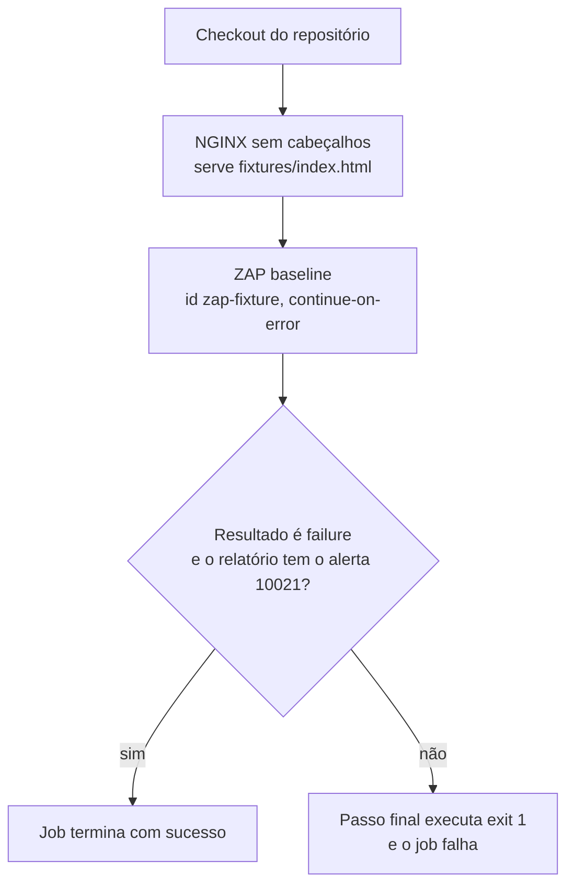

# Análise dinâmica de segurança com OWASP ZAP

## Problema que a prática resolve

A análise estática do cenário 06 lê o código-fonte e não enxerga o que só existe com a aplicação em execução. Um cabeçalho de segurança ausente na resposta HTTP depende da configuração do servidor e da imagem de contêiner, o que uma varredura do repositório não alcança. A análise dinâmica de segurança, conhecida pela sigla DAST e originada do termo inglês *dynamic application security testing*, envia requisições a uma instância em execução. Ela examina as respostas como um atacante externo faria e por isso depende de uma aplicação já iniciada pela esteira.

O OWASP ZAP, ferramenta de código aberto da fundação OWASP, oferece o modo *baseline*. Ele rastreia a aplicação por poucos minutos e executa apenas verificações passivas, que examinam as respostas sem enviar cargas de ataque. Esse modo é seguro para rodar em toda alteração, porque não altera dados nem sobrecarrega o serviço.

## Workflow do cenário

O *workflow* `07-dast.yml` roda em *pull request* e em *push* para o `main` quando mudam `apps/api/`, `.zap/`, a pasta do cenário ou o próprio arquivo. Ele declara apenas a permissão `contents: read` no nível superior e contém dois jobs, chamados `zap-api` e `fixture-deve-reprovar`. Nenhum desses nomes coincide com as verificações obrigatórias `pytest`, `actionlint`, `build` ou `titulo`. O filtro de caminhos inclui o próprio arquivo, de modo que uma alteração apenas no YAML também dispara a execução.

O job `zap-api` constrói a imagem de `apps/api` com `docker build` e inicia o contêiner na porta 8080. Em seguida aguarda a resposta de `/health` por até 60 segundos, com uma tentativa por segundo. Se a API não responder nesse prazo, o passo imprime os registros do contêiner com `docker logs` e falha. A *action* `zaproxy/action-baseline` é fixada por SHA e varre então o endereço `http://localhost:8080/api/v1/versao` com `fail_action: true`. Essa opção reprova o job quando o ZAP gera qualquer alerta. O parâmetro `allow_issue_writing: false` impede que a *action* abra *issues* no repositório e dispensa a permissão `issues: write`. O relatório da varredura permanece anexado à execução com o nome de artefato `zap-api`.

O arquivo `.zap/regras.tsv` permite rebaixar uma regra do ZAP. Cada linha tem três colunas separadas por tabulação, que são o identificador da regra, a ação e a justificativa. O teste `test_regras_tem_justificativa` exige que toda linha ativa traga a justificativa no terceiro campo. A preferência do cenário é corrigir a API em vez de rebaixar a regra. Por isso o *middleware* `CabecalhosSeguranca` acrescenta a toda resposta seis cabeçalhos, com cobertura de teste em `Api.Tests`. A única regra rebaixada é a `10049`, que apenas informa que a resposta não pode ser armazenada em cache, comportamento desejado com `Cache-Control: no-store`.

O job `fixture-deve-reprovar` prova que o ZAP detecta o problema. Ele serve `fixtures/index.html` com um NGINX configurado sem nenhum `add_header` e roda o mesmo ZAP baseline em um passo com `id: zap-fixture` e `continue-on-error: true`. O passo final falha se o resultado do ZAP não for `failure`. Ele também falha se o relatório JSON não contiver o alerta de identificador `10021`, que indica a ausência do cabeçalho `X-Content-Type-Options`. Essa segunda condição impede que uma porta errada ou uma falha ao baixar a imagem do ZAP façam o job passar por um motivo que não é o esperado.

## Como executar

1. Construa e suba a API com `docker build -t api-dast apps/api` e `docker run -d -p 8080:8080 api-dast`. Confirme com `curl -i http://localhost:8080/health` que a resposta traz os cabeçalhos de segurança.
2. Rode o ZAP baseline com `docker run --rm --network host -v "$PWD:/zap/wrk:rw" ghcr.io/zaproxy/zaproxy:stable zap-baseline.py -t http://localhost:8080/api/v1/versao -c .zap/regras.tsv`. A saída lista as regras aprovadas e os alertas encontrados.
3. Pare a API e suba o fixture com `docker run -d -p 8080:80 -v "$PWD/cenarios/07-seguranca-dinamica/fixtures/nginx-sem-cabecalhos.conf:/etc/nginx/conf.d/default.conf:ro" -v "$PWD/cenarios/07-seguranca-dinamica/fixtures/index.html:/usr/share/nginx/html/index.html:ro" nginx:1.27-alpine`. Repita o comando do passo anterior sem o argumento `-c` e observe os alertas de cabeçalhos ausentes.
4. Abra um *pull request* que altere `apps/api/` e baixe o artefato `zap-api` da execução para ler o relatório em HTML.

## Como levar a prática a um sistema existente

1. Escolha um ambiente descartável criado pela própria esteira. Evite ambiente compartilhado ou de produção. O ZAP baseline é passivo. Ainda assim o rastreador segue *links* e pode gerar muitas requisições de leitura.
2. Rode o ZAP uma primeira vez sem `fail_action` e leia o relatório completo. Corrija na aplicação o que for defeito real, como um cabeçalho ausente. Ative a reprovação somente depois disso.
3. Registre em `.zap/regras.tsv` cada regra rebaixada com a justificativa na mesma linha, por exemplo uma regra que não se aplica a uma API sem HTML. Uma exceção sem justificativa esconde o risco.
4. Informe ao ZAP uma descrição da API em OpenAPI, usando o modo `zap-api-scan.py`, quando a aplicação for apenas uma API. O rastreamento de *links* não descobre rotas que nenhuma página referencia.
5. Mantenha um *fixture* com defeito conhecido para comprovar que a varredura continua detectando problemas depois de atualizações do ZAP.
6. Torne o job uma verificação obrigatória do *ruleset* do ramo principal, conforme o cenário 02.

## Nível C3DM e fontes

O repositório agrupa o cenário no nível Intermediário, junto das demais verificações de segurança do ciclo de desenvolvimento. O modelo C3DM situa os testes de segurança no nível Avançado do domínio de teste. A página da [trilha](../../docs/trilha.md) explica essa diferença de agrupamento na seção sobre o nível dos cenários de segurança.

As fontes são a documentação do ZAP baseline (https://www.zaproxy.org/docs/docker/baseline-scan/), a da *action* `zaproxy/action-baseline` (https://github.com/zaproxy/action-baseline) e o projeto OWASP Web Security Testing Guide (https://owasp.org/www-project-web-security-testing-guide/). O texto do modelo está na [bibliografia](../../docs/referencia/bibliografia.md).
