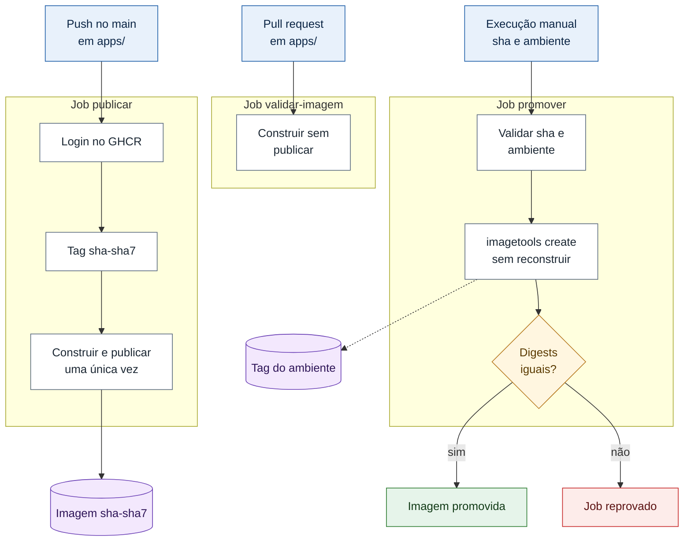
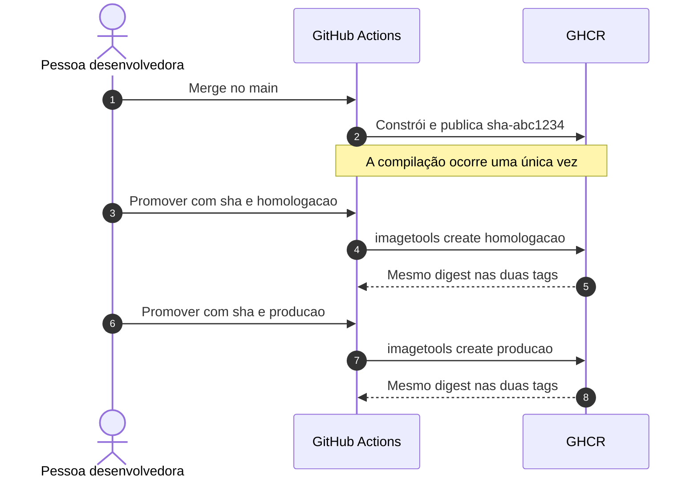

# Artefato único em imagem de contêiner promovida sem recompilação

## Problema que a prática resolve

Quando cada ambiente recebe uma compilação própria do mesmo código, o que foi testado em homologação deixa de ser o que chega à produção. Uma dependência que mudou de versão entre duas compilações, uma variável de ambiente lida na hora errada ou uma diferença na imagem-base do sistema operacional produzem binários distintos a partir do mesmo *commit*. A prática do artefato único, descrita por Jez Humble e David Farley no livro *Continuous Delivery*, exige que o pacote seja construído uma vez e que o mesmo pacote percorra todos os ambientes.

Neste repositório o artefato é uma imagem de contêiner, que reúne a aplicação e suas dependências em um único arquivo executável por qualquer servidor com Docker. As imagens ficam no GHCR, sigla de *GitHub Container Registry*, o registro de imagens do GitHub. Cada imagem recebe uma *tag*, que é um rótulo legível apontando para um conteúdo identificado por um *digest*. O *digest* é o *hash* SHA-256 do manifesto da imagem e muda sempre que o conteúdo muda. A promoção entre ambientes consiste em criar uma nova *tag* sobre o mesmo *digest*, operação que não executa nenhuma compilação.

## Workflow do cenário

O *workflow* `08-artefato.yml` declara no nível superior a permissão `contents: read` e a variável `REGISTRO` com o prefixo `ghcr.io/arkhibr/devops-fluxos-c3dm`. Cada imagem acrescenta a esse prefixo o sufixo do componente e recebe o nome `devops-fluxos-c3dm-api` ou `devops-fluxos-c3dm-web` no registro. Ele contém os *jobs* `validar-imagem`, `publicar` e `promover`, que não coincidem com as verificações obrigatórias do repositório. O diagrama mostra os três gatilhos do *workflow* e o caminho de cada um até o registro GHCR.



A sequência entre a pessoa que desenvolve, o GitHub Actions e o registro mostra por que a promoção não compila nada. A imagem é construída uma vez no *merge* e as *tags* de ambiente apenas apontam para o mesmo conteúdo.



### Gatilhos e controle de concorrência

Os filtros de caminho de `pull_request` e de `push` incluem `apps/`, a pasta do cenário e o próprio arquivo do *workflow*, de modo que uma alteração apenas no YAML também dispara a execução. A promoção é manual e recebe duas entradas.

Arquivo completo: [`.github/workflows/08-artefato.yml`, linhas 15 a 34](https://github.com/arkhibr/devops-fluxos-c3dm/blob/main/.github/workflows/08-artefato.yml#L15-L34).

```yaml
  workflow_dispatch:
    inputs:
      sha:
        description: Prefixo de 7 a 40 caracteres hexadecimais do commit cuja imagem será promovida
        required: true
        type: string
      ambiente:
        description: Ambiente que recebe a tag
        required: true
        type: choice
        options:
          - homologacao
          - producao
# ...
concurrency:
  group: ${{ github.event_name == 'workflow_dispatch' && format('promocao-{0}', inputs.ambiente) || format('08-artefato-{0}', github.ref) }}
  cancel-in-progress: ${{ github.event_name == 'pull_request' }}
```

A entrada `ambiente` é uma lista de escolha com os valores `homologacao` e `producao`, o que impede um nome livre. O grupo de *concurrency* se chama `promocao-<ambiente>` nas execuções manuais e `08-artefato-<ref>` nas demais. Uma promoção pendente não é substituída por uma execução de publicação e duas promoções para o mesmo ambiente se enfileiram em vez de se cancelarem. O cancelamento da execução anterior vale apenas para *pull requests*, pela expressão de `cancel-in-progress`.

### Publicação da imagem única

O job `publicar` roda somente em *push* para o `main`. O trecho mostra a condição de execução, a permissão de escrita no registro e os dois passos que nomeiam e constroem a imagem.

Arquivo completo: [`.github/workflows/08-artefato.yml`, linhas 56 a 89](https://github.com/arkhibr/devops-fluxos-c3dm/blob/main/.github/workflows/08-artefato.yml#L56-L89).

```yaml
  publicar:
    if: github.event_name == 'push' && github.ref == 'refs/heads/main'
    runs-on: ubuntu-latest
    permissions:
      contents: read
      packages: write
      # ...
      - name: Calcular a tag sha-<sha7>
        id: meta
        uses: docker/metadata-action@dc802804100637a589fabce1cb79ff13a1411302  # v6.2.0
        with:
          images: ${{ env.REGISTRO }}-${{ matrix.componente }}
          tags: type=sha,prefix=sha-,format=short
      - name: Construir e publicar a imagem uma única vez
        uses: docker/build-push-action@c3c9e263c25d99ce0380d002d59b67737d91b0dc  # v7.4.0
        with:
          context: apps/${{ matrix.componente }}
          push: true
          tags: ${{ steps.meta.outputs.tags }}
          labels: |
            ${{ steps.meta.outputs.labels }}
            org.opencontainers.image.source=https://github.com/arkhibr/devops-fluxos-c3dm
```

A permissão de escrita no registro existe apenas neste *job*, enquanto o *job* `validar-imagem` roda sem publicar e com acesso somente de leitura, porque um *pull request* de um *fork* recebe um `GITHUB_TOKEN` sem permissão de escrita. O passo com `docker/metadata-action` calcula a *tag* `sha-<sha7>` a partir dos sete primeiros caracteres do *commit*. O passo seguinte constrói e publica a imagem com `push: true`, o que representa a única compilação do ciclo de entrega. O *label* `org.opencontainers.image.source` associa o pacote ao repositório no GHCR, que então herda as permissões dele. Nenhuma *tag* `latest` é criada, porque uma *tag* móvel esconde qual versão está em execução. A matriz com `api` e `web` repete o *job* para as duas imagens publicadas no GHCR.

### Promoção sem recompilação

O job `promover` roda somente por `workflow_dispatch` no `main`. As entradas passam ao *shell* por variáveis de ambiente e nunca por interpolação direta de `${{ inputs.* }}` no script, o que impede que um valor malicioso seja executado como comando.

Arquivo completo: [`.github/workflows/08-artefato.yml`, linhas 91 a 122](https://github.com/arkhibr/devops-fluxos-c3dm/blob/main/.github/workflows/08-artefato.yml#L91-L122).

```yaml
  promover:
    if: github.event_name == 'workflow_dispatch' && github.ref == 'refs/heads/main'
    runs-on: ubuntu-latest
    permissions:
      contents: read
      packages: write
      # ...
      - name: Validar as entradas
        id: entradas
        env:
          SHA_ENTRADA: ${{ inputs.sha }}
          AMBIENTE_ENTRADA: ${{ inputs.ambiente }}
        run: |
          if ! [[ "$SHA_ENTRADA" =~ ^[0-9a-f]{7,40}$ ]]; then
            echo "::error::O sha deve ter de 7 a 40 caracteres hexadecimais em minúsculas."
            exit 1
          fi
          case "$AMBIENTE_ENTRADA" in
            homologacao | producao) ;;
            *)
              echo "::error::Ambiente inválido. Use homologacao ou producao."
              exit 1
              ;;
          esac
          echo "sha7=${SHA_ENTRADA:0:7}" >> "$GITHUB_OUTPUT"
```

O bloco `env` associa cada entrada a uma variável de ambiente que o *script* lê, de modo que nenhum valor digitado pela pessoa chega ao *shell* como parte do texto do comando. A expressão regular exige de sete a quarenta caracteres hexadecimais em minúsculas e o comando `case` aceita somente os dois nomes de ambiente previstos no cenário 08. O passo grava os sete primeiros caracteres do *sha* no arquivo `GITHUB_OUTPUT` para uso pelos passos seguintes do *job* de promoção.

Arquivo completo: [`.github/workflows/08-artefato.yml`, linhas 123 a 142](https://github.com/arkhibr/devops-fluxos-c3dm/blob/main/.github/workflows/08-artefato.yml#L123-L142).

```yaml
      - name: Criar a tag do ambiente sobre a mesma imagem, sem reconstruir
        env:
          SHA7: ${{ steps.entradas.outputs.sha7 }}
          AMBIENTE_ENTRADA: ${{ inputs.ambiente }}
        run: |
          for componente in api web; do
            imagem="${REGISTRO}-${componente}"
            docker buildx imagetools create -t "${imagem}:${AMBIENTE_ENTRADA}" "${imagem}:sha-${SHA7}"
          done
          # ...
          for componente in api web; do
            imagem="${REGISTRO}-${componente}"
            origem=$(docker buildx imagetools inspect "${imagem}:sha-${SHA7}" --format '{{json .Manifest.Digest}}')
            destino=$(docker buildx imagetools inspect "${imagem}:${AMBIENTE_ENTRADA}" --format '{{json .Manifest.Digest}}')
            echo "${componente}: sha-${SHA7}=${origem} ${AMBIENTE_ENTRADA}=${destino}"
            [ "$origem" = "$destino" ] || { echo "::error::Digests diferentes em ${componente}."; exit 1; }
```

O comando `docker buildx imagetools create` copia o manifesto no registro sem baixar camadas e sem compilar, de modo que a nova *tag* aponta para o mesmo conteúdo da `sha-<sha7>`. O passo de conferência compara os *digests* das duas *tags* e falha se algum deles diferir. Essa comparação transforma a promessa do artefato único em uma verificação executada a cada promoção.

### Arquivos do cenário

| Arquivo | Papel |
| --- | --- |
| [`.github/workflows/08-artefato.yml`](https://github.com/arkhibr/devops-fluxos-c3dm/blob/main/.github/workflows/08-artefato.yml) | *Workflow* com os jobs de validação, publicação e promoção. |
| [`apps/api/Dockerfile`](https://github.com/arkhibr/devops-fluxos-c3dm/blob/main/apps/api/Dockerfile) | Receita da imagem da API. |
| [`apps/web/Dockerfile`](https://github.com/arkhibr/devops-fluxos-c3dm/blob/main/apps/web/Dockerfile) | Receita da imagem da aplicação web. |
| [`tests/pipelines/test_08_artefato.py`](https://github.com/arkhibr/devops-fluxos-c3dm/blob/main/tests/pipelines/test_08_artefato.py) | Testes estruturais do *workflow*. |

## Como executar

1. Faça um *push* no `main` que altere `apps/` ou abra e conclua um *pull request*. Acompanhe com `gh run watch` a execução do *workflow* `08 Artefato único` e confirme que o job `publicar` terminou com sucesso para os dois componentes.
2. Liste as *tags* publicadas com `gh api /orgs/arkhibr/packages/container/devops-fluxos-c3dm-api/versions --jq '.[].metadata.container.tags'`. A resposta contém a *tag* `sha-<sha7>` do *commit* publicado.
3. Promova para homologação com `gh workflow run 08-artefato.yml -f sha=<sha7> -f ambiente=homologacao`. Depois repita com `-f ambiente=producao` quando a homologação for aprovada.
4. Confira o resultado com `docker buildx imagetools inspect ghcr.io/arkhibr/devops-fluxos-c3dm-api:homologacao`. O *digest* exibido é igual ao de `ghcr.io/arkhibr/devops-fluxos-c3dm-api:sha-<sha7>`.
5. Torne os pacotes públicos em *Package settings* e *Change visibility*, para que qualquer pessoa consiga executar `docker pull` sem autenticação. O GitHub não oferece ponto de acesso estável na API REST para essa alteração.

## Como levar a prática a um sistema existente

1. Identifique onde o sistema hoje compila uma vez por ambiente e mova a compilação para um único job disparado pelo ramo principal. O resultado desse job é o único artefato candidato a implantação.
2. Retire do artefato toda configuração de ambiente, como endereços de banco de dados e chaves. A configuração entra na hora da execução, por variáveis de ambiente ou por arquivos montados, pois um valor gravado na imagem obriga a reconstruir para cada ambiente.
3. Nomeie o artefato pelo identificador do *commit*, nunca por um rótulo móvel como `latest`. A rastreabilidade entre o código e o que roda em produção depende dessa correspondência direta.
4. Troque a etapa de implantação de cada ambiente por uma promoção de *tag* no registro e registre o *digest* implantado. Se o sistema não usa contêineres, a mesma lógica vale para um pacote em repositório de artefatos, com a versão no nome do arquivo.
5. Restrinja a permissão de escrita no registro aos jobs de publicação e de promoção e proteja a execução manual com *environments*, tema do cenário 09.

## Nível C3DM e fontes

O repositório agrupa o cenário no nível Intermediário, junto da implantação automática e dos ambientes do cenário 09. A página da [trilha](../../docs/trilha.md) explica como o agrupamento do repositório se relaciona com os níveis do modelo.

As fontes são a documentação do GHCR (https://docs.github.com/packages/working-with-a-github-packages-registry/working-with-the-container-registry), a da ferramenta `docker buildx imagetools` (https://docs.docker.com/reference/cli/docker/buildx/imagetools/) e o capítulo sobre o *pipeline* de implantação do livro de Humble e Farley. O texto do modelo e a referência do livro estão na [bibliografia](../../docs/referencia/bibliografia.md).
