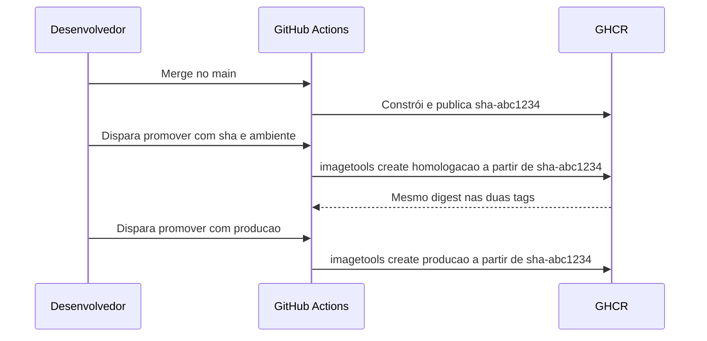

# Artefato único em imagem de contêiner promovida sem recompilação

## Problema que a prática resolve

Quando cada ambiente recebe uma compilação própria do mesmo código, o que foi testado em homologação deixa de ser o que chega à produção. Uma dependência que mudou de versão entre duas compilações, uma variável de ambiente lida na hora errada ou uma diferença na imagem-base do sistema operacional produzem binários distintos a partir do mesmo *commit*. A prática do artefato único, descrita por Jez Humble e David Farley no livro *Continuous Delivery*, exige que o pacote seja construído uma vez e que o mesmo pacote percorra todos os ambientes.

Neste repositório o artefato é uma imagem de contêiner, que reúne a aplicação e suas dependências em um único arquivo executável por qualquer servidor com Docker. As imagens ficam no GHCR, sigla de *GitHub Container Registry*, o registro de imagens do GitHub. Cada imagem recebe uma *tag*, que é um rótulo legível apontando para um conteúdo identificado por um *digest*. O *digest* é o *hash* SHA-256 do manifesto da imagem e muda sempre que o conteúdo muda. A promoção entre ambientes consiste em criar uma nova *tag* sobre o mesmo *digest*, operação que não executa nenhuma compilação.

## Workflow do cenário

O *workflow* `08-artefato.yml` declara no nível superior somente a permissão `contents: read` e a variável `REGISTRO`, que guarda o prefixo `ghcr.io/arkhibr/devops-fluxos-c3dm`. Cada imagem acrescenta a esse prefixo o sufixo do componente e recebe o nome `devops-fluxos-c3dm-api` ou `devops-fluxos-c3dm-web` no registro. Ele contém três jobs chamados `validar-imagem`, `publicar` e `promover`. Esses nomes não coincidem com as verificações obrigatórias `pytest`, `actionlint`, `build` ou `titulo`. Os filtros de caminho de `pull_request` e de `push` incluem `apps/`, a pasta do cenário e o próprio arquivo do *workflow*, de modo que uma alteração apenas no YAML também dispara a execução.

O job `validar-imagem` roda somente em *pull request*. Ele constrói as duas imagens por uma matriz com os componentes `api` e `web`, usando `docker/build-push-action` com `push: false`. A construção prova que os *Dockerfiles* continuam válidos e não exige autenticação nem permissão de escrita, porque um *pull request* vindo de um *fork* recebe um `GITHUB_TOKEN` somente de leitura.

O job `publicar` roda somente em *push* para o `main`, protegido pela condição `github.event_name == 'push' && github.ref == 'refs/heads/main'`. Ele declara `packages: write` apenas nesse job. Depois de autenticar no GHCR com `docker/login-action` e o `GITHUB_TOKEN`, o passo com `docker/metadata-action` calcula a *tag* `sha-<sha7>`, formada pelos sete primeiros caracteres do *commit*. O passo seguinte constrói e publica a imagem uma única vez. Além dos rótulos gerados pelo metadata, o passo acrescenta o *label* `org.opencontainers.image.source`, que o GHCR usa para associar o pacote ao repositório e herdar suas permissões. Nenhuma *tag* `latest` é criada, porque uma *tag* móvel esconde qual versão está em execução.

O job `promover` roda somente por `workflow_dispatch` no `main`, com as entradas `sha` e `ambiente`. A entrada `ambiente` é uma lista de escolha com os valores `homologacao` e `producao`. As entradas passam ao *shell* por variáveis de ambiente e nunca por interpolação direta de `${{ inputs.* }}` no script, o que impede que um valor malicioso seja executado como comando. O primeiro passo valida que `sha` tem de sete a quarenta caracteres hexadecimais e que `ambiente` é um dos dois valores aceitos. O passo seguinte executa `docker buildx imagetools create -t <imagem>:<ambiente> <imagem>:sha-<sha7>` para a API e para a aplicação web. Esse comando copia o manifesto no registro sem baixar camadas e sem compilar. O último passo compara os *digests* da *tag* de origem e da *tag* do ambiente e falha se algum deles diferir. O grupo de *concurrency* do *workflow* tem o nome `promocao-<ambiente>` nas execuções manuais e `08-artefato-<ref>` nas demais, de modo que uma promoção pendente não é substituída por uma execução de publicação e duas promoções para o mesmo ambiente se enfileiram em vez de se cancelarem.

## Como executar

1. Faça um *push* no `main` que altere `apps/` ou abra e conclua um *pull request*. Acompanhe com `gh run watch` a execução do *workflow* `08 Artefato único` e confirme que o job `publicar` terminou com sucesso para os dois componentes.
2. Liste as *tags* publicadas com `gh api /orgs/arkhibr/packages/container/devops-fluxos-c3dm-api/versions --jq '.[].metadata.container.tags'`. A resposta contém a *tag* `sha-<sha7>` do *commit* publicado.
3. Promova para homologação com `gh workflow run 08-artefato.yml -f sha=<sha7> -f ambiente=homologacao`. Depois repita com `-f ambiente=producao` quando a homologação for aprovada.
4. Confira o resultado com `docker buildx imagetools inspect ghcr.io/arkhibr/devops-fluxos-c3dm-api:homologacao`. O *digest* exibido é igual ao de `ghcr.io/arkhibr/devops-fluxos-c3dm-api:sha-<sha7>`.
5. Torne os pacotes públicos em *Package settings* e *Change visibility*, para que qualquer pessoa consiga executar `docker pull` sem autenticação. O GitHub não oferece ponto de acesso estável na API REST para essa alteração.

## Como levar a prática a um sistema existente

1. Identifique onde o sistema hoje compila uma vez por ambiente e mova a compilação para um único job disparado pelo ramo principal. O resultado desse job é o único artefato candidato a implantação.
2. Retire do artefato toda configuração de ambiente, como endereços de banco de dados e chaves. A configuração entra na hora da execução, por variáveis de ambiente ou por arquivos montados, pois um valor gravado na imagem obriga a reconstruir para cada ambiente.
3. Nomeie o artefato pelo identificador do *commit*, nunca por um rótulo móvel como `latest`. A rastreabilidade entre o código e o que roda em produção depende dessa correspondência direta.
4. Troque a etapa de implantação de cada ambiente por uma promoção de *tag* no registro e registre o *digest* implantado. Se o sistema não usa contêineres, a mesma lógica vale para um pacote em repositório de artefatos, com a versão no nome do arquivo.
5. Restrinja a permissão de escrita no registro aos jobs de publicação e de promoção e proteja a execução manual com *environments*, tema do cenário 09.

## Nível C3DM e fontes

O repositório agrupa o cenário no nível Intermediário, junto da implantação automática e dos ambientes do cenário 09. A página da [trilha](../../docs/trilha.md) explica como o agrupamento do repositório se relaciona com os níveis do modelo.

As fontes são a documentação do GHCR (https://docs.github.com/packages/working-with-a-github-packages-registry/working-with-the-container-registry), a da ferramenta `docker buildx imagetools` (https://docs.docker.com/reference/cli/docker/buildx/imagetools/) e o capítulo sobre o *pipeline* de implantação do livro de Humble e Farley. O texto do modelo e a referência do livro estão na [bibliografia](../../docs/referencia/bibliografia.md).
