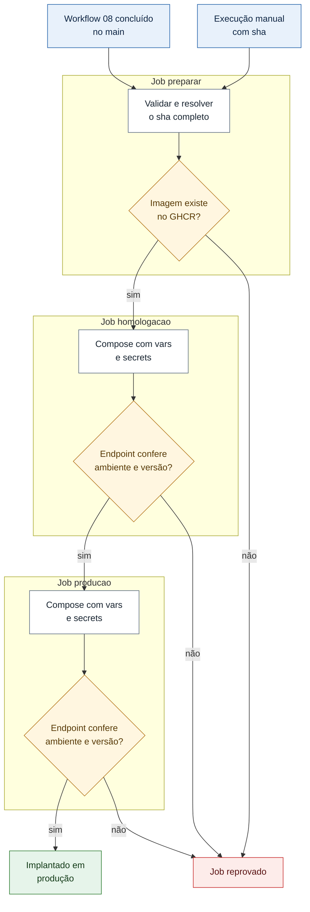
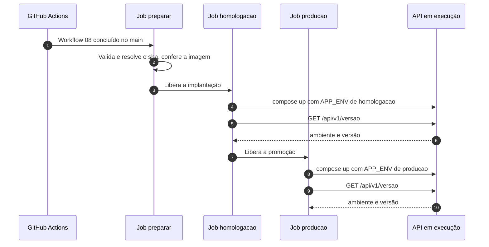

# Ambientes de homologação e produção com variáveis e segredos

## Problema que a prática resolve

Quando a mesma imagem percorre vários ambientes, a configuração é o que muda entre eles. Se essa configuração fica gravada no código ou em comandos digitados à mão, a diferença entre homologação e produção deixa de ser conhecida e auditável. Os segredos agravam o quadro porque uma senha copiada para um arquivo de configuração permanece no histórico do repositório. O cenário 08 produziu uma imagem única identificada pelo *commit* e este cenário mostra como entregar a ela, em cada ambiente, apenas a configuração que lhe cabe.

O GitHub oferece para isso os *environments*, que são ambientes nomeados como `homologacao` e agrupam variáveis, segredos e regras de proteção. Uma variável guarda valores não sensíveis que podem aparecer em qualquer log. Um segredo guarda valores sensíveis, é cifrado em repouso e tem o valor mascarado nos logs do *workflow*. Quando um job declara `environment:`, ele passa a enxergar as variáveis e os segredos daquele ambiente e o GitHub registra um *deployment*, que é o registro de uma implantação na API do repositório. O cenário 13 usa esses registros para calcular métricas.

## Workflow do cenário

O *workflow* `09-ambientes.yml` declara no nível superior as permissões `contents: read` e `packages: read`, que bastam para ler o repositório e baixar imagens privadas do GHCR. Ele contém três *jobs* chamados `preparar`, `homologacao` e `producao`, nomes que não coincidem com as verificações obrigatórias do repositório. O diagrama mostra o caminho entre os dois gatilhos e a implantação em produção, com os pontos em que a execução é reprovada.



A sequência a seguir mostra a ordem das chamadas entre os *jobs* e a API. Cada *job* de ambiente consulta o *endpoint* de versão antes de liberar o próximo.



### Gatilhos e o job preparar

O *workflow* dispara de duas formas. A primeira é o evento `workflow_run`, que inicia esta esteira quando o *workflow* `08 Artefato único` termina no `main`. A segunda é o `workflow_dispatch`, com a entrada `sha`, usada para implantar uma imagem já publicada sem esperar nova execução do cenário 08. O trecho mostra o gatilho, a guarda do job `preparar` e a validação da entrada.

Arquivo completo: [`.github/workflows/09-ambientes.yml`, linhas 4 a 51](https://github.com/arkhibr/devops-fluxos-c3dm/blob/main/.github/workflows/09-ambientes.yml#L4-L51).

```yaml
  workflow_run:
    workflows: ["08 Artefato único"]
    types: [completed]
    branches: [main]
  workflow_dispatch:
  # ...
  preparar:
    if: >-
      github.event_name == 'workflow_dispatch' ||
      (github.event.workflow_run.conclusion == 'success' && github.event.workflow_run.event == 'push')
      # ...
      - name: Validar a entrada e resolver o sha completo
        id: resolver
        env:
          SHA_ENTRADA: ${{ inputs.sha || github.event.workflow_run.head_sha }}
          GH_TOKEN: ${{ github.token }}
          REPOSITORIO: ${{ github.repository }}
        run: |
          if ! [[ "$SHA_ENTRADA" =~ ^[0-9a-f]{7,40}$ ]]; then
            echo "::error::O sha deve ter de 7 a 40 caracteres hexadecimais em minúsculas."
            exit 1
          fi
          sha=$(gh api "repos/${REPOSITORIO}/commits/${SHA_ENTRADA}" --jq .sha)
          echo "sha=${sha}" >> "$GITHUB_OUTPUT"
          echo "sha7=${sha:0:7}" >> "$GITHUB_OUTPUT"
```

A condição de `preparar` exige `conclusion == 'success'` e que o evento original tenha sido um *push*, de modo que uma execução do cenário 08 reprovada ou originada em *pull request* não implanta nada. A entrada chega ao *script* por variável de ambiente, nunca por interpolação direta. A expressão regular aceita de sete a quarenta caracteres hexadecimais e a chamada `gh api` devolve o *sha* completo do *commit*, gravado em `GITHUB_OUTPUT` para os *jobs* seguintes.

Arquivo completo: [`.github/workflows/09-ambientes.yml`, linhas 52 a 60](https://github.com/arkhibr/devops-fluxos-c3dm/blob/main/.github/workflows/09-ambientes.yml#L52-L60).

```yaml
      - name: Conferir que a imagem existe no registro
        env:
          SHA7: ${{ steps.resolver.outputs.sha7 }}
        run: |
          imagem="${REGISTRO}-api:sha-${SHA7}"
          if ! docker buildx imagetools inspect "$imagem" > /dev/null; then
            echo "::error::A imagem ${imagem} não existe. Ela só é publicada quando o workflow 08 roda sobre o commit."
            exit 1
          fi
```

O passo seguinte confere com `docker buildx imagetools inspect` que a imagem `sha-<sha7>` existe no GHCR. O *workflow* 08 filtra por caminhos, de modo que um *commit* que altera só a documentação não gera imagem. A mensagem de erro explica isso a quem dispara a implantação do cenário 09.

### Implantação em homologação

Os *jobs* de homologação e de produção declaram o ambiente e por isso recebem as variáveis e os segredos do respectivo ambiente sem que o código do *workflow* contenha qualquer valor. Cada *job* executa cinco passos em sequência, que vão do *checkout* do repositório até a remoção dos contêineres criados pelo Compose no *runner* do GitHub Actions.

Arquivo completo: [`.github/workflows/09-ambientes.yml`, linhas 62 a 111](https://github.com/arkhibr/devops-fluxos-c3dm/blob/main/.github/workflows/09-ambientes.yml#L62-L111).

```yaml
  homologacao:
    needs: preparar
    runs-on: ubuntu-latest
    environment: homologacao
    concurrency:
      group: implantacao-homologacao
      cancel-in-progress: false
    steps:
      # ...
      - name: Subir a API com a configuração do ambiente
        env:
          SHA7: ${{ needs.preparar.outputs.sha7 }}
          APP_ENV: ${{ vars.APP_ENV }}
          APP_VERSION: ${{ needs.preparar.outputs.sha }}
          TOKEN_DEMONSTRACAO: ${{ secrets.TOKEN_DEMONSTRACAO }}
        run: docker compose -p c3dm-homologacao -f cenarios/09-ambientes/compose.yml up -d --wait --wait-timeout 60
      # ...
      - name: Remover os contêineres
        if: always()
        env:
          SHA7: ${{ needs.preparar.outputs.sha7 }}
          APP_ENV: ${{ vars.APP_ENV }}
          APP_VERSION: ${{ needs.preparar.outputs.sha }}
          TOKEN_DEMONSTRACAO: ${{ secrets.TOKEN_DEMONSTRACAO }}
        run: docker compose -p c3dm-homologacao -f cenarios/09-ambientes/compose.yml down -v
```

A chave de ambiente registra um *deployment* no repositório e libera as variáveis e os segredos do ambiente de homologação. O grupo de *concurrency* tem `cancel-in-progress: false`, de modo que uma implantação em andamento não é cancelada por outra do mesmo ambiente. O GitHub mantém no máximo uma execução pendente em cada grupo. Os valores chegam ao Compose por variáveis de ambiente e nenhum passo escreve o segredo com `echo`. O GitHub mascara o valor literal nos *logs* embora uma transformação como a codificação em *base64* escape do mascaramento, razão pela qual a regra do repositório é nunca imprimir o segredo. O último passo roda sempre e remove os contêineres para que a execução seguinte comece sem resíduos no mesmo *runner* do GitHub Actions.

Arquivo completo: [`.github/workflows/09-ambientes.yml`, linhas 91 a 103](https://github.com/arkhibr/devops-fluxos-c3dm/blob/main/.github/workflows/09-ambientes.yml#L91-L103).

```yaml
          resposta=""
          for _ in $(seq 1 30); do
            resposta=$(curl -fsS http://127.0.0.1:8080/api/v1/versao) && break
            sleep 2
          done
          echo "Resposta: ${resposta}"
          ambiente=$(jq -r .ambiente <<< "$resposta")
          versao=$(jq -r .versao <<< "$resposta")
          if [ -z "$APP_ENV" ] || [ "$ambiente" != "$APP_ENV" ] || [ "$versao" != "$APP_VERSION" ]; then
            echo "::error::Esperado ambiente=${APP_ENV} e versao=${APP_VERSION}, recebido ambiente=${ambiente} e versao=${versao}."
            docker compose -p c3dm-homologacao -f cenarios/09-ambientes/compose.yml logs
            exit 1
          fi
```

O quarto passo chama `GET /api/v1/versao` com até trinta tentativas e compara o campo `ambiente` com `vars.APP_ENV` e o campo `versao` com o *sha* do *commit*. Se a comparação falha, o passo exibe os logs do contêiner antes de encerrar.

### Promoção para produção

O *job* `producao` repete os passos de homologação com o ambiente `producao`. A diferença está nas primeiras linhas.

Arquivo completo: [`.github/workflows/09-ambientes.yml`, linhas 113 a 134](https://github.com/arkhibr/devops-fluxos-c3dm/blob/main/.github/workflows/09-ambientes.yml#L113-L134).

```yaml
  producao:
    needs: [preparar, homologacao]
    runs-on: ubuntu-latest
    environment: producao
    concurrency:
      group: implantacao-producao
      cancel-in-progress: false
        # ...
        run: docker compose -p c3dm-producao -f cenarios/09-ambientes/compose.yml up -d --wait --wait-timeout 60
```

A chave `needs: [preparar, homologacao]` faz o *job* rodar somente depois que a implantação em homologação e a verificação terminam com sucesso. A mesma imagem `sha-<sha7>` percorre os dois ambientes e muda apenas a configuração entregue a ela.

### Configuração por variáveis no Compose

O arquivo `compose.yml` usa a imagem da *tag* `sha-<sha7>` e repassa à API as variáveis `APP_ENV` e `APP_VERSION` com o segredo.

Arquivo completo: [`cenarios/09-ambientes/compose.yml`, linhas 1 a 12](https://github.com/arkhibr/devops-fluxos-c3dm/blob/main/cenarios/09-ambientes/compose.yml#L1-L12).

```yaml
# Sobe a API a partir de uma imagem já publicada no GHCR.
# As variáveis sem valor padrão são obrigatórias: se alguma faltar, o Compose
# interrompe com erro em vez de passar uma string vazia ao contêiner.
services:
  api:
    image: ghcr.io/arkhibr/devops-fluxos-c3dm-api:sha-${SHA7:?defina SHA7 com os sete primeiros caracteres do commit}
    environment:
      APP_ENV: ${APP_ENV:?defina APP_ENV com o nome do ambiente}
      APP_VERSION: ${APP_VERSION:?defina APP_VERSION com o sha do commit}
      APP_TOKEN_DEMONSTRACAO: ${TOKEN_DEMONSTRACAO:?defina TOKEN_DEMONSTRACAO}
    ports:
      - "127.0.0.1:8080:8080"
```

A forma `${VARIAVEL:?mensagem}` interrompe a execução quando o valor falta, o que evita que uma variável vazia sobrescreva o valor padrão da aplicação. A porta é publicada apenas em `127.0.0.1`.

### Ambientes e política de ramos

O *script* `configurar-ambientes.sh` cria os dois ambientes pela API, sem revisores obrigatórios, grava a variável `APP_ENV` em cada um e gera o segredo com `openssl rand -hex 20`.

Arquivo completo: [`cenarios/09-ambientes/configurar-ambientes.sh`, linhas 14 a 27](https://github.com/arkhibr/devops-fluxos-c3dm/blob/main/cenarios/09-ambientes/configurar-ambientes.sh#L14-L27).

```bash
for ambiente in homologacao producao; do
  echo "Configurando o ambiente ${ambiente}"
  # Sem revisores obrigatórios: a promoção para produção depende só do job anterior.
  # Política de ramos personalizada: só ramos com política cadastrada podem implantar.
  printf '%s' '{"deployment_branch_policy":{"protected_branches":false,"custom_branch_policies":true}}' \
    | gh api --method PUT "repos/${repositorio}/environments/${ambiente}" --input - --silent
  existentes="$(gh api "repos/${repositorio}/environments/${ambiente}/deployment-branch-policies" --jq '.branch_policies[].name')"
  if ! grep -qx 'main' <<<"$existentes"; then
    gh api --method POST "repos/${repositorio}/environments/${ambiente}/deployment-branch-policies" \
      -f name=main -f type=branch --silent
  fi
  gh variable set APP_ENV --env "$ambiente" --repo "$repositorio" --body "$ambiente"
  # O valor segue por entrada padrão para não aparecer na lista de processos nem no terminal.
  openssl rand -hex 20 | gh secret set TOKEN_DEMONSTRACAO --env "$ambiente" --repo "$repositorio"
```

A primeira chamada ativa a política de ramos personalizada e a segunda cadastra o ramo `main` como único autorizado a implantar, de modo que uma execução disparada a partir de outro ramo é recusada pelo GitHub antes de iniciar o *job*. O *script* verifica as políticas existentes antes de criar a do ramo `main`, o que permite executá-lo novamente sem duplicá-las. O valor do segredo segue por entrada padrão para o comando de gravação e nunca aparece no terminal. A decisão de não exigir revisores mantém a demonstração executável sem intervenção humana. Em um sistema real a proteção do ambiente de produção com revisores obrigatórios é a prática recomendada pelo GitHub.

### Arquivos do cenário

| Arquivo | Papel |
| --- | --- |
| [`.github/workflows/09-ambientes.yml`](https://github.com/arkhibr/devops-fluxos-c3dm/blob/main/.github/workflows/09-ambientes.yml) | *Workflow* com os *jobs* de preparação, homologação e produção. |
| [`cenarios/09-ambientes/compose.yml`](https://github.com/arkhibr/devops-fluxos-c3dm/blob/main/cenarios/09-ambientes/compose.yml) | Definição do contêiner da API com variáveis obrigatórias. |
| [`cenarios/09-ambientes/configurar-ambientes.sh`](https://github.com/arkhibr/devops-fluxos-c3dm/blob/main/cenarios/09-ambientes/configurar-ambientes.sh) | *Script* que cria ambientes, variáveis, segredos e política de ramos. |
| [`tests/pipelines/test_09_ambientes.py`](https://github.com/arkhibr/devops-fluxos-c3dm/blob/main/tests/pipelines/test_09_ambientes.py) | Testes estruturais do *workflow*. |

## Como executar

1. Execute uma única vez `cenarios/09-ambientes/configurar-ambientes.sh arkhibr/devops-fluxos-c3dm`. O comando exige o `gh` autenticado com permissão de administração no repositório e lista ao final as variáveis e os nomes dos segredos de cada ambiente.
2. Dispare a implantação de uma imagem publicada com `gh workflow run 09-ambientes.yml -f sha=<sha7>`. O sha precisa pertencer a um *commit* sobre o qual o *workflow* 08 publicou a imagem. Quando o cenário 08 conclui no `main`, a implantação começa sozinha.
3. Acompanhe com `gh run watch` e confirme que os jobs `homologacao` e `producao` terminaram com sucesso, nessa ordem.
4. Liste os registros de implantação com `gh api repos/arkhibr/devops-fluxos-c3dm/deployments --jq length`. Cada execução acrescenta um registro por ambiente, de modo que o valor é maior ou igual a 2 depois da primeira.
5. Abra a aba *Environments* do repositório no GitHub para ver o histórico de cada ambiente e as variáveis cadastradas.

## Como levar a prática a um sistema existente

1. Liste toda configuração que difere entre os ambientes e separe o que é sensível do que não é. Endereços de serviços e opções de funcionalidade seguem como variáveis. Credenciais e chaves seguem como segredos.
2. Crie um *environment* por etapa real do caminho até produção e cadastre os valores em cada um. Remova do repositório os arquivos de configuração específicos de ambiente.
3. Faça a aplicação ler a configuração por variáveis de ambiente ou por arquivos montados na execução, de modo que a mesma imagem sirva a todos os ambientes.
4. Acrescente ao fim de cada implantação uma verificação que consulte a aplicação e confirme o ambiente e a versão em execução, como faz o passo de teste do cenário.
5. Acrescente revisores obrigatórios e uma janela de espera ao ambiente de produção quando o risco do sistema justificar. Restrinja os ambientes aos ramos autorizados na página de configuração de cada um.

## Nível C3DM e fontes

O repositório agrupa o cenário no nível Intermediário, junto do artefato único do cenário 08, por tratar da implantação automática com configuração separada do código. A página da [trilha](../../docs/trilha.md) explica como esse agrupamento se relaciona com os níveis do modelo.

As fontes são a documentação do GitHub sobre ambientes de implantação (https://docs.github.com/actions/deployment/targeting-different-environments/using-environments-for-deployment), a sobre segredos (https://docs.github.com/actions/security-for-github-actions/security-guides/using-secrets-in-github-actions) e a referência do Docker Compose sobre interpolação de variáveis (https://docs.docker.com/reference/compose-file/interpolation/). O princípio da configuração no ambiente aparece no fator III do *The Twelve-Factor App* e no capítulo sobre gestão de configuração do livro *Continuous Delivery*, de Humble e Farley. A referência do livro está na [bibliografia](../../docs/referencia/bibliografia.md).
