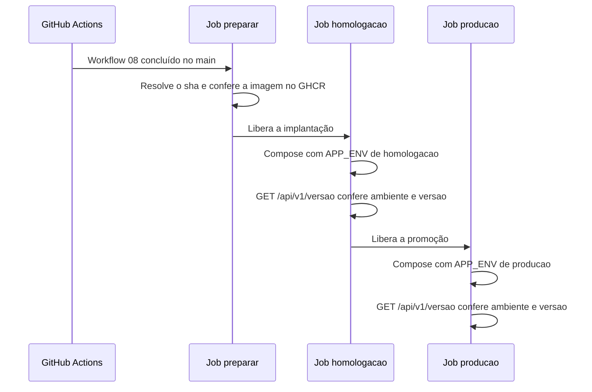

# Ambientes de homologação e produção com variáveis e segredos

## Problema que a prática resolve

Quando a mesma imagem percorre vários ambientes, a configuração é o que muda entre eles. Se essa configuração fica gravada no código ou em comandos digitados à mão, a diferença entre homologação e produção deixa de ser conhecida e auditável. Os segredos agravam o quadro porque uma senha copiada para um arquivo de configuração permanece no histórico do repositório. O cenário 08 produziu uma imagem única identificada pelo *commit* e este cenário mostra como entregar a ela, em cada ambiente, apenas a configuração que lhe cabe.

O GitHub oferece para isso os *environments*, que são ambientes nomeados como `homologacao` e agrupam variáveis, segredos e regras de proteção. Uma variável guarda valores não sensíveis que podem aparecer em qualquer log. Um segredo guarda valores sensíveis, é cifrado em repouso e tem o valor mascarado nos logs do *workflow*. Quando um job declara `environment:`, ele passa a enxergar as variáveis e os segredos daquele ambiente e o GitHub registra um *deployment*, que é o registro de uma implantação na API do repositório. O cenário 13 usa esses registros para calcular métricas.

## Workflow do cenário

O *workflow* `09-ambientes.yml` declara no nível superior as permissões `contents: read` e `packages: read`. Elas bastam para ler o repositório e baixar imagens privadas do GHCR. Ele contém três jobs chamados `preparar`, `homologacao` e `producao`, nomes que não coincidem com as verificações obrigatórias do repositório. O *workflow* dispara de duas formas. A primeira é o evento `workflow_run`, que inicia esta esteira quando o *workflow* `08 Artefato único` termina no `main`. A condição do job `preparar` exige `conclusion == 'success'` e que o evento original tenha sido um *push*. A segunda é o `workflow_dispatch`, com a entrada `sha`, usada para implantar uma imagem já publicada sem esperar nova execução do cenário 08.

O job `preparar` valida a entrada por variável de ambiente, nunca por interpolação direta no script. Em seguida resolve o *sha* completo do *commit* pela API do GitHub e confere com `docker buildx imagetools inspect` que a imagem `sha-<sha7>` existe no GHCR. Se não existir, o job falha com uma mensagem que explica que a imagem só é publicada quando o cenário 08 roda sobre aquele *commit*. O *workflow* 08 filtra por caminhos, de modo que um *commit* que altera só a documentação não gera imagem.

Os jobs `homologacao` e `producao` declaram `environment:`. Por isso recebem `vars.APP_ENV` e `secrets.TOKEN_DEMONSTRACAO` do respectivo ambiente, sem que o código do *workflow* contenha qualquer valor. O job `producao` declara `needs` sobre `homologacao` e só roda depois que a implantação em homologação e a verificação terminam com sucesso. Cada job tem um grupo de `concurrency` chamado `implantacao-<ambiente>` com `cancel-in-progress: false`, de modo que uma implantação em andamento não é cancelada por outra do mesmo ambiente. Em cada grupo o GitHub mantém no máximo uma execução pendente, que uma nova execução pendente substitui antes de iniciar a espera pela execução em andamento terminar.

Cada um desses dois jobs executa cinco passos em sequência, sendo o primeiro o *checkout* do repositório. O segundo autentica no GHCR com o `GITHUB_TOKEN`. O terceiro sobe o arquivo `compose.yml` com o Docker Compose dentro do próprio *runner*, que é a máquina virtual que executa o job. O arquivo usa a imagem da *tag* `sha-<sha7>` e repassa à API as variáveis `APP_ENV` e `APP_VERSION` com o segredo. As variáveis do Compose usam a forma `${VARIAVEL:?mensagem}`, que interrompe a execução quando o valor falta. Isso evita que uma variável vazia sobrescreva o valor padrão da aplicação. O quarto passo chama `GET /api/v1/versao` com até trinta tentativas e compara o campo `ambiente` com `vars.APP_ENV` e o campo `versao` com o *sha* do *commit*. Se a comparação falha, o passo exibe os logs do contêiner antes de encerrar. O quinto e último passo roda sempre, mesmo após falha. Ele remove os contêineres e os volumes do ambiente com o comando `docker compose down -v`. Assim a execução seguinte começa sem resíduos da anterior no mesmo *runner*, o que importa quando se usa um *runner* próprio.

O segredo `TOKEN_DEMONSTRACAO` chega ao *workflow* apenas por `env:` e nenhum passo o escreve em `echo`. O GitHub mascara o valor literal nos logs. Uma transformação do valor, como a codificação em *base64*, escapa do mascaramento e por isso a regra do repositório é nunca imprimi-lo.

O script `configurar-ambientes.sh` cria os dois ambientes pela API, sem revisores obrigatórios, grava a variável `APP_ENV` em cada um e gera o segredo com `openssl rand -hex 20`. O valor segue por entrada padrão para `gh secret set --env` e nunca aparece no terminal. O script também ativa em cada ambiente a política de ramos personalizada e cadastra o ramo `main` como único ramo autorizado a implantar, com a chamada `gh api -X POST repos/<repositório>/environments/<ambiente>/deployment-branch-policies -f name=main -f type=branch`. Uma execução disparada a partir de outro ramo é recusada pelo GitHub antes de iniciar o job. O script verifica as políticas existentes e por isso pode ser executado novamente sem duplicá-las. A decisão de não exigir revisores mantém a demonstração executável sem intervenção humana. Em um sistema real, a proteção do ambiente de produção com revisores obrigatórios é a prática recomendada.

## Como executar

1. Execute uma única vez `cenarios/09-ambientes/configurar-ambientes.sh arkhibr/devops-fluxos-c3dm`. O comando exige o `gh` autenticado com permissão de administração no repositório e lista ao final as variáveis e os nomes dos segredos de cada ambiente.
2. Dispare a implantação de uma imagem publicada com `gh workflow run 09-ambientes.yml -f sha=<sha7>`. O sha precisa pertencer a um *commit* sobre o qual o *workflow* 08 publicou a imagem. Quando o cenário 08 conclui no `main`, a implantação começa sozinha.
3. Acompanhe com `gh run watch` e confirme que os jobs `homologacao` e `producao` terminaram com sucesso, nessa ordem.
4. Liste os registros de implantação com `gh api repos/arkhibr/devops-fluxos-c3dm/deployments --jq length`. Cada execução acrescenta um registro por ambiente, de modo que o valor é maior ou igual a 2 depois da primeira.
5. Abra a aba *Environments* do repositório no GitHub para ver o histórico de cada ambiente e as variáveis cadastradas.

## Como levar a prática a um sistema existente

1. Liste toda configuração que difere entre os ambientes e separe o que é sensível do que não é. Endereços de serviços e opções de funcionalidade seguem como variáveis. Credenciais e chaves seguem como segredos.
2. Crie um *environment* por etapa real do caminho até produção e cadastre os valores em cada um. Remova do repositório os arquivos de configuração específicos de ambiente.
3. Faça a aplicação ler a configuração por variáveis de ambiente ou por arquivos montados na execução, de modo que a mesma imagem sirva a todos os ambientes.
4. Acrescente ao fim de cada implantação uma verificação que consulte a aplicação e confirme o ambiente e a versão em execução, como faz o passo de teste do cenário.
5. Acrescente revisores obrigatórios e uma janela de espera ao ambiente de produção quando o risco do sistema justificar. Restrinja os ambientes aos ramos autorizados na página de configuração de cada um.

## Nível C3DM e fontes

O repositório agrupa o cenário no nível Intermediário, junto do artefato único do cenário 08, por tratar da implantação automática com configuração separada do código. A página da [trilha](../../docs/trilha.md) explica como esse agrupamento se relaciona com os níveis do modelo.

As fontes são a documentação do GitHub sobre ambientes de implantação (https://docs.github.com/actions/deployment/targeting-different-environments/using-environments-for-deployment), a sobre segredos (https://docs.github.com/actions/security-for-github-actions/security-guides/using-secrets-in-github-actions) e a referência do Docker Compose sobre interpolação de variáveis (https://docs.docker.com/reference/compose-file/interpolation/). O princípio da configuração no ambiente aparece no fator III do *The Twelve-Factor App* e no capítulo sobre gestão de configuração do livro *Continuous Delivery*, de Humble e Farley. A referência do livro está na [bibliografia](../../docs/referencia/bibliografia.md).
