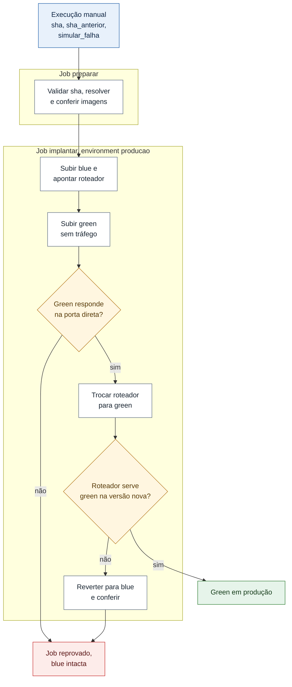
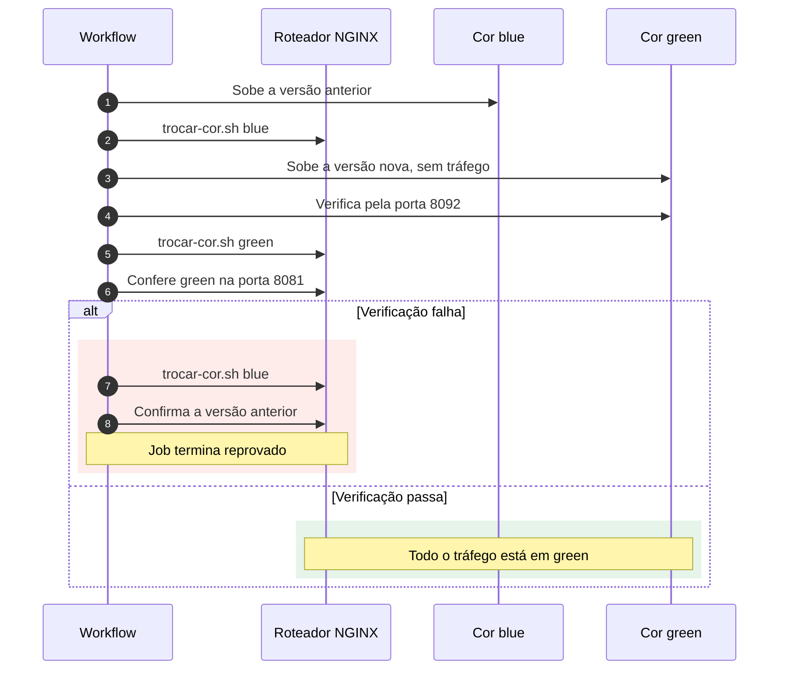

# Implantação blue-green com reversão automática

## Problema que a prática resolve

Substituir a versão em produção por uma nova costuma interromper o serviço durante a troca. Uma versão com defeito só é percebida depois que os usuários já a receberam. A implantação *blue-green* evita os dois problemas mantendo duas cópias completas do sistema, chamadas cores. A cor ativa recebe todo o tráfego. A cor inativa recebe a versão nova, é verificada sem tráfego de usuários e só então passa a ser a ativa, quando um roteador muda de destino. Se a verificação posterior à troca falhar, o roteador volta para a cor anterior, que continua em execução e intacta.

O cenário 09 colocou uma imagem em cada ambiente. Este cenário acrescenta o mecanismo de troca. O roteador usado é o NGINX, um servidor *web* que também encaminha requisições a outros serviços e que consegue recarregar a configuração sem derrubar conexões em andamento. Como o repositório é didático e não tem servidores de produção, as duas cores e o roteador rodam com o Docker Compose dentro da máquina virtual do GitHub Actions, que é o *runner*. O mecanismo é o mesmo de um ambiente real, com a diferença de que aqui tudo desaparece ao fim da execução.

## Workflow do cenário

O *workflow* `10-blue-green.yml` só dispara por `workflow_dispatch`, porque uma implantação em produção deve ser uma decisão explícita. Ele declara no nível superior as permissões `contents: read` e `packages: read` e recebe três entradas. A entrada `sha` identifica o *commit* da versão nova, que roda na cor green. A entrada opcional `sha_anterior` identifica o *commit* da versão em produção, que roda na cor blue. Quando ela fica vazia, as duas cores usam a mesma imagem e diferem apenas nas variáveis `APP_COLOR` e `APP_VERSION`. A entrada booleana `simular_falha` provoca de propósito a falha da verificação posterior à troca, para que a reversão possa ser observada sem alterar o código da API.



A sequência a seguir detalha a troca e a reversão entre as cores. A cor green é verificada pela porta direta 8092 antes de receber tráfego e a reversão ocorre apenas quando a conferência pelo roteador na porta 8081 falha.



### Preparação e ambiente de produção

O *job* `preparar` valida cada *sha* por variável de ambiente com a expressão `^[0-9a-f]{7,40}$`, resolve o *sha* completo pela API do GitHub e confere com `docker buildx imagetools inspect` que as duas imagens `sha-<sha7>` existem no GHCR. O *job* `implantar` recebe os resultados e declara o ambiente.

Arquivo completo: [`.github/workflows/10-blue-green.yml`, linhas 79 a 92](https://github.com/arkhibr/devops-fluxos-c3dm/blob/main/.github/workflows/10-blue-green.yml#L79-L92).

```yaml
  implantar:
    needs: preparar
    runs-on: ubuntu-latest
    environment: producao
    concurrency:
      group: implantacao-producao
      cancel-in-progress: false
    env:
      SHA7_BLUE: ${{ needs.preparar.outputs.sha7_anterior }}
      VERSAO_BLUE: ${{ needs.preparar.outputs.sha_anterior }}
      SHA7_GREEN: ${{ needs.preparar.outputs.sha7 }}
      VERSAO_GREEN: ${{ needs.preparar.outputs.sha }}
      COMPOSE_PROJECT_NAME: c3dm-blue-green
    steps:
```

O `environment: producao` gera um registro de *deployment* por execução. O grupo de *concurrency* `implantacao-producao` é o mesmo do cenário 09, de modo que duas trocas de cor nunca ocorrem ao mesmo tempo sobre o mesmo ambiente. O ambiente só aceita implantações a partir do ramo `main`, conforme a política de ramos configurada no cenário 09. As variáveis `SHA7_BLUE`, `SHA7_GREEN` e as de versão alimentam o `compose.yml`, que as exige com `${VARIAVEL:?mensagem}`.

### O roteador e o script de troca

O roteador é o NGINX e o arquivo `nginx.conf.tmpl` guarda a configuração com um marcador no lugar do destino.

Arquivo completo: [`cenarios/10-blue-green/nginx.conf.tmpl`, linhas 3 a 13](https://github.com/arkhibr/devops-fluxos-c3dm/blob/main/cenarios/10-blue-green/nginx.conf.tmpl#L3-L13).

```nginx
upstream api {
    server COR_ATIVA:8080;
}

server {
    listen 80;

    location / {
        proxy_pass http://api;
    }
}
```

O marcador `COR_ATIVA` é substituído pelo nome do serviço da cor que recebe o tráfego. O bloco `upstream` contém um único destino, de modo que toda requisição vai para a cor ativa.

Arquivo completo: [`cenarios/10-blue-green/trocar-cor.sh`, linhas 8 a 22](https://github.com/arkhibr/devops-fluxos-c3dm/blob/main/cenarios/10-blue-green/trocar-cor.sh#L8-L22).

```bash
cor="${1:-}"
if [ "$cor" != "blue" ] && [ "$cor" != "green" ]; then
  echo "Uso: $0 <blue|green>" >&2
  exit 2
fi

pasta="$(cd "$(dirname "${BASH_SOURCE[0]}")" && pwd)"
temporario="$(mktemp)"
trap 'rm -f "$temporario"' EXIT

sed "s/COR_ATIVA/${cor}/" "${pasta}/nginx.conf.tmpl" > "$temporario"
docker cp "$temporario" roteador:/etc/nginx/conf.d/default.conf
docker exec roteador nginx -t
docker exec roteador nginx -s reload
echo "Roteador apontado para ${cor}."
```

O *script* recebe `blue` ou `green` e gera a configuração com `sed`. Em seguida copia o resultado para o contêiner `roteador` com `docker cp`, valida com `nginx -t` e aplica com `nginx -s reload`. A cópia substitui a montagem de volume e permite rodar o *script* em qualquer máquina com Docker, inclusive onde o diretório do repositório não é visível ao motor de contêineres. O comando `nginx -t` impede que uma configuração inválida chegue ao `reload` e derrube o roteador do cenário 10.

### Troca de cor

Os passos do *job* seguem a ordem da sequência. A verificação direta da cor green antes da troca impede que uma versão defeituosa chegue ao tráfego dos usuários.

Arquivo completo: [`.github/workflows/10-blue-green.yml`, linhas 100 a 110](https://github.com/arkhibr/devops-fluxos-c3dm/blob/main/.github/workflows/10-blue-green.yml#L100-L110).

```yaml
      - name: Subir a cor blue com a versão em produção e apontar o roteador para ela
        run: |
          docker compose -f cenarios/10-blue-green/compose.yml up -d blue roteador
          cenarios/10-blue-green/trocar-cor.sh blue
          cenarios/10-blue-green/verificar-cor.sh 8081 blue "$VERSAO_BLUE"
      - name: Subir a cor green, ainda inativa, com a versão nova
        run: docker compose -f cenarios/10-blue-green/compose.yml up -d green
      - name: Verificar a cor green diretamente na porta dela
        run: cenarios/10-blue-green/verificar-cor.sh 8092 green "$VERSAO_GREEN"
      - name: Trocar o roteador para a cor green
        run: cenarios/10-blue-green/trocar-cor.sh green
```

O primeiro passo sobe a cor blue e o roteador, aponta o roteador para blue e confirma pelo roteador que ela responde com a versão anterior. A cor green sobe sem tráfego e é verificada na porta 8092. Se a versão nova não iniciar ou responder de forma errada, o *job* falha antes de qualquer troca e nenhum usuário é afetado. A troca em si ocorre quando o passo seguinte executa `trocar-cor.sh green` e o roteador passa a enviar todo o tráfego à porta 8080 da cor green.

Arquivo completo: [`cenarios/10-blue-green/verificar-cor.sh`, linhas 15 a 26](https://github.com/arkhibr/devops-fluxos-c3dm/blob/main/cenarios/10-blue-green/verificar-cor.sh#L15-L26).

```bash
resposta=""
for _ in $(seq 1 30); do
  if resposta=$(curl -fsS --max-time 5 "http://127.0.0.1:${porta}/api/v1/versao" 2>/dev/null) \
    && [ "$(jq -r .cor <<< "$resposta")" = "$cor_esperada" ] \
    && [ "$(jq -r .versao <<< "$resposta")" = "$versao_esperada" ]; then
    echo "Porta ${porta}: ${resposta}"
    exit 0
  fi
  sleep 2
done
echo "::error::Porta ${porta}: esperado cor=${cor_esperada} e versao=${versao_esperada}, recebido: ${resposta:-sem resposta}"
exit 1
```

O *script* de verificação consulta `GET /api/v1/versao` com até trinta tentativas de dois segundos e confere os campos `cor` e `versao`. Logo após a troca, uma consulta isolada ainda pode atingir a cor antiga por alguns instantes, pois o NGINX encerra os processos antigos de forma gradual. É por isso que a verificação repete a consulta em vez de aceitar uma única resposta.

### Verificação posterior e reversão

Arquivo completo: [`.github/workflows/10-blue-green.yml`, linhas 111 a 130](https://github.com/arkhibr/devops-fluxos-c3dm/blob/main/.github/workflows/10-blue-green.yml#L111-L130).

```yaml
      - name: Conferir pelo roteador que a cor green responde
        env:
          SIMULAR_FALHA: ${{ inputs.simular_falha }}
        run: |
          esperada="$VERSAO_GREEN"
          if [ "$SIMULAR_FALHA" = "true" ]; then
            echo "::warning::Falha simulada: a verificação espera uma versão que nenhuma cor serve."
            esperada="versao-inexistente"
          fi
          cenarios/10-blue-green/verificar-cor.sh 8081 green "$esperada"
      - name: Reverter o roteador para a cor blue
        if: failure()
        run: |
          docker compose -f cenarios/10-blue-green/compose.yml logs green roteador
          cenarios/10-blue-green/trocar-cor.sh blue
          cenarios/10-blue-green/verificar-cor.sh 8081 blue "$VERSAO_BLUE"
          echo "::warning::Reversão concluída: o roteador voltou para a cor blue e a implantação foi reprovada."
      - name: Remover os contêineres
        if: always()
        run: docker compose -f cenarios/10-blue-green/compose.yml down -v
```

O passo de conferência pelo roteador troca a versão esperada por `versao-inexistente` quando `simular_falha` é verdadeira, o que faz a verificação falhar sem tocar na API. O passo com `if: failure()` executa quando qualquer passo anterior falhou. Ele mostra os *logs* e chama `trocar-cor.sh blue`. Depois confirma que o roteador voltou a responder com a cor blue e a versão anterior e emite um aviso. O *job* termina como reprovado, porque a implantação não foi concluída. O último passo roda com `if: always()` e remove contêineres e volumes com `docker compose down -v` ao fim de cada execução.

### Arquivos do cenário

| Arquivo | Papel |
| --- | --- |
| [`.github/workflows/10-blue-green.yml`](https://github.com/arkhibr/devops-fluxos-c3dm/blob/main/.github/workflows/10-blue-green.yml) | *Workflow* de troca de cor com reversão automática. |
| [`cenarios/10-blue-green/compose.yml`](https://github.com/arkhibr/devops-fluxos-c3dm/blob/main/cenarios/10-blue-green/compose.yml) | Duas cores da API e o roteador NGINX. |
| [`cenarios/10-blue-green/nginx.conf.tmpl`](https://github.com/arkhibr/devops-fluxos-c3dm/blob/main/cenarios/10-blue-green/nginx.conf.tmpl) | Modelo da configuração do roteador. |
| [`cenarios/10-blue-green/trocar-cor.sh`](https://github.com/arkhibr/devops-fluxos-c3dm/blob/main/cenarios/10-blue-green/trocar-cor.sh) | *Script* que aponta o roteador para uma cor. |
| [`cenarios/10-blue-green/verificar-cor.sh`](https://github.com/arkhibr/devops-fluxos-c3dm/blob/main/cenarios/10-blue-green/verificar-cor.sh) | *Script* que confere cor e versão com repetição. |
| [`tests/pipelines/test_10_11_implantacao.py`](https://github.com/arkhibr/devops-fluxos-c3dm/blob/main/tests/pipelines/test_10_11_implantacao.py) | Testes estruturais dos *workflows* 10 e 11. |

## Como executar

1. Escolha dois *commits* sobre os quais o *workflow* 08 publicou imagem. Os sete primeiros caracteres de cada um são os valores de `sha` e `sha_anterior`.
2. Dispare a troca com `gh workflow run 10-blue-green.yml -f sha=<sha7-nova> -f sha_anterior=<sha7-anterior>` e acompanhe com `gh run watch`. O resultado esperado é o job `implantar` verde, com a última verificação mostrando `"cor":"green"` e a versão nova.
3. Para ver a reversão, dispare com a entrada adicional `-f simular_falha=true`. O passo de conferência pelo roteador falha, o passo de reversão aparece como executado, o log mostra o roteador de volta na cor blue e o job termina como reprovado.
4. Para testar o mecanismo fora do GitHub, defina `SHA7_BLUE` e `VERSAO_BLUE` para a cor blue. Defina `SHA7_GREEN` e `VERSAO_GREEN` para a cor green. Depois suba `docker compose -f cenarios/10-blue-green/compose.yml up -d` e execute `cenarios/10-blue-green/trocar-cor.sh green`. A resposta de `curl localhost:8081/api/v1/versao` passa a conter `"cor":"green"`.
5. Liste os registros de implantação com `gh api repos/arkhibr/devops-fluxos-c3dm/deployments --jq length`. Cada execução do job `implantar` acrescenta um registro ao ambiente `producao`.

## Como levar a prática a um sistema existente

1. Confirme que o sistema aceita duas versões em execução ao mesmo tempo. Mudanças de esquema de banco de dados precisam ser compatíveis com as duas versões, o que normalmente exige separar a alteração do esquema da alteração do código em duas implantações.
2. Coloque na frente do sistema um roteador ou balanceador cujo destino possa ser trocado por configuração, sem reinício. Em ambientes de nuvem esse papel costuma ser de um balanceador de carga ou de um serviço de DNS ponderado.
3. Exponha em cada cópia um ponto de verificação que informe a versão e a cor, como o `GET /api/v1/versao` deste repositório. Use esse ponto antes e depois da troca.
4. Automatize a reversão como parte da esteira, de modo que a volta para a cor anterior não dependa de uma pessoa. Mantenha a cor anterior em execução por um período de observação antes de desligá-la.
5. Registre cada troca como *deployment* no ambiente de produção e proteja esse ambiente com revisores obrigatórios quando o risco do sistema justificar.

## Nível C3DM e fontes

O repositório agrupa o cenário no nível Avançado, que corresponde ao nível Avançado do domínio de implantação do modelo, dedicado à implantação sem parada. A página da [trilha](../../docs/trilha.md) explica como o agrupamento do repositório se relaciona com os níveis do modelo.

As fontes são a descrição do padrão *BlueGreenDeployment* de Martin Fowler (https://martinfowler.com/bliki/BlueGreenDeployment.html), a documentação do NGINX sobre o módulo `upstream` (https://nginx.org/en/docs/http/ngx_http_upstream_module.html) e sobre o controle do processo com `nginx -s reload` (https://nginx.org/en/docs/control.html), além do capítulo sobre implantação do livro *Continuous Delivery*, de Humble e Farley. A referência do livro está na [bibliografia](../../docs/referencia/bibliografia.md).
