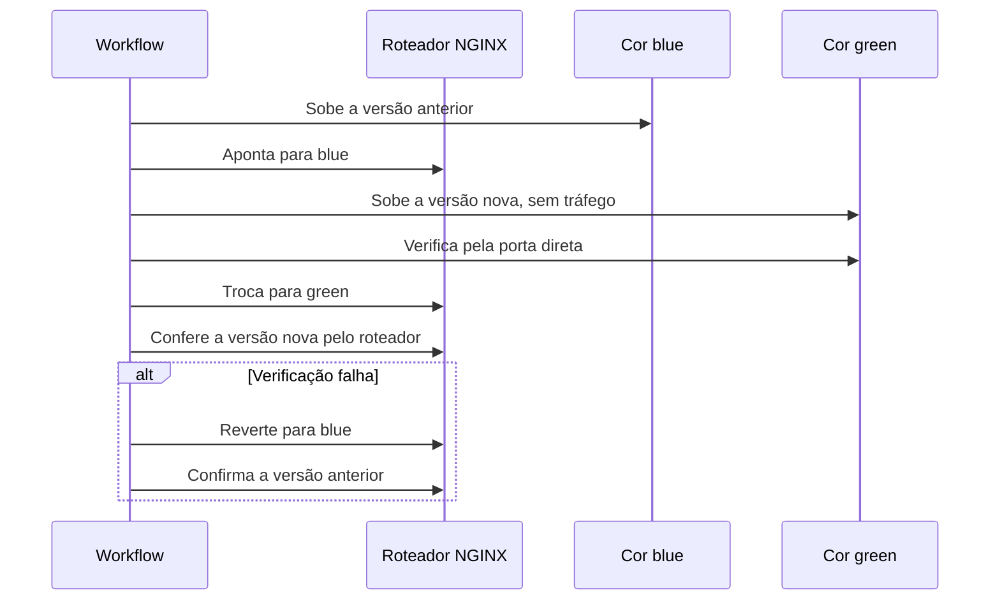

# Implantação blue-green com reversão automática

## Problema que a prática resolve

Substituir a versão em produção por uma nova costuma interromper o serviço durante a troca. Uma versão com defeito só é percebida depois que os usuários já a receberam. A implantação *blue-green* evita os dois problemas mantendo duas cópias completas do sistema, chamadas cores. A cor ativa recebe todo o tráfego. A cor inativa recebe a versão nova, é verificada sem tráfego de usuários e só então passa a ser a ativa, quando um roteador muda de destino. Se a verificação posterior à troca falhar, o roteador volta para a cor anterior, que continua em execução e intacta.

O cenário 09 colocou uma imagem em cada ambiente. Este cenário acrescenta o mecanismo de troca. O roteador usado é o NGINX, um servidor *web* que também encaminha requisições a outros serviços e que consegue recarregar a configuração sem derrubar conexões em andamento. Como o repositório é didático e não tem servidores de produção, as duas cores e o roteador rodam com o Docker Compose dentro da máquina virtual do GitHub Actions, que é o *runner*. O mecanismo é o mesmo de um ambiente real, com a diferença de que aqui tudo desaparece ao fim da execução.

## Workflow do cenário

O *workflow* `10-blue-green.yml` só dispara por `workflow_dispatch`, porque uma implantação em produção deve ser uma decisão explícita. Ele declara no nível superior as permissões `contents: read` e `packages: read`. Recebe três entradas. A entrada `sha` identifica o *commit* da versão nova, que roda na cor green. A entrada opcional `sha_anterior` identifica o *commit* da versão em produção, que roda na cor blue. Quando ela fica vazia, as duas cores usam a mesma imagem e diferem apenas nas variáveis `APP_COLOR` e `APP_VERSION`. A entrada booleana `simular_falha` provoca de propósito a falha da verificação posterior à troca, para que a reversão possa ser observada sem alterar o código da API.

O job `preparar` valida cada *sha* por variável de ambiente com a expressão `^[0-9a-f]{7,40}$`, resolve o *sha* completo pela API do GitHub e confere com `docker buildx imagetools inspect` que as duas imagens `sha-<sha7>` existem no GHCR. Esses nomes de job não coincidem com as verificações obrigatórias do repositório.

O job `implantar` declara `environment: producao`, o que gera um registro de *deployment* por execução. Ele usa o grupo de `concurrency` `implantacao-producao` com `cancel-in-progress: false`. O mesmo grupo é usado pelo cenário 09, de modo que duas trocas de cor nunca ocorrem ao mesmo tempo sobre o mesmo ambiente. Os passos do job seguem a ordem abaixo. A verificação direta da cor green antes da troca impede que uma versão defeituosa chegue ao tráfego dos usuários.

1. Sobe a cor blue com a versão anterior e o roteador. O script `trocar-cor.sh blue` grava o destino no roteador e o script `verificar-cor.sh` confirma, pelo roteador, que a cor blue responde com a versão anterior.
2. Sobe a cor green com a versão nova, ainda sem tráfego.
3. Verifica a cor green diretamente na porta 8092, sem passar pelo roteador. Se a versão nova não iniciar ou responder de forma errada, o job falha antes de qualquer troca e nenhum usuário é afetado.
4. Troca o roteador para a cor green com `trocar-cor.sh green`.
5. Confere pelo roteador, na porta 8081, que a cor green responde com a versão nova.
6. Em caso de falha de qualquer passo anterior, o passo com `if: failure()` mostra os logs e chama `trocar-cor.sh blue`. Em seguida confirma que o roteador voltou a responder com a cor blue e a versão anterior. Por fim emite um aviso. O job termina como reprovado, porque a implantação não foi concluída.
7. O último passo, com `if: always()`, remove contêineres e volumes com `docker compose down -v`.

O script `trocar-cor.sh` recebe `blue` ou `green` e substitui o marcador `COR_ATIVA` do arquivo `nginx.conf.tmpl` pelo nome do serviço. O resultado é copiado para o contêiner `roteador` com `docker cp`, validado com `nginx -t` e aplicado com `nginx -s reload`. A cópia substitui a montagem de volume e permite rodar o script em qualquer máquina com Docker, inclusive onde o diretório do repositório não é visível ao motor de contêineres. A diretiva `proxy_next_upstream off` impede que o NGINX repita no outro destino uma requisição que falhou, o que esconderia erros da cor ativa.

O arquivo `compose.yml` usa variáveis na forma `${VARIAVEL:?mensagem}`, de modo que nenhuma variável `APP_*` chega vazia ao contêiner. O script `verificar-cor.sh` consulta `GET /api/v1/versao` com até trinta tentativas e confere os campos `cor` e `versao`. Logo após a troca, uma consulta isolada ainda pode atingir a cor antiga por alguns instantes, pois o NGINX encerra os processos antigos de forma gradual. É por isso que a verificação repete a consulta em vez de aceitar uma única resposta.

## Como executar

1. Escolha dois *commits* sobre os quais o *workflow* 08 publicou imagem. Os sete primeiros caracteres de cada um são os valores de `sha` e `sha_anterior`.
2. Dispare a troca com `gh workflow run 10-blue-green.yml -f sha=<sha7-nova> -f sha_anterior=<sha7-anterior>` e acompanhe com `gh run watch`. O resultado esperado é o job `implantar` verde, com a última verificação mostrando `"cor":"green"` e a versão nova.
3. Para ver a reversão, dispare com a entrada adicional `-f simular_falha=true`. O passo de conferência pelo roteador falha, o passo de reversão aparece como executado, o log mostra o roteador de volta na cor blue e o job termina como reprovado.
4. Para testar o mecanismo fora do GitHub, defina `SHA7_BLUE` e `VERSAO_BLUE` para a cor blue. Defina `SHA7_GREEN` e `VERSAO_GREEN` para a cor green. Depois suba `docker compose -f cenarios/10-blue-green/compose.yml up -d` e execute `cenarios/10-blue-green/trocar-cor.sh green`. A resposta de `curl localhost:8081/api/v1/versao` passa a conter `"cor":"green"`.
5. Liste os registros de implantação com `gh api repos/arkhibr/devops-fluxos-c3dm/deployments --jq length`. Cada execução do job `implantar` acrescenta um registro ao ambiente `producao`.

## Como levar a prática a um sistema existente

1. Confirme que o sistema aceita duas versões em execução ao mesmo tempo. Mudanças de esquema de banco de dados precisam ser compatíveis com as duas versões, o que normalmente exige separar a alteração do esquema da alteração do código em duas implantações.
2. Coloque na frente do sistema um roteador ou balanceador cujo destino possa ser trocado por configuração, sem reinício. Em ambientes de nuvem esse papel costuma ser de um balanceador de carga ou de um serviço de DNS ponderado.
3. Exponha em cada cópia um ponto de verificação que informe a versão e a cor, como o `GET /api/v1/versao` deste repositório. Use esse ponto antes e depois da troca.
4. Automatize a reversão como parte da esteira, de modo que a volta para a cor anterior não dependa de uma pessoa. Mantenha a cor anterior em execução por um período de observação antes de desligá-la.
5. Registre cada troca como *deployment* no ambiente de produção e proteja esse ambiente com revisores obrigatórios quando o risco do sistema justificar.

## Nível C3DM e fontes

O repositório agrupa o cenário no nível Avançado, que corresponde ao nível Avançado do domínio de implantação do modelo, dedicado à implantação sem parada. A página da [trilha](../../docs/trilha.md) explica como o agrupamento do repositório se relaciona com os níveis do modelo.

As fontes são a descrição do padrão *BlueGreenDeployment* de Martin Fowler (https://martinfowler.com/bliki/BlueGreenDeployment.html), a documentação do NGINX sobre o módulo `upstream` (https://nginx.org/en/docs/http/ngx_http_upstream_module.html) e sobre o controle do processo com `nginx -s reload` (https://nginx.org/en/docs/control.html), além do capítulo sobre implantação do livro *Continuous Delivery*, de Humble e Farley. A referência do livro está na [bibliografia](../../docs/referencia/bibliografia.md).
