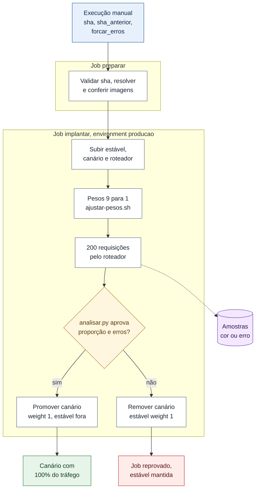
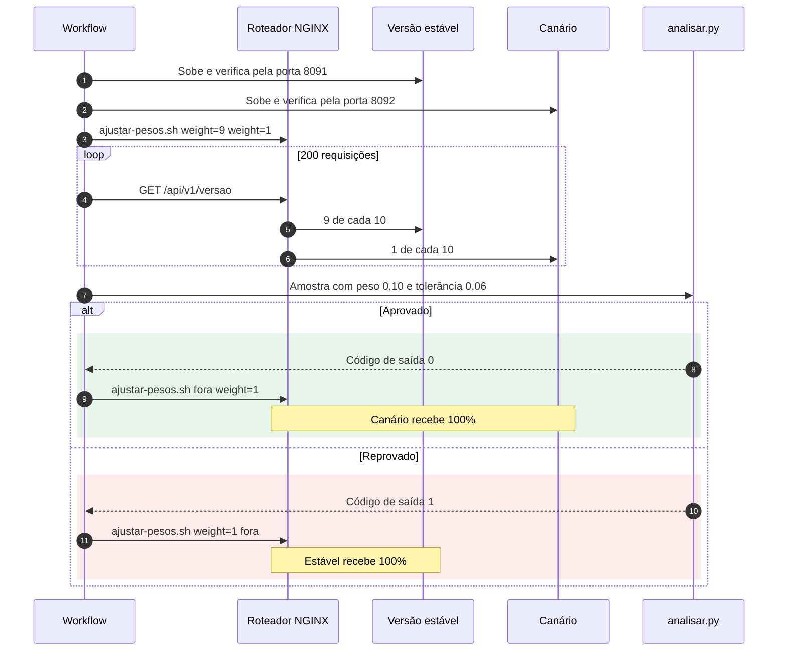

# Implantação canário com análise de proporção e de erros

## Problema que a prática resolve

Uma versão nova pode passar por todos os testes e ainda assim se comportar mal diante do tráfego real. A implantação canário reduz esse risco enviando a ela uma fração pequena das requisições, enquanto a versão estável atende o restante. O nome vem do canário que mineiros levavam às galerias para avisar da presença de gás. Se a fração exposta apresenta problemas, apenas uma parte dos usuários é afetada e a versão nova é retirada. Se não apresenta, o tráfego passa por inteiro para ela, que então se torna a versão estável.

O cenário 10 trocou todo o tráfego de uma cor para outra em um único passo. Este cenário divide o tráfego por pesos e decide a promoção com base em medições. O roteador é o NGINX, um servidor *web* que também encaminha requisições a outros serviços. Ele usa um grupo de destinos chamado *upstream*, no qual cada destino tem um peso, de modo que a proporção entre as requisições segue a proporção entre os pesos. A decisão de promover ou remover depende de duas medições, que são a proporção real de requisições atendidas pelo canário e a quantidade de erros.

## Workflow do cenário

O *workflow* `11-canario.yml` só dispara por `workflow_dispatch`, porque uma implantação em produção deve ser uma decisão explícita. Ele declara no nível superior as permissões `contents: read` e `packages: read` e recebe três entradas de execução manual. A entrada `sha` identifica o *commit* da versão canário e a entrada opcional `sha_anterior` identifica o *commit* da versão estável. Quando a segunda fica vazia, as duas versões usam a mesma imagem e diferem apenas nas variáveis `APP_COLOR` e `APP_VERSION`. A entrada booleana `forcar_erros` para o contêiner do canário depois de iniciado, o que permite observar o caminho de remoção sem alterar o código da API. O diagrama mostra o caminho do lançamento entre o gatilho manual e os dois desfechos possíveis do *job* `implantar`.



A sequência a seguir detalha a análise automática e as duas saídas possíveis. A decisão depende do código de saída do programa `analisar.py`.



### Preparação e ambiente de produção

O *job* `preparar` valida cada *sha* por variável de ambiente com a expressão `^[0-9a-f]{7,40}$`, resolve o *sha* completo pela API do GitHub e confere com `docker buildx imagetools inspect` que as duas imagens existem no GHCR. O *job* `implantar` declara `environment: producao`, que só aceita implantações a partir do ramo `main` conforme a política de ramos do cenário 09. Cada execução gera um registro de *deployment*. O grupo de *concurrency* `implantacao-producao` com `cancel-in-progress: false` é o mesmo do cenário 10, de modo que dois lançamentos nunca ocorrem ao mesmo tempo.

### Roteador com pesos

O NGINX distribui as requisições por rotação ponderada com ordem fixa. Cada destino do bloco `upstream` recebe um atributo de peso.

Arquivo completo: [`cenarios/11-canario/nginx.conf.tmpl`, linhas 5 a 17](https://github.com/arkhibr/devops-fluxos-c3dm/blob/main/cenarios/11-canario/nginx.conf.tmpl#L5-L17).

```nginx
upstream api {
    server estavel:8080 ESTAVEL max_fails=0;
    server canario:8080 CANARIO max_fails=0;
}

server {
    listen 80;

    location / {
        proxy_pass http://api;
        proxy_next_upstream off;
    }
}
```

O *script* substitui os marcadores `ESTAVEL` e `CANARIO` por `weight=N` ou apaga a linha do destino. A diretiva `max_fails=0` faz o NGINX continuar enviando requisições a um destino que falhou. A diretiva `proxy_next_upstream off` impede a repetição da requisição no outro destino. Sem essas duas diretivas os erros do canário ficariam escondidos e a análise aprovaria uma versão defeituosa do cenário 11.

Arquivo completo: [`cenarios/11-canario/ajustar-pesos.sh`, linhas 15 a 39](https://github.com/arkhibr/devops-fluxos-c3dm/blob/main/cenarios/11-canario/ajustar-pesos.sh#L15-L39).

```bash
for atributo in "$1" "$2"; do
  if ! [[ "$atributo" =~ ^(weight=[1-9][0-9]*|fora)$ ]]; then
    echo "Atributo inválido: ${atributo}" >&2
    exit 2
  fi
done
# ...
# Um destino apagado do upstream deixa de ser resolvido pelo NGINX, o que permite
# remover um canário cujo contêiner já foi parado.
sed -e "s/^\\( *server estavel:8080\\) ESTAVEL /\\1 $1 /" -e "s/^\\( *server canario:8080\\) CANARIO /\\1 $2 /" \
  -e "/server estavel:8080 fora /d" -e "/server canario:8080 fora /d" \
  "${pasta}/nginx.conf.tmpl" > "$temporario"
docker cp "$temporario" roteador:/etc/nginx/conf.d/default.conf
docker exec roteador nginx -t
docker exec roteador nginx -s reload
echo "Roteador ajustado: estavel ${1}, canario ${2}."
```

O *script* valida que cada atributo é `weight=N` ou `fora`. O comando `sed` preenche o modelo, o arquivo é copiado para o contêiner `roteador` com `docker cp`, validado com `nginx -t` e aplicado com `nginx -s reload`. O valor `fora` apaga a linha do destino, o que permite remover um canário cujo contêiner já parou, pois o NGINX não consegue validar um *upstream* com nome que deixou de ser resolvido.

### Distribuição e amostragem

O *job* envia 10 por cento das requisições ao canário e só inicia a amostragem depois que o roteador estabiliza.

Arquivo completo: [`.github/workflows/11-canario.yml`, linhas 117 a 146](https://github.com/arkhibr/devops-fluxos-c3dm/blob/main/.github/workflows/11-canario.yml#L117-L146).

```yaml
      - name: Enviar 10 por cento das requisições ao canário
        run: |
          cenarios/11-canario/ajustar-pesos.sh weight=9 weight=1
          # Os processos antigos do NGINX encerram aos poucos e respondem 404 por instantes.
          # A amostragem só começa depois de dez respostas seguidas com sucesso.
      # ...
      - name: Gerar 200 requisições pelo roteador
        run: |
          for _ in $(seq 1 200); do
            if cor=$(curl -fsS --max-time 5 http://127.0.0.1:8081/api/v1/versao 2>/dev/null | jq -er .cor); then
              echo "$cor"
            else
              echo erro
            fi
          done > "$RUNNER_TEMP/amostras.txt"
          sort "$RUNNER_TEMP/amostras.txt" | uniq -c
```

A chamada `ajustar-pesos.sh weight=9 weight=1` grava o *upstream* ponderado de 9 para 1. Como os processos antigos do NGINX encerram aos poucos e respondem 404 por instantes, o passo só termina depois de dez respostas seguidas com sucesso, conforme o laço que segue a chamada. Em seguida o *workflow* gera 200 requisições a `GET /api/v1/versao` pelo roteador e grava uma linha por requisição, com a cor informada pela API ou a palavra `erro` quando a requisição falha. Com pesos 9 e 1 a ordem fixa produz 20 requisições ao canário, que correspondem à proporção de 0,10.

### Análise da proporção e dos erros

A função central do programa `analisar.py` reprova em três casos.

Arquivo completo: [`cenarios/11-canario/analisar.py`, linhas 16 a 41](https://github.com/arkhibr/devops-fluxos-c3dm/blob/main/cenarios/11-canario/analisar.py#L16-L41).

```python
def analisar(cores: list[str], erros: int, peso_esperado: float, tolerancia: float) -> dict:
    """Reprova sem amostras, com qualquer erro ou com proporção fora da tolerância."""
    if not cores:
        return {"proporcao_canario": 0.0, "aprovado": False, "motivo": "sem amostras para analisar"}
    proporcao = cores.count(COR_CANARIO) / len(cores)
    if erros > 0:
        return {
            "proporcao_canario": proporcao,
            "aprovado": False,
            "motivo": f"{erros} erro(s) nas requisições, e qualquer erro reprova o canário",
        }
    desvio = abs(proporcao - peso_esperado)
    if desvio > tolerancia:
    # ...
    return {
        "proporcao_canario": proporcao,
        "aprovado": True,
        "motivo": f"proporção do canário {proporcao:.3f} dentro de {peso_esperado:.3f} ± {tolerancia:.3f} e sem erros",
    }
```

Os três casos de reprovação são a ausência de amostras, a presença de qualquer erro e uma proporção do canário que difere do peso esperado por mais que a tolerância. O programa sai com código 1 quando reprova e o passo `analisar.py --peso 0.10 --tolerancia 0.06` herda esse código. A tolerância de 0,06 cobre a variação de um balanceador real, que sorteia o destino de cada requisição entre as versões.

Os testes de `tests/pipelines/test_analisar_canario.py` exercitam a função com listas de cores montadas em memória.

Arquivo completo: [`tests/pipelines/test_analisar_canario.py`, linhas 15 a 22](https://github.com/arkhibr/devops-fluxos-c3dm/blob/main/tests/pipelines/test_analisar_canario.py#L15-L22).

```python
def _cores(canario: int, total: int) -> list[str]:
    return ["canario"] * canario + ["estavel"] * (total - canario)


def test_proporcao_dentro_da_tolerancia_aprova():
    r = analisar(_cores(20, 200), erros=0, peso_esperado=0.10, tolerancia=0.06)
    assert r["aprovado"] is True
    assert r["proporcao_canario"] == 0.10
```

O auxiliar monta uma amostra de 200 itens com 20 do canário e o teste confirma a aprovação com a proporção exata de 0,10. Os testes seguintes do mesmo arquivo cobrem a proporção fora da tolerância, a presença de um erro e a lista vazia, que reprovam a análise.

### Promoção e remoção

Arquivo completo: [`.github/workflows/11-canario.yml`, linhas 147 a 163](https://github.com/arkhibr/devops-fluxos-c3dm/blob/main/.github/workflows/11-canario.yml#L147-L163).

```yaml
      - name: Analisar a proporção do canário e os erros
        run: python3 cenarios/11-canario/analisar.py --peso 0.10 --tolerancia 0.06 < "$RUNNER_TEMP/amostras.txt"
      - name: Promover o canário a 100 por cento do tráfego
        run: |
          cenarios/11-canario/ajustar-pesos.sh fora weight=1
          for _ in $(seq 1 15); do
            unicas=$(for _ in $(seq 1 20); do
              curl -fsS --max-time 5 http://127.0.0.1:8081/api/v1/versao | jq -r .cor
            done | sort -u | tr '\n' ' ')
            if [ "$unicas" = "canario " ]; then
              echo "Todo o tráfego está no canário."
              exit 0
            fi
            sleep 2
          done
          echo "::error::Depois da promoção o roteador ainda devolve: ${unicas}"
          exit 1
```

Se a análise aprova, `ajustar-pesos.sh fora weight=1` apaga a versão estável do *upstream*. O laço seguinte repete a consulta até que as respostas contenham somente a cor `canario`.

Arquivo completo: [`.github/workflows/11-canario.yml`, linhas 164 a 180](https://github.com/arkhibr/devops-fluxos-c3dm/blob/main/.github/workflows/11-canario.yml#L164-L180).

```yaml
      - name: Remover o canário e manter a versão estável
        if: failure()
        run: |
          docker compose -f cenarios/11-canario/compose.yml logs canario roteador
          cenarios/11-canario/ajustar-pesos.sh weight=1 fora
          for _ in $(seq 1 15); do
            unicas=$(for _ in $(seq 1 20); do
              curl -fsS --max-time 5 http://127.0.0.1:8081/api/v1/versao | jq -r .cor
            done | sort -u | tr '\n' ' ')
            if [ "$unicas" = "estavel " ]; then
              echo "::warning::Canário removido: o tráfego voltou para a versão estável e o lançamento foi reprovado."
              exit 0
            fi
            sleep 2
          done
          echo "::error::Depois da remoção o roteador ainda devolve: ${unicas}"
          exit 1
```

O passo com condição de falha executa quando qualquer passo anterior falhou, mostra os *logs* dos contêineres e devolve todo o tráfego à versão estável com o *script* de pesos. Depois confere que todas as respostas voltam a vir da versão estável e termina o *job* como reprovado, porque o lançamento não foi concluído. O último passo roda sempre e remove contêineres e volumes ao fim de cada execução do cenário 11.

O estado do canário não persiste entre execuções, pois cada execução sobe contêineres novos em um *runner* descartável. Os pesos 9 e 1 e a promoção valem apenas durante a execução. Em um ambiente real o roteador permanece ativo entre as execuções e guarda o estado.

### Arquivos do cenário

| Arquivo | Papel |
| --- | --- |
| [`.github/workflows/11-canario.yml`](https://github.com/arkhibr/devops-fluxos-c3dm/blob/main/.github/workflows/11-canario.yml) | *Workflow* de lançamento canário com análise e remoção. |
| [`cenarios/11-canario/compose.yml`](https://github.com/arkhibr/devops-fluxos-c3dm/blob/main/cenarios/11-canario/compose.yml) | Versão estável, canário e roteador. |
| [`cenarios/11-canario/nginx.conf.tmpl`](https://github.com/arkhibr/devops-fluxos-c3dm/blob/main/cenarios/11-canario/nginx.conf.tmpl) | Modelo do *upstream* ponderado. |
| [`cenarios/11-canario/ajustar-pesos.sh`](https://github.com/arkhibr/devops-fluxos-c3dm/blob/main/cenarios/11-canario/ajustar-pesos.sh) | *Script* que regrava os pesos e recarrega o NGINX. |
| [`cenarios/11-canario/analisar.py`](https://github.com/arkhibr/devops-fluxos-c3dm/blob/main/cenarios/11-canario/analisar.py) | Análise da proporção e dos erros da amostra. |
| [`tests/pipelines/test_analisar_canario.py`](https://github.com/arkhibr/devops-fluxos-c3dm/blob/main/tests/pipelines/test_analisar_canario.py) | Testes da função de análise. |
| [`tests/pipelines/test_10_11_implantacao.py`](https://github.com/arkhibr/devops-fluxos-c3dm/blob/main/tests/pipelines/test_10_11_implantacao.py) | Testes estruturais dos *workflows* 10 e 11. |

## Como executar

1. Escolha dois *commits* sobre os quais o *workflow* 08 publicou imagem. Os sete primeiros caracteres de cada um são os valores de `sha` e `sha_anterior`.
2. Dispare o lançamento com `gh workflow run 11-canario.yml -f sha=<sha7-canario> -f sha_anterior=<sha7-estavel>` e acompanhe com `gh run watch`. O resultado esperado é o job `implantar` verde, com 20 respostas `canario` e 180 respostas `estavel` na amostra, seguidas da promoção.
3. Para ver a remoção do canário, dispare com a entrada adicional `-f forcar_erros=true`. A amostra passa a conter 20 linhas `erro`, a análise reprova com a mensagem sobre erros, o passo de remoção aparece como executado e o job termina como reprovado.
4. Para exercitar a análise sem Docker, execute `printf 'canario\nestavel\n' | python3 cenarios/11-canario/analisar.py --peso 0.5 --tolerancia 0.1`. O programa imprime o resultado em JSON e o código de saída informa a decisão.
5. Execute `python -m pytest tests/pipelines/test_analisar_canario.py` para ver os casos de aprovação e de reprovação da análise.

## Como levar a prática a um sistema existente

1. Escolha as medições que decidem a promoção. Este repositório usa a proporção e a contagem de erros porque a API é mínima. Em um sistema real acrescentam-se latência, taxa de erros por rota e indicadores de negócio, comparados entre canário e versão estável.
2. Defina a fração inicial e o tempo de observação com base no volume de tráfego. Frações pequenas exigem tempo suficiente para que a amostra tenha significado estatístico.
3. Use um roteador que permita pesos por configuração. Servem a esse papel um balanceador de carga em nuvem, uma malha de serviços ou um *ingress* de Kubernetes. Automatize a mudança de pesos na esteira.
4. Automatize a remoção do canário em falha, de modo que a volta ao estado anterior não dependa de uma pessoa. Aumente a fração em etapas de 10, 25, 50 e 100 por cento quando o risco justificar.
5. Garanta que as duas versões convivam com o mesmo banco de dados e com as mesmas mensagens, como no cenário 10.

## Nível C3DM e fontes

O repositório agrupa o cenário no nível Avançado, que corresponde ao nível Avançado do domínio de implantação do modelo, dedicado à implantação sem parada. A página da [trilha](../../docs/trilha.md) explica como o agrupamento do repositório se relaciona com os níveis do modelo.

As fontes são a descrição do padrão *CanaryRelease* de Danilo Sato, publicada por Martin Fowler (https://martinfowler.com/bliki/CanaryRelease.html), a documentação do NGINX sobre o módulo `upstream` e a diretiva `weight` (https://nginx.org/en/docs/http/ngx_http_upstream_module.html) e o capítulo sobre implantação do livro *Continuous Delivery*, de Humble e Farley. A referência do livro está na [bibliografia](../../docs/referencia/bibliografia.md).
