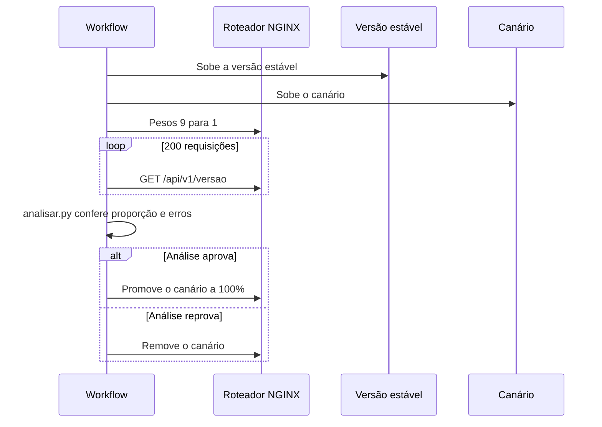

# Implantação canário com análise de proporção e de erros

## Problema que a prática resolve

Uma versão nova pode passar por todos os testes e ainda assim se comportar mal diante do tráfego real. A implantação canário reduz esse risco enviando a ela uma fração pequena das requisições, enquanto a versão estável atende o restante. O nome vem do canário que mineiros levavam às galerias para avisar da presença de gás. Se a fração exposta apresenta problemas, apenas uma parte dos usuários é afetada e a versão nova é retirada. Se não apresenta, o tráfego passa por inteiro para ela, que então se torna a versão estável.

O cenário 10 trocou todo o tráfego de uma cor para outra em um único passo. Este cenário divide o tráfego por pesos e decide a promoção com base em medições. O roteador é o NGINX, um servidor *web* que também encaminha requisições a outros serviços. Ele usa um grupo de destinos chamado *upstream*, no qual cada destino tem um peso, de modo que a proporção entre as requisições segue a proporção entre os pesos. A decisão de promover ou remover depende de duas medições, que são a proporção real de requisições atendidas pelo canário e a quantidade de erros.

## Workflow do cenário

O *workflow* `11-canario.yml` só dispara por `workflow_dispatch`, porque uma implantação em produção deve ser uma decisão explícita. O *workflow* declara no nível superior as permissões `contents: read` e `packages: read` e recebe três entradas de execução manual. A entrada `sha` identifica o *commit* da versão canário. A entrada opcional `sha_anterior` identifica o *commit* da versão estável. Quando ela fica vazia, as duas versões usam a mesma imagem e diferem apenas nas variáveis `APP_COLOR` e `APP_VERSION`. A entrada booleana `forcar_erros` para o contêiner do canário depois de iniciado, o que permite observar o caminho de remoção das requisições com erro sem alterar o código da API.

O job `preparar` valida cada *sha* por variável de ambiente com a expressão `^[0-9a-f]{7,40}$`, resolve o *sha* completo pela API do GitHub e confere com `docker buildx imagetools inspect` que as duas imagens `sha-<sha7>` existem no GHCR. O job `implantar` declara `environment: producao`, o que gera um registro de *deployment* por execução. Ele usa o grupo de `concurrency` `implantacao-producao` com `cancel-in-progress: false`, o mesmo do cenário 10, de modo que dois lançamentos nunca ocorrem ao mesmo tempo. Os passos do job seguem a ordem abaixo. A análise automática antes da promoção impede que uma versão defeituosa receba todo o tráfego dos usuários.

1. Sobe três contêineres, que são a versão estável com a cor `estavel`, o canário com a cor `canario` e o roteador. Cada versão é consultada diretamente em sua porta, com espera limitada, até responder a cor e a versão esperadas.
2. Executa `ajustar-pesos.sh weight=9 weight=1`, que grava no roteador um *upstream* ponderado de 9 para 1 e recarrega o NGINX. Como os processos antigos do NGINX encerram aos poucos e respondem 404 por instantes, o passo só termina depois de dez respostas seguidas com sucesso.
3. Quando a entrada `forcar_erros` é verdadeira, para o contêiner do canário. As requisições encaminhadas a ele passam a falhar.
4. Gera 200 requisições a `GET /api/v1/versao` pelo roteador e grava uma linha por requisição, com a cor informada pela API ou a palavra `erro` quando a requisição falha.
5. Executa `analisar.py --peso 0.10 --tolerancia 0.06` sobre essa saída. O programa sai com código 1 e reprova o passo em três casos. O primeiro é a ausência de amostras. O segundo é a presença de qualquer erro. O terceiro é uma proporção do canário que difere de 0,10 por mais de 0,06.
6. Se a análise aprova, o passo de promoção executa `ajustar-pesos.sh fora weight=1`, que apaga a versão estável do *upstream*. Em seguida confere que todas as respostas vêm do canário.
7. Se qualquer passo anterior falha, o passo com `if: failure()` mostra os logs, executa `ajustar-pesos.sh weight=1 fora` e confere que todas as respostas voltam a vir da versão estável. O job termina como reprovado, porque o lançamento não foi concluído.
8. O último passo, com `if: always()`, remove contêineres e volumes com `docker compose down -v`.

O NGINX distribui as requisições por rotação ponderada com ordem fixa. Por isso 200 requisições com pesos 9 e 1 resultam em 20 requisições ao canário, que correspondem à proporção de 0,10. A tolerância de 0,06 cobre a variação de um balanceador real, que sorteia o destino de cada requisição. O arquivo `nginx.conf.tmpl` usa a diretiva `max_fails=0` para que o NGINX continue enviando requisições a um destino que falhou. Usa também a diretiva `proxy_next_upstream off`, que impede a repetição da requisição no outro destino. Sem essas diretivas, os erros do canário ficariam escondidos e a análise aprovaria uma versão defeituosa.

O script `ajustar-pesos.sh` gera a configuração a partir do modelo, copia o arquivo para o contêiner `roteador` com `docker cp`, valida com `nginx -t` e executa `nginx -s reload`. A cópia substitui a montagem de volume. O valor `fora` apaga a linha do destino, o que permite remover um canário cujo contêiner já parou, pois o NGINX não consegue validar um *upstream* com nome que deixou de ser resolvido. O arquivo `compose.yml` usa variáveis na forma `${VARIAVEL:?mensagem}`, de modo que nenhuma variável `APP_*` chega vazia ao contêiner.

## Como executar

1. Escolha dois *commits* sobre os quais o *workflow* 08 publicou imagem. Os sete primeiros caracteres de cada um são os valores de `sha` e `sha_anterior`.
2. Dispare o lançamento com `gh workflow run 11-canario.yml -f sha=<sha7-canario> -f sha_anterior=<sha7-estavel>` e acompanhe com `gh run watch`. O resultado esperado é o job `implantar` verde, com 20 respostas `canario` e 180 respostas `estavel` na amostra, seguidas da promoção.
3. Para ver a remoção do canário, dispare com a entrada adicional `-f forcar_erros=true`. A amostra passa a conter 20 linhas `erro`, a análise reprova com a mensagem sobre erros, o passo de remoção aparece como executado e o job termina como reprovado.
4. Para exercitar a análise sem Docker, execute `printf 'canario\nestavel\n' | python3 cenarios/11-canario/analisar.py --peso 0.5 --tolerancia 0.1`. O programa imprime o resultado em JSON e o código de saída informa a decisão.
5. Execute `python -m pytest tests/pipelines/test_analisar_canario.py` para ver os casos de aprovação e de reprovação da análise.

## Como levar a prática a um sistema existente

1. Escolha as medições que decidem a promoção. Este repositório usa a proporção e a contagem de erros porque a API é mínima. Em um sistema real acrescentam-se latência, taxa de erros por rota e indicadores de negócio, comparados entre canário e versão estável.
2. Defina a fração inicial e o tempo de observação com base no volume de tráfego. Frações pequenas exigem tempo suficiente para que a amostra tenha significado estatístico.
3. Use um roteador que permita pesos por configuração. Servem a esse papel um balanceador de carga em nuvem, uma malha de serviços ou um *ingress* de Kubernetes. Automatize a mudança de pesos na esteira.
4. Automatize a remoção do canário em falha, de modo que a volta ao estado anterior não dependa de uma pessoa. Aumente a fração em etapas de 10, 25, 50 e 100 por cento quando o risco justificar.
5. Garanta que as duas versões convivam com o mesmo banco de dados e com as mesmas mensagens, como no cenário 10.

## Nível C3DM e fontes

O repositório agrupa o cenário no nível Avançado, que corresponde ao nível Avançado do domínio de implantação do modelo, dedicado à implantação sem parada. A página da [trilha](../../docs/trilha.md) explica como o agrupamento do repositório se relaciona com os níveis do modelo.

As fontes são a descrição do padrão *CanaryRelease* de Danilo Sato, publicada por Martin Fowler (https://martinfowler.com/bliki/CanaryRelease.html), a documentação do NGINX sobre o módulo `upstream` e a diretiva `weight` (https://nginx.org/en/docs/http/ngx_http_upstream_module.html) e o capítulo sobre implantação do livro *Continuous Delivery*, de Humble e Farley. A referência do livro está na [bibliografia](../../docs/referencia/bibliografia.md).
