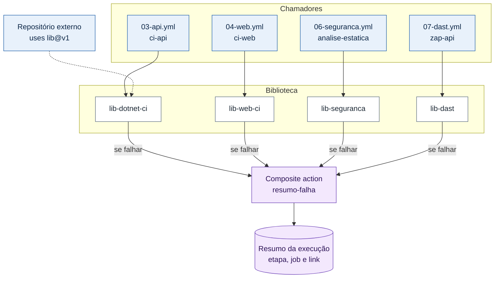

# Biblioteca de workflows reutilizáveis e composite action

## Problema que a prática resolve

Quando vários repositórios copiam o mesmo arquivo de esteira para atender a cada sistema, cada cópia evolui por conta própria. Uma correção de segurança aplicada a um repositório não chega aos demais. A versão da ferramenta de varredura fica diferente em cada lugar. O custo de manter a esteira cresce com o número de sistemas. Com isso a equipe perde a garantia de que todos eles passam pelas mesmas verificações. A correção de uma falha exige então repetir a mesma alteração em cada repositório.

O GitHub Actions oferece dois mecanismos para reaproveitar esse código. O primeiro é o *workflow* reutilizável, um arquivo YAML com o gatilho `workflow_call` que outro *workflow* chama no lugar de um passo e que executa jobs completos. O segundo é a *composite action*, um conjunto de passos empacotado em um arquivo `action.yml` que se usa como uma *action* comum dentro de um job. O cenário publica uma biblioteca com quatro *workflows* reutilizáveis e uma *composite action*. Os cenários 03, 04, 06 e 07 foram refatorados para consumi-la. Outros repositórios a utilizam pela versão `v1`, publicada ao final do cenário como a primeira versão maior da biblioteca.

## Workflow do cenário

Os arquivos da biblioteca ficam em `.github/workflows/` com o prefixo `lib-`, enquanto a *composite action* fica em `.github/actions/resumo-falha/action.yml`. Cada arquivo declara as entradas em `on.workflow_call.inputs` com `description` e `type`, conforme a tabela a seguir. O teste `test_entradas_documentadas` reprova qualquer entrada sem descrição, o que mantém a interface da biblioteca documentada no próprio código.

| Arquivo | Entradas | Jobs |
| --- | --- | --- |
| `lib-dotnet-ci.yml` | `solucao` (obrigatória), `dotnet-version` (`10.0.x`), `cobertura-minima` (`80`), `diretorio` (`.`), `incluir-cobertura` (vazia) | `integracao` |
| `lib-web-ci.yml` | `diretorio` (obrigatória), `node-version` (`24`) | `integracao` |
| `lib-seguranca.yml` | `linguagens` (obrigatória, lista JSON), `config-gitleaks` (`.gitleaks.toml`), `config-codeql` (vazia) | `codeql` e `segredos` |
| `lib-dast.yml` | `contexto-docker` e `alvo` (obrigatórias), `porta` (`8080`), `caminho-health` (`/health`), `regras-zap` (vazia), `nome-artefato` (`zap-api`) | `zap` |

O diagrama mostra os chamadores, as quatro bibliotecas e o caminho da *composite action* em caso de falha.



### Interface de um workflow reutilizável

Um *workflow* reutilizável é um arquivo YAML com o gatilho `workflow_call`, que outro *workflow* chama no lugar de um passo e que executa *jobs* completos. O trecho mostra a interface da biblioteca da aplicação web.

Arquivo completo: [`.github/workflows/lib-web-ci.yml`, linhas 5 a 18](https://github.com/arkhibr/devops-fluxos-c3dm/blob/main/.github/workflows/lib-web-ci.yml#L5-L18).

```yaml
on:
  workflow_call:
    inputs:
      diretorio:
        description: >-
          Pasta da aplicação, a partir da raiz do repositório chamador, que contém o package.json
          com os scripts lint, typecheck, test e build. Os limites de cobertura vêm da configuração
          do vitest do chamador.
        type: string
        required: true
      node-version:
        description: Versão do Node.js instalada pelo setup-node.
        type: string
        default: '24'
```

A chave `on.workflow_call.inputs` lista as entradas e cada uma tem descrição e tipo. A marca `required: true` obriga o chamador a informar a entrada e a presença de um valor padrão dispensa essa informação. O comentário que antecede o gatilho registra o endereço de chamada a partir de outro repositório na versão `v1`. A entrada `diretorio` é obrigatória porque não existe uma pasta padrão razoável, enquanto a versão do Node.js assume o valor 24 quando o chamador não a informa.

### Chamador neste repositório

Os cenários 03, 04, 06 e 07 deixaram de conter passos próprios nesses trechos. Cada um tem um *job* que declara `uses: ./.github/workflows/lib-*.yml` e informa as entradas na chave `with`.

Arquivo completo: [`.github/workflows/04-web.yml`, linhas 18 a 26](https://github.com/arkhibr/devops-fluxos-c3dm/blob/main/.github/workflows/04-web.yml#L18-L26).

```yaml
permissions:
  contents: read

jobs:
  ci-web:
    uses: ./.github/workflows/lib-web-ci.yml
    with:
      diretorio: apps/web
      node-version: '24'
```

A referência começa por `./` porque o chamador e a biblioteca estão no mesmo repositório, de modo que a versão chamada é a do próprio *commit*. Os nomes `ci-api` e `ci-web` permanecem distintos das verificações obrigatórias `pytest`, `actionlint`, `build` e `titulo`. O contexto exibido no *pull request* passa a ter a forma `ci-web / integracao`, composta pelo nome do *job* chamador e pelo nome do *job* da biblioteca. Os *jobs* que provam a falha esperada continuam nos cenários 06 e 07, pois descrevem o experimento didático e não a prática reutilizável.

### Composite action

A *composite action* é um conjunto de passos empacotado em um arquivo `action.yml`, que se usa como uma *action* comum dentro de um *job*. A *action* `resumo-falha` recebe a entrada `etapa` e grava no arquivo apontado por `GITHUB_STEP_SUMMARY` três linhas com a etapa, o *job* e o *link* da execução.

Arquivo completo: [`.github/actions/resumo-falha/action.yml`, linhas 1 a 25](https://github.com/arkhibr/devops-fluxos-c3dm/blob/main/.github/actions/resumo-falha/action.yml#L1-L25).

```yaml
name: Resumo de falha
description: Grava no resumo da execução a etapa que falhou, o job e o link da execução.

inputs:
  etapa:
    description: Nome legível da etapa ou do conjunto de etapas que falhou.
    required: true

runs:
  using: composite
  steps:
    - name: Gravar o resumo da falha
      shell: bash
      env:
        ETAPA: ${{ inputs.etapa }}
        JOB: ${{ github.job }}
        LINK: ${{ github.server_url }}/${{ github.repository }}/actions/runs/${{ github.run_id }}
      run: |
        {
          echo "### Falha na esteira"
          echo
          echo "- Etapa: ${ETAPA}"
          echo "- Job: ${JOB}"
          echo "- Execução: ${LINK}"
        } >> "$GITHUB_STEP_SUMMARY"
```

A chave `runs.using: composite` declara o tipo da *action*. O passo declara `shell: bash`, exigido de todo passo com `run` em uma *composite action*. Os valores entram no *script* por variáveis de ambiente, porque a interpolação direta de `${{ }}` no texto do comando permitiria que uma entrada fosse interpretada como código de *shell*. O *link* da execução usa `github.server_url`, `github.repository` e `github.run_id` do contexto do GitHub Actions.

### Condicionais, expressões e tratamento de erro

Todo *job* da biblioteca termina com um passo `if: ${{ failure() }}` que chama a *action* `resumo-falha`. A função `failure()` devolve verdadeiro quando um passo anterior do mesmo *job* falhou, de modo que o leitor recebe o resumo sem abrir o registro completo da execução.

Arquivo completo: [`.github/workflows/lib-dotnet-ci.yml`, linhas 76 a 80](https://github.com/arkhibr/devops-fluxos-c3dm/blob/main/.github/workflows/lib-dotnet-ci.yml#L76-L80).

```yaml
      - name: Resumir a falha
        if: ${{ failure() }}
        uses: arkhibr/devops-fluxos-c3dm/.github/actions/resumo-falha@v1
        with:
          etapa: CI da solução ${{ inputs.solucao }}
```

O teste `test_lib_termina_com_resumo_de_falha` verifica que esse passo é o último de cada *job* da biblioteca, o que garante o resumo em qualquer falha. A biblioteca usa também condicionais e expressões dinâmicas em outros pontos. O *job* de CodeQL mostra dois exemplos no trecho a seguir.

Arquivo completo: [`.github/workflows/lib-seguranca.yml`, linhas 28 a 37](https://github.com/arkhibr/devops-fluxos-c3dm/blob/main/.github/workflows/lib-seguranca.yml#L28-L37).

```yaml
  codeql:
    if: github.event_name != 'pull_request' || github.event.pull_request.head.repo.full_name == github.repository
    runs-on: ubuntu-latest
    permissions:
      contents: read
      security-events: write
    strategy:
      fail-fast: false
      matrix:
        language: ${{ fromJSON(inputs.linguagens) }}
```

A condição de `if` só deixa passar *push* ou *pull request* originado no próprio repositório, porque o `GITHUB_TOKEN` de um *fork* é somente leitura e a publicação dos alertas falharia. A matriz de linguagens vem da expressão `fromJSON(inputs.linguagens)`, que converte o texto JSON da entrada em uma lista para que cada chamador defina as próprias linguagens. A função `contains` não é usada nesta biblioteca, embora sirva a casos como `contains(github.event.pull_request.labels.*.name, 'dast')`, que roda um *job* apenas quando o *pull request* tem um rótulo.

A biblioteca também trata a ausência de arquivos do chamador. O Gitleaks usa `--config` somente quando o arquivo informado existe e aplica as regras padrão no caso contrário. O CodeQL e o ZAP recebem o caminho de configuração como entrada, de modo que o valor vazio faz a ferramenta rodar sem arquivo de configuração. O teste `test_lib_nao_depende_de_arquivos_deste_repositorio` garante que nenhum caminho de `apps/`, `.zap/` ou `cenarios/` aparece nos arquivos da biblioteca. A espera pelo *health* da aplicação em `lib-dast.yml` tem limite de 60 tentativas, com um segundo entre elas. Ao esgotá-las, o passo imprime os registros do contêiner com `docker logs` e falha. Quando `regras-zap` aponta para um arquivo inexistente, o *job* emite um `::warning::` e roda o ZAP sem regras. O mesmo aviso vale para a configuração do Gitleaks ausente no repositório chamador.

### Uso a partir de outro repositório

O *workflow* reutilizável executa `actions/checkout` sem o parâmetro `repository`, de modo que o repositório baixado é sempre o do chamador. A *composite action* é chamada com o endereço completo `arkhibr/devops-fluxos-c3dm/.github/actions/resumo-falha@v1`, pois um caminho local como `./.github/actions/resumo-falha` seria procurado no repositório chamador, onde o arquivo não existe. As demais *actions* continuam fixadas por SHA. O teste estrutural de fixação cobre também os `uses:` dentro de `action.yml`, o que estende a regra às *composite actions* do repositório. A referência `@v1` à *composite action* dentro da biblioteca é a única exceção à regra de SHA. Uma correção nela só chega aos chamadores externos depois que a *tag* `v1` avança para o *commit* que a contém.

O chamador de um repositório externo é o do `net-minimal-api`, apresentado no [cenário 14](../../docs/cenarios/14.md). A ramificação `devops/esteira-c3dm` ainda não foi incorporada à `main` daquele repositório e o *pull request* correspondente está em https://github.com/arkhibr/net-minimal-api/pull/1.

Arquivo completo na ramificação do *pull request*: [`.github/workflows/ci.yml`, linhas 4 a 22](https://github.com/arkhibr/net-minimal-api/blob/devops/esteira-c3dm/.github/workflows/ci.yml#L4-L22).

```yaml
on:
  pull_request:
  push:
    branches: [main]

permissions:
  contents: read

concurrency:
  group: ci-${{ github.ref }}
  cancel-in-progress: true

jobs:
  ci:
    uses: arkhibr/devops-fluxos-c3dm/.github/workflows/lib-dotnet-ci.yml@v1
    with:
      solucao: ProdutosAPI.ci.slnf
      cobertura-minima: 60
      incluir-cobertura: "[ProdutosAPI]*,[Catalogo.*]*,[Pix.*]*"
```

O chamador dispara em `pull_request` e em `push` na `main`, declara `permissions: contents: read` e chama `lib-dotnet-ci.yml@v1` com as entradas da biblioteca. Os demais chamadores seguem o mesmo formato, com as exigências descritas a seguir. A `lib-dotnet-ci.yml` exige que cada projeto de testes do chamador referencie o pacote `coverlet.collector`. Com a entrada `incluir-cobertura` vazia, a medição abrange todos os *assemblies* carregados, inclusive os de terceiros. A `lib-web-ci.yml` supõe que o `package.json` do chamador tenha os *scripts* `lint`, `typecheck`, `test` e `build`. Os limites de cobertura dessa biblioteca são os que a configuração do vitest do chamador define para o projeto dele. Os endereços são `arkhibr/devops-fluxos-c3dm/.github/workflows/lib-web-ci.yml@v1`, `arkhibr/devops-fluxos-c3dm/.github/workflows/lib-seguranca.yml@v1` e `arkhibr/devops-fluxos-c3dm/.github/workflows/lib-dast.yml@v1`. Quem chama `lib-seguranca.yml` precisa conceder `security-events: write` ao *job* chamador, pois um *workflow* chamado nunca recebe mais permissões do que o chamador possui. Em repositório privado o *job* também precisa de `actions: read` para o CodeQL consultar a execução.

### Versão v1

As versões `v1.0.0` e `v1.0.1` foram publicadas manualmente porque a organização bloqueia a abertura de *pull requests* pelo GitHub Actions, o que impede o `release-please` de abrir o *pull request* de *release*. A *tag* móvel `v1` do cenário 01 aponta para a última versão `v1.x.y` publicada, que hoje é a `v1.0.1`. Uma mudança que quebra a compatibilidade das entradas exige uma nova versão maior chamada `v2`. Os chamadores que usam a versão maior 1 continuam funcionando até migrarem para a versão maior 2.

Os *workflows* da biblioteca referenciam a *composite action* `resumo-falha` pela *tag* móvel `@v1`, sem fixar um SHA. Um chamador que fixa o *workflow* da biblioteca por SHA continua recebendo a *composite action* pela *tag* móvel, que o mantenedor pode reapontar para outro *commit*. Esse comportamento facilita a publicação de correções, porém contraria a recomendação de segurança da cadeia de suprimentos, que pede referências imutáveis. Para evitá-la, o mantenedor da biblioteca pode fixar a *action* por SHA dentro dos próprios *workflows* e atualizar o SHA a cada *release*, mantendo a versão em comentário. O chamador também pode copiar a biblioteca para um repositório próprio e fixar nele todas as referências.

### Arquivos do cenário

| Arquivo | Papel |
| --- | --- |
| [`.github/workflows/lib-dotnet-ci.yml`](https://github.com/arkhibr/devops-fluxos-c3dm/blob/main/.github/workflows/lib-dotnet-ci.yml) | Biblioteca de CI para soluções .NET. |
| [`.github/workflows/lib-web-ci.yml`](https://github.com/arkhibr/devops-fluxos-c3dm/blob/main/.github/workflows/lib-web-ci.yml) | Biblioteca de CI para aplicações Node. |
| [`.github/workflows/lib-seguranca.yml`](https://github.com/arkhibr/devops-fluxos-c3dm/blob/main/.github/workflows/lib-seguranca.yml) | Biblioteca de CodeQL e Gitleaks. |
| [`.github/workflows/lib-dast.yml`](https://github.com/arkhibr/devops-fluxos-c3dm/blob/main/.github/workflows/lib-dast.yml) | Biblioteca de varredura dinâmica com ZAP. |
| [`.github/actions/resumo-falha/action.yml`](https://github.com/arkhibr/devops-fluxos-c3dm/blob/main/.github/actions/resumo-falha/action.yml) | *Composite action* que grava a falha no resumo da execução. |
| [`tests/pipelines/test_12_biblioteca.py`](https://github.com/arkhibr/devops-fluxos-c3dm/blob/main/tests/pipelines/test_12_biblioteca.py) | Testes estruturais da biblioteca. |

## Como executar

1. Abra um *pull request* que altere `apps/api/` e confira na aba de verificações o contexto `ci-api / integracao`. Ele vem do chamador do cenário 03 e do job da biblioteca.
2. Quebre de propósito a biblioteca, por exemplo apontando `solucao` para um arquivo inexistente. Observe o resumo da execução com a etapa, o job e o link gravados pela *action* `resumo-falha`.
3. Rode `python -m pytest tests/pipelines/test_12_biblioteca.py -q` e confira que as entradas têm descrição, que todo job termina com o resumo de falha e que a biblioteca não referencia arquivos deste repositório.
4. Em outro repositório, crie um *workflow* com o chamador do `net-minimal-api` apresentado na seção anterior e execute-o. O job aparece na lista de verificações com o nome `api / integracao`.

## Como levar a prática a um sistema existente

1. Escolha o trecho mais copiado entre os repositórios, que costuma ser a compilação com testes. Extraia-o para um *workflow* reutilizável com `on: workflow_call` e declare como entrada tudo o que varia entre os sistemas.
2. Documente cada entrada com `description` e valor padrão. Trate como obrigatória apenas a que não tem padrão razoável. Teste a biblioteca em um repositório piloto antes de espalhá-la.
3. Publique uma versão com *tag* e mantenha a *tag* móvel da versão maior, como no cenário 01. Os chamadores que usam `@v1` recebem correções compatíveis sem alterar seus arquivos.
4. Trate toda remoção ou renomeação de entrada como mudança de versão maior, para que nenhum chamador quebre sem aviso.
5. Evite que a biblioteca dependa de arquivos do repositório que a publica. Receba os caminhos de configuração por entrada e defina o comportamento para o caso de o arquivo não existir.
6. Mantenha a fixação por SHA nas *actions* de terceiros dentro da biblioteca, porque uma alteração ali afeta todos os chamadores.

## Nível C3DM e fontes

O repositório agrupa o cenário no nível Avançado, no eixo transversal, embora o modelo C3DM não tenha domínio dedicado ao reaproveitamento de esteiras. A [trilha](../../docs/trilha.md) explica essa diferença entre o agrupamento do repositório e os níveis do modelo.

As fontes são a documentação do GitHub sobre *workflows* reutilizáveis (https://docs.github.com/actions/sharing-automations/reusing-workflows), a sobre *composite actions* (https://docs.github.com/actions/sharing-automations/creating-actions/creating-a-composite-action) e a de expressões e funções de status como `failure()` (https://docs.github.com/actions/reference/workflows-and-actions/expressions). O texto do modelo está na [bibliografia](../../docs/referencia/bibliografia.md).
