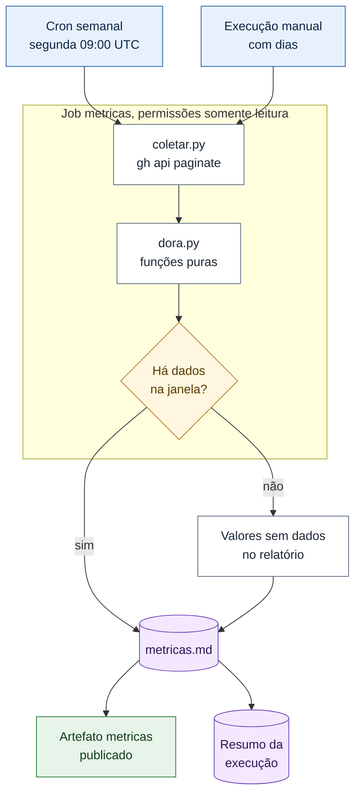
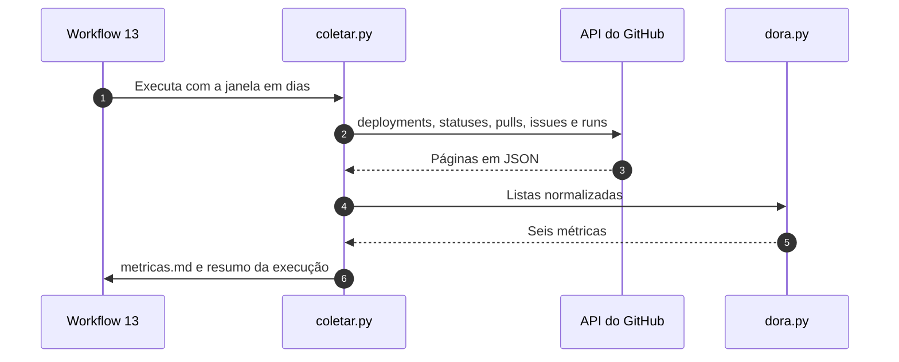

# Métricas DORA e métricas de esteira pela API do GitHub

## Problema que a prática resolve

Sem medição, uma equipe não sabe se as práticas dos cenários anteriores alteraram o resultado da entrega. A pesquisa *DORA* definiu quatro métricas para essa finalidade, descritas na página de [métricas](../../docs/referencia/metricas.md). A sigla designa *DevOps Research and Assessment*, um programa de levantamentos anuais sobre práticas de entrega de software. A frequência de implantação e o prazo de entrega de mudanças medem a velocidade da entrega. A taxa de falha de mudanças e o tempo de recuperação de implantação com falha medem a estabilidade. Este cenário calcula as quatro a partir de dados que o próprio GitHub já registra, sem ferramenta paga nem instrumentação da aplicação. Uma execução de *workflow* é uma rodada de um arquivo da pasta `.github/workflows/`. O cenário acrescenta duas métricas da esteira, que são a taxa de sucesso e a duração mediana dessas execuções.

Os dados vêm da API REST do GitHub, a interface de consulta por requisições HTTP que a CLI `gh` expõe no comando `gh api`. Os registros de *deployment*, criados toda vez que um job declara `environment:`, informam quando cada versão chegou a produção. As *issues* com o rótulo `incidente` informam falhas percebidas pelos usuários e o tempo até a correção. Os *pull requests* incorporados e as execuções de *workflow* completam as fontes. Os *pull requests* permitem medir o intervalo entre o primeiro *commit* e a produção.

## Workflow do cenário

O arquivo `13-metricas.yml` dispara toda segunda-feira às 09:00 UTC e por `workflow_dispatch`. O código se divide em dois arquivos Python. O arquivo `coletar.py` é o único que acessa a rede e o arquivo `dora.py` contém funções puras sobre listas de dicionários. O primeiro diagrama mostra o caminho do gatilho ao artefato `metricas` e a sequência seguinte detalha as chamadas entre os componentes.





### Agenda e permissões

O disparo manual permite escolher a janela de coleta em dias com padrão de 30 dias. As cinco permissões do nível superior valem `read` no arquivo do *workflow* 13.

Arquivo completo: [`.github/workflows/13-metricas.yml`, linhas 3 a 19](https://github.com/arkhibr/devops-fluxos-c3dm/blob/main/.github/workflows/13-metricas.yml#L3-L19).

```yaml
on:
  schedule:
    - cron: "0 9 * * 1"
  workflow_dispatch:
    inputs:
      dias:
        description: Tamanho da janela de coleta, em dias
        required: false
        type: string
        default: "30"

permissions:
  contents: read
  deployments: read
  issues: read
  actions: read
  pull-requests: read
```

O gatilho `schedule` usa a expressão `cron` `0 9 * * 1`, que significa minuto 0 da hora 9 de toda segunda-feira. Os escopos de leitura cobrem código, implantações, execuções e *pull requests* do repositório. Com essa configuração o *token* do *workflow* nunca escreve no repositório e isso reduz o dano possível de uma alteração indevida na coleta feita pelo GitHub Actions.

### Job de coleta

O único *job* executa `coletar.py`, que grava o relatório em `metricas.md` e o acrescenta ao resumo da execução em `$GITHUB_STEP_SUMMARY`.

Arquivo completo: [`.github/workflows/13-metricas.yml`, linhas 21 a 36](https://github.com/arkhibr/devops-fluxos-c3dm/blob/main/.github/workflows/13-metricas.yml#L21-L36).

```yaml
jobs:
  metricas:
    runs-on: ubuntu-latest
    steps:
      - uses: actions/checkout@11bd71901bbe5b1630ceea73d27597364c9af683  # v4.2.2
      - name: Coletar dados pela API e calcular as métricas
        env:
          GH_TOKEN: ${{ github.token }}
          DIAS: ${{ inputs.dias || '30' }}
        run: python3 cenarios/13-metricas-dora/coletar.py --dias "$DIAS" --saida metricas.md
      - name: Publicar o relatório como artefato
        uses: actions/upload-artifact@cf430e030ddbb5b0abf93d22962f4752f3646cd9  # v7.0.2
        with:
          name: metricas
          path: metricas.md
          if-no-files-found: error
```

A variável `DIAS` recebe `inputs.dias` ou o valor `'30'` quando a execução vem do agendamento, porque `inputs` é vazio nesse caso. O passo final publica o arquivo como artefato de nome `metricas`. A opção `if-no-files-found: error` reprova a execução se o relatório não existir ao fim do passo anterior.

### Coleta pela API do GitHub

A função `chamar` é o único ponto de acesso à rede. Ela executa `gh api --method GET --paginate` e junta as páginas em uma lista.

Arquivo completo: [`cenarios/13-metricas-dora/coletar.py`, linhas 19 a 35](https://github.com/arkhibr/devops-fluxos-c3dm/blob/main/cenarios/13-metricas-dora/coletar.py#L19-L35).

```python
def chamar(caminho: str, **parametros: str) -> list[dict]:
    """Executa `gh api --paginate` e junta as páginas em uma lista."""
    comando = ["gh", "api", "--method", "GET", "--paginate", caminho]
    for chave, valor in parametros.items():
        comando += ["-f", f"{chave}={valor}"]
    resultado = subprocess.run(comando, capture_output=True, text=True)
    if resultado.returncode != 0:
        sys.exit(f"Falha em {' '.join(comando)}: {resultado.stderr.strip()}")
    saida = resultado.stdout
    decodificador, posicao, itens = json.JSONDecoder(), 0, []
    while posicao < len(saida):
        if saida[posicao].isspace():
            posicao += 1
            continue
        pagina, posicao = decodificador.raw_decode(saida, posicao)
        itens.extend(pagina["workflow_runs"] if isinstance(pagina, dict) and "workflow_runs" in pagina else pagina)
    return itens
```

A opção `--paginate` segue as páginas da resposta e a CLI concatena os documentos JSON um após o outro, que o decodificador `raw_decode` lê em sequência. Quando a resposta é um objeto com a chave `workflow_runs`, a função usa a lista contida nele. Uma falha do comando encerra o programa com a mensagem do erro e o código de saída diferente de 0.

Arquivo completo: [`cenarios/13-metricas-dora/coletar.py`, linhas 38 a 44](https://github.com/arkhibr/devops-fluxos-c3dm/blob/main/cenarios/13-metricas-dora/coletar.py#L38-L44).

```python
def coletar_deployments(repo: str, desde: datetime) -> list[dict]:
    deployments = chamar(f"repos/{repo}/deployments", environment=dora.PRODUCAO, per_page="100")
    deployments = [d for d in deployments if datetime.fromisoformat(d["created_at"].replace("Z", "+00:00")) >= desde]
    for deployment in deployments:
        statuses = chamar(f"repos/{repo}/deployments/{deployment['id']}/statuses", per_page="100")
        deployment["estado"] = dora.estado_final(statuses)
    return deployments
```

Para cada *deployment* de `producao` o programa consulta `/deployments/{id}/statuses` e guarda o estado terminal mais recente, porque o estado não aparece no objeto do *deployment*. Para cada *pull request* incorporado, a função `coletar_prs` busca os *commits* e guarda a data do mais antigo.

### Cálculo das métricas

As funções de `dora.py` são puras e testadas em `tests/pipelines/test_dora.py` com os *fixtures* de `tests/pipelines/dados/`. A função `estado_final` resolve a ambiguidade dos *statuses*.

Arquivo completo: [`cenarios/13-metricas-dora/dora.py`, linhas 26 a 36](https://github.com/arkhibr/devops-fluxos-c3dm/blob/main/cenarios/13-metricas-dora/dora.py#L26-L36).

```python
def estado_final(statuses: list[dict]) -> str | None:
    """Devolve o estado terminal mais recente de um deployment.

    A API lista os statuses do mais novo para o mais antigo. Os estados `inactive`,
    `in_progress` e `queued` não dizem se a implantação deu certo, e `inactive` é
    gravado pelo GitHub quando um deployment posterior o substitui.
    """
    for status in statuses:
        if status.get("state") in ESTADOS_TERMINAIS:
            return status["state"]
    return None
```

O GitHub grava o estado `inactive` quando um *deployment* posterior substitui o anterior. Por isso a função ignora também os estados `queued` e `in_progress` e devolve o primeiro estado terminal da lista, que a API ordena do mais novo para o mais antigo.

Arquivo completo: [`cenarios/13-metricas-dora/dora.py`, linhas 74 a 89](https://github.com/arkhibr/devops-fluxos-c3dm/blob/main/cenarios/13-metricas-dora/dora.py#L74-L89).

```python
def taxa_falha(deployments: list[dict], incidentes: list[dict]) -> float:
    """Fração de implantações de produção com falha ou seguidas de incidente.

    Um incidente é atribuído ao último deployment de produção criado antes dele, de
    modo que cobre o intervalo até o próximo deployment. Cada deployment conta uma vez.
    """
    todos = _producao(deployments)
    if not todos:
        return 0.0
    com_falha = {d["id"] for d in todos if d["estado"] != "success"}
    for incidente in incidentes:
        abertura = _data(incidente["created_at"])
        anteriores = [d for d in todos if _data(d["created_at"]) <= abertura]
        if anteriores:
            com_falha.add(anteriores[-1]["id"])
    return len(com_falha) / len(todos)
```

A função `taxa_falha` conta cada implantação uma vez, mesmo quando ela tem estado de falha e também um incidente associado, porque o conjunto de falhas guarda identificadores e cada incidente é atribuído ao último *deployment* criado antes da abertura dele. Sem implantações o resultado é 0. A tabela a seguir resume o cálculo das 6 métricas.

| Métrica | Cálculo em `dora.py` |
| --- | --- |
| Frequência de implantação | Implantações de produção com estado `success` divididas pelos dias da janela. |
| Prazo de entrega de mudanças | Mediana, por *pull request*, entre o primeiro *commit* e o primeiro *deployment* de produção bem-sucedido cujo `sha` é o *merge commit* ou cuja criação é posterior ao merge. |
| Taxa de falha de mudanças | Implantações de produção com estado `failure` ou `error`, ou seguidas de *issue* `incidente` aberta antes da implantação seguinte, divididas pelo total de implantações concluídas. Cada implantação conta uma vez. |
| Tempo de recuperação de implantação com falha | Mediana de `closed_at` menos `created_at` das *issues* `incidente` fechadas. |
| Taxa de sucesso das execuções | Execuções com conclusão `success` divididas pelas concluídas com `success`, `failure` ou `timed_out`. Canceladas e em andamento ficam fora. |
| Duração mediana das execuções | Mediana de `updated_at` menos `run_started_at` das mesmas execuções concluídas. |

Sem dados suficientes, a frequência e as taxas valem 0 no relatório. O prazo de entrega, o tempo de recuperação e a duração aparecem como "sem dados" porque a mediana de uma lista vazia não existe. Nesse caso as funções `prazo_entrega`, `tempo_restauracao` e `duracao_mediana` devolvem `None`, que o relatório converte em texto para não apresentar um valor inventado.

### Limites do cálculo

O prazo de entrega é uma aproximação. Nos cenários disparados por `workflow_run`, como o 09, o `sha` do *deployment* é o HEAD da *branch* `main` no momento da execução e não o *commit* da imagem implantada. Verificar se esse `sha` descende do *merge commit* exigiria consultar o grafo de *commits* para cada par. O cálculo usa a ordem de `created_at` e associa cada *pull request* ao primeiro *deployment* bem-sucedido criado depois do *merge*. Quando a implantação ocorre sempre sobre o HEAD, as duas definições coincidem. Se alguém implanta manualmente um *commit* antigo depois do *merge*, o prazo medido fica menor que o real.

Os cenários 10 e 11 têm entradas de execução manual que fazem a implantação falhar de propósito, chamadas `simular_falha` e `forcar_erros`. Elas deixam *deployments* de `producao` com estado `failure`. O cálculo os conta como falhas, porque são tentativas reais de implantação que não chegaram ao fim. Por esse motivo a taxa de falha deste repositório didático supera a de um sistema em uso normal. A *issue* de incidente também não é aberta automaticamente, pois a abertura e o fechamento dependem de uma pessoa e o tempo de recuperação só existe se houver essa prática.

### Arquivos do cenário

| Arquivo | Papel |
| --- | --- |
| [`.github/workflows/13-metricas.yml`](https://github.com/arkhibr/devops-fluxos-c3dm/blob/main/.github/workflows/13-metricas.yml) | *Workflow* agendado que coleta e publica as métricas. |
| [`cenarios/13-metricas-dora/coletar.py`](https://github.com/arkhibr/devops-fluxos-c3dm/blob/main/cenarios/13-metricas-dora/coletar.py) | Coleta pela API do GitHub e gravação do relatório. |
| [`cenarios/13-metricas-dora/dora.py`](https://github.com/arkhibr/devops-fluxos-c3dm/blob/main/cenarios/13-metricas-dora/dora.py) | Funções puras que calculam as seis métricas. |
| [`tests/pipelines/test_dora.py`](https://github.com/arkhibr/devops-fluxos-c3dm/blob/main/tests/pipelines/test_dora.py) | Testes das funções com *fixtures*. |
| [`tests/pipelines/dados/`](https://github.com/arkhibr/devops-fluxos-c3dm/blob/main/tests/pipelines/dados) | Dados de exemplo no formato da API. |

## Como executar

1. Crie o rótulo uma única vez com `gh label create incidente --color B60205 --description "Incidente em produção"`. Para registrar um incidente, abra uma *issue* com esse rótulo quando a falha for percebida e feche-a quando o serviço for restaurado.
2. Dispare a coleta com `gh workflow run 13-metricas.yml` e acompanhe com `gh run watch`. Para outra janela, acrescente `-f dias=60`.
3. Leia o resumo na página da execução ou baixe o artefato com `gh run download -n metricas`. O resultado esperado é uma tabela com as seis métricas. Antes dela aparece a base de cálculo, com a quantidade de implantações, de *pull requests* e de incidentes. A mesma linha informa o total de execuções consideradas.
4. Para executar localmente, autentique a CLI com `gh auth login` e rode `python3 cenarios/13-metricas-dora/coletar.py --dias 30 --repositorio <dono>/<nome>`.
5. Rode `python -m pytest tests/pipelines/test_dora.py` para ver os testes das funções puras com os *fixtures*.

## Como levar a prática a um sistema existente

1. Garanta que a esteira de implantação use `environment:` com o nome da etapa, pois sem ele o GitHub não cria registros de *deployment*. Sistemas que implantam por outra ferramenta devem registrar o *deployment* e o status pela API.
2. Defina o que é incidente e quem o registra. A taxa de falha e o tempo de recuperação só têm significado se as *issues* forem abertas e fechadas de forma consistente.
3. Registre a medição inicial antes de adotar uma prática nova e repita a coleta depois. A leitura conjunta das quatro métricas evita que a melhora de uma esconda a piora de outra.
4. Use as métricas para orientar melhorias do processo e não como meta individual, pelo motivo descrito na página de [métricas](../../docs/referencia/metricas.md).
5. Em organizações com muitos repositórios, o mesmo cálculo pode ser repetido por repositório e consolidado em um painel. Planos pagos do GitHub e do GitLab oferecem painéis prontos.

## Nível C3DM e fontes

O repositório agrupa o cenário no nível Avançado. O modelo C3DM não tem domínio de medição da entrega que corresponda a ele, como explica a página da [trilha](../../docs/trilha.md).

A fonte principal é o livro *Accelerate*, de Forsgren, Humble e Kim. Sua referência completa consta da [bibliografia](../../docs/referencia/bibliografia.md). O relatório *Accelerate State of DevOps 2024* atualiza as definições das métricas e é a base da terminologia desta página. A documentação da API REST do GitHub sobre *deployments*, em https://docs.github.com/en/rest/deployments, descreve os registros e os status usados no cálculo.
