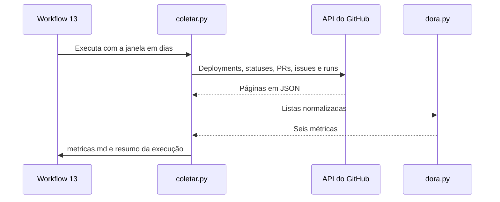

# Métricas DORA e métricas de esteira pela API do GitHub

## Problema que a prática resolve

Sem medição, uma equipe não sabe se as práticas dos cenários anteriores alteraram o resultado da entrega. A pesquisa *DORA* definiu quatro métricas para essa finalidade, descritas na página de [métricas](../../docs/referencia/metricas.md). A sigla designa *DevOps Research and Assessment*, um programa de levantamentos anuais sobre práticas de entrega de software. A frequência de implantação e o prazo de entrega de mudanças medem a velocidade da entrega. A taxa de falha de mudanças e o tempo de recuperação de implantação com falha medem a estabilidade. Este cenário calcula as quatro a partir de dados que o próprio GitHub já registra, sem ferramenta paga nem instrumentação da aplicação. Uma execução de *workflow* é uma rodada de um arquivo da pasta `.github/workflows/`. O cenário acrescenta duas métricas da esteira, que são a taxa de sucesso e a duração mediana dessas execuções.

Os dados vêm da API REST do GitHub, a interface de consulta por requisições HTTP que a CLI `gh` expõe no comando `gh api`. Os registros de *deployment*, criados toda vez que um job declara `environment:`, informam quando cada versão chegou a produção. As *issues* com o rótulo `incidente` informam falhas percebidas pelos usuários e o tempo até a correção. Os *pull requests* incorporados e as execuções de *workflow* completam as fontes. Os *pull requests* permitem medir o intervalo entre o primeiro *commit* e a produção.

## Workflow do cenário

O arquivo `13-metricas.yml` dispara toda segunda-feira às 09:00 UTC e por `workflow_dispatch`. Esse segundo disparo permite escolher a janela de coleta em dias, com padrão de 30. Todas as cinco permissões do nível superior valem `read`. Os escopos de código, de implantações e de *issues* usam `contents`, `deployments` e `issues`. Os escopos de execuções e de *pull requests* usam `actions` e `pull-requests` na mesma modalidade de leitura. Com essa configuração o token do *workflow* nunca escreve no repositório, o que reduz o dano possível de uma alteração indevida. O único job executa `coletar.py`, que grava o relatório em `metricas.md` e o acrescenta ao resumo da execução em `$GITHUB_STEP_SUMMARY`. Um passo final publica o arquivo como artefato de nome `metricas`, que fica disponível para download pela página da execução.

O código se divide em dois arquivos. O arquivo `coletar.py` é o único que acessa a rede, por meio de `gh api --method GET --paginate`, que segue as páginas da resposta. Para cada *deployment* de `producao` ele consulta `/deployments/{id}/statuses` e guarda o estado terminal mais recente, porque o estado não aparece no objeto do *deployment*. O GitHub grava o estado `inactive` quando um *deployment* posterior substitui o anterior. Por isso a função `estado_final` ignora `inactive`, `queued` e `in_progress` e devolve o primeiro entre `success`, `failure` e `error`. Para cada *pull request* incorporado, o programa busca os *commits* e guarda a data do mais antigo.

O arquivo `dora.py` contém funções puras sobre listas de dicionários, testadas em `tests/pipelines/test_dora.py` com os *fixtures* de `tests/pipelines/dados/`. Os cálculos são os seguintes.

| Métrica | Cálculo em `dora.py` |
| --- | --- |
| Frequência de implantação | Implantações de produção com estado `success` divididas pelos dias da janela. |
| Prazo de entrega de mudanças | Mediana, por *pull request*, entre o primeiro *commit* e o primeiro *deployment* de produção bem-sucedido cujo `sha` é o *merge commit* ou cuja criação é posterior ao merge. |
| Taxa de falha de mudanças | Implantações de produção com estado `failure` ou `error`, ou seguidas de *issue* `incidente` aberta antes da implantação seguinte, divididas pelo total de implantações concluídas. Cada implantação conta uma vez. |
| Tempo de recuperação de implantação com falha | Mediana de `closed_at` menos `created_at` das *issues* `incidente` fechadas. |
| Taxa de sucesso das execuções | Execuções com conclusão `success` divididas pelas concluídas com `success`, `failure` ou `timed_out`. Canceladas e em andamento ficam fora. |
| Duração mediana das execuções | Mediana de `updated_at` menos `run_started_at` das mesmas execuções concluídas. |

Sem dados suficientes, a frequência e as taxas valem 0 no relatório. O prazo de entrega, o tempo de recuperação e a duração aparecem como "sem dados" porque a mediana de uma lista vazia não existe. Nesse caso as funções `prazo_entrega`, `tempo_restauracao` e `duracao_mediana` devolvem `None`, que o relatório converte em texto para não apresentar um valor inventado.

### Limites do cálculo

O prazo de entrega é uma aproximação. Nos cenários disparados por `workflow_run`, como o 09, o `sha` do *deployment* é o HEAD da branch `main` no momento da execução e não o *commit* da imagem implantada. Verificar se esse `sha` descende do *merge commit* exigiria consultar o grafo de *commits* para cada par. O cálculo usa a ordem de `created_at` e associa cada *pull request* ao primeiro *deployment* bem-sucedido criado depois do *merge*. Quando a implantação ocorre sempre sobre o HEAD, as duas definições coincidem. Se alguém implanta manualmente um *commit* antigo depois do *merge*, o prazo medido fica menor que o real.

Os cenários 10 e 11 têm entradas de execução manual que fazem a implantação falhar de propósito, chamadas `simular_falha` e `forcar_erros`. Elas deixam *deployments* de `producao` com estado `failure`. O cálculo os conta como falhas, porque são tentativas reais de implantação que não chegaram ao fim. Por esse motivo a taxa de falha deste repositório didático supera a de um sistema em uso normal. A *issue* de incidente também não é aberta automaticamente, pois a abertura e o fechamento dependem de uma pessoa e o tempo de recuperação só existe se houver essa prática.

## Como executar

1. Crie o rótulo uma única vez com `gh label create incidente --color B60205 --description "Incidente em produção"`. Para registrar um incidente, abra uma *issue* com esse rótulo quando a falha for percebida e feche-a quando o serviço for restaurado.
2. Dispare a coleta com `gh workflow run 13-metricas.yml` e acompanhe com `gh run watch`. Para outra janela, acrescente `-f dias=60`.
3. Leia o resumo na página da execução ou baixe o artefato com `gh run download -n metricas`. O resultado esperado é uma tabela com as seis métricas. Antes dela aparece a base de cálculo, com a quantidade de implantações, de *pull requests* e de incidentes. A mesma linha informa o total de execuções consideradas.
4. Para executar localmente, autentique a CLI com `gh auth login` e rode `python3 cenarios/13-metricas-dora/coletar.py --dias 30 --repositorio <dono>/<nome>`.
5. Rode `python -m pytest tests/pipelines/test_dora.py` para ver os testes das funções puras com os *fixtures*.

## Como levar a prática a um sistema existente

1. Garanta que a esteira de implantação use `environment:` com o nome da etapa, pois sem ele o GitHub não cria registros de *deployment*. Sistemas que implantam por outra ferramenta devem registrar o *deployment* e o status pela API.
2. Defina o que é incidente e quem o registra. A taxa de falha e o tempo de recuperação só têm significado se as *issues* forem abertas e fechadas de forma consistente.
3. Registre a medição inicial antes de adotar uma prática nova e repita a coleta depois. A leitura conjunta das quatro métricas evita que a melhora de uma esconda a piora de outra.
4. Use as métricas para orientar melhorias do processo e não como meta individual, pelo motivo descrito na página de [métricas](../../docs/referencia/metricas.md).
5. Em organizações com muitos repositórios, o mesmo cálculo pode ser repetido por repositório e consolidado em um painel. Planos pagos do GitHub e do GitLab oferecem painéis prontos.

## Nível C3DM e fontes

O repositório agrupa o cenário no nível Avançado. O modelo C3DM não tem domínio de medição da entrega que corresponda a ele, como explica a página da [trilha](../../docs/trilha.md).

A fonte principal é o livro *Accelerate*, de Forsgren, Humble e Kim. Sua referência completa consta da [bibliografia](../../docs/referencia/bibliografia.md). O relatório *Accelerate State of DevOps 2024* atualiza as definições das métricas e é a base da terminologia desta página. A documentação da API REST do GitHub sobre *deployments*, em https://docs.github.com/en/rest/deployments, descreve os registros e os status usados no cálculo.
