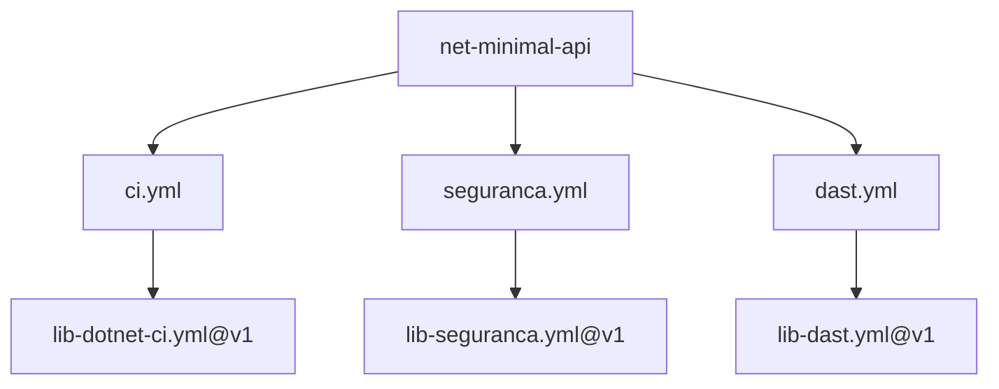

# Aplicação da biblioteca a um sistema existente

## Problema que a prática resolve

Um sistema que já existe raramente tem esteira. O código está em um repositório e os testes rodam na máquina de quem os escreveu, enquanto a segurança depende de revisão manual. Escrever uma esteira do zero para ele repete o trabalho dos cenários anteriores. Copiar os arquivos de outro repositório reproduz o problema descrito no [cenário 12](../../docs/cenarios/12.md), em que cada cópia passa a evoluir por conta própria. A biblioteca publicada na versão `v1` resolve a cópia, porque o sistema chama os *workflows* reutilizáveis sem duplicá-los. Falta conhecer o que muda no próprio sistema para que a chamada funcione. O cenário registra essas mudanças e as decisões tomadas em cada uma, com o *pull request* correspondente como evidência.

O cenário aplica a biblioteca ao `net-minimal-api`, uma API REST em .NET 10 com Minimal API, três projetos de testes e uma solução `ProdutosAPI.slnx`. O repositório é público e pertence à mesma organização da biblioteca. A aplicação foi escrita sem esteira e o escopo da mudança ficou restrito a esteira, contêiner e teste dinâmico, de modo que o código da aplicação permaneceu como estava. O resultado é um *pull request* com três *workflows* chamadores, um `Dockerfile` e os arquivos de configuração das ferramentas. O *pull request* está em https://github.com/arkhibr/net-minimal-api/pull/1 e a decisão de incorporá-lo cabe ao dono do repositório.

## Workflow do cenário

Três ferramentas aparecem nos chamadores. O CodeQL analisa o código-fonte em busca de padrões de vulnerabilidade, o Gitleaks procura segredos no código e no histórico do repositório. O ZAP *baseline* é uma varredura dinâmica que consulta a aplicação em execução e aponta falhas visíveis nas respostas HTTP. Um *pull request* é a proposta de incorporar uma *branch* à `main`. As verificações dos três chamadores aparecem na página desse *pull request*, que reúne os resultados antes da decisão de incorporar o código.

Os arquivos do cenário ficam no repositório do sistema e não neste. Cada chamador declara `uses:` com o endereço da biblioteca na versão `v1` e informa as entradas na chave `with`, conforme a tabela a seguir.

| Arquivo no sistema | Biblioteca chamada | Entradas informadas |
| --- | --- | --- |
| `.github/workflows/ci.yml` | `lib-dotnet-ci.yml@v1` | `solucao: ProdutosAPI.ci.slnf` e `cobertura-minima: 65` |
| `.github/workflows/seguranca.yml` | `lib-seguranca.yml@v1` | `linguagens: '["csharp"]'` |
| `.github/workflows/dast.yml` | `lib-dast.yml@v1` | `contexto-docker: .`, `alvo: http://localhost:8080/health` e `regras-zap: .zap/regras.tsv` |

Cada chamador dispara em `pull_request` e em `push` na `main` e declara `permissions: contents: read` no nível superior. O chamador de segurança concede `security-events: write` ao job que chama a biblioteca, porque a biblioteca de segurança exige essa permissão para publicar resultados. Um *workflow* chamado nunca recebe mais permissões do que o chamador possui. Sem a concessão, o CodeQL não consegue gravar os alertas na aba de segurança do repositório. Os arquivos de apoio completam a mudança. O primeiro deles é o `Dockerfile`, que publica `ProdutosAPI.csproj` em uma imagem do ASP.NET com as variáveis `ASPNETCORE_ENVIRONMENT=Staging` e `ASPNETCORE_HTTP_PORTS=8080` e executa como o usuário `app`, sem privilégios. O ambiente `Staging` é necessário porque o `Program.cs` só ativa o redirecionamento para HTTPS em `Production`. A esteira acessa a aplicação por HTTP em `localhost`. O `.dockerignore` exclui `bin`, `obj`, o histórico e os testes do contexto de construção. O `.gitleaks.toml` e o `.zap/regras.tsv` registram as exceções justificadas de cada ferramenta, com 5 entradas no primeiro e 3 no segundo.

## Como executar

1. Clone o sistema, crie a *branch* com `git switch -c devops/esteira-c3dm` e rode os testes antes de qualquer mudança com `dotnet test ProdutosAPI.slnx`. Registre quantos testes passam, pois esse número é a linha de base. No `net-minimal-api` eram 143 testes em `ProdutosAPI.Tests` e 7 em `Pix.MockServer.Tests`.
2. Rode `gitleaks detect --source . --redact` sem configuração e registre as ocorrências. A varredura percorre o histórico inteiro, de modo que um valor removido há meses ainda aparece. O resultado esperado é uma lista de arquivos, linhas e regras.
3. Crie o `.gitleaks.toml` com `useDefault = true` e uma exceção `[[allowlists]]` por valor exato. Cada exceção usa `paths` para restringir o arquivo, `regexes` com o valor completo e `condition = "AND"`, de modo que o valor só é aceito no arquivo indicado. Um comentário ao lado de cada exceção registra a justificativa. Rode a varredura de novo e confirme a mensagem de nenhuma ocorrência.
4. Escreva o `Dockerfile` e o `.dockerignore`, construa a imagem com `docker build -t produtos-api .`, suba o contêiner com `docker run -d -p 8080:8080 produtos-api` e confira `curl -fsS localhost:8080/health`. O resultado esperado é `{"status":"healthy"}`. Remova o contêiner e a imagem ao terminar.
5. Escreva os três chamadores, faça o *commit* com `ci: esteira de CI, segurança e DAST pela biblioteca devops-fluxos-c3dm@v1`, envie a *branch* e abra o *pull request* com `gh pr create`. Acompanhe com `gh pr checks --watch`.
6. Se o ZAP emitir alertas, mantenha o código da aplicação intacto. Acrescente uma linha por regra em `.zap/regras.tsv` com o identificador, a ação `IGNORE` e a justificativa na mesma linha. Liste os alertas na descrição do *pull request* como pendência para a equipe responsável pelo código.

### Ajustes que o sistema exigiu

A execução revelou quatro diferenças entre o sistema e as premissas da biblioteca. Todas foram tratadas sem alterar a aplicação.

O primeiro ajuste foi a solução de testes. Em um clone limpo o projeto `Pedidos.Tests` não compila, porque referencia `src/Produtos/Produtos.Domain`, uma pasta sem arquivos versionados. A esteira não pode reprovar no primeiro dia por um defeito anterior à adoção. O chamador usa por isso o filtro de solução `ProdutosAPI.ci.slnf`, que lista os dez projetos restantes de `ProdutosAPI.slnx` sem o projeto quebrado. A correção de `Pedidos.Tests` ficou como pendência registrada no *pull request*. Concluída essa correção, a entrada `solucao` do `ci.yml` pode voltar a apontar para `ProdutosAPI.slnx`, com os 150 testes dos três projetos na esteira.

O segundo foi a cobertura. A biblioteca exige o pacote `coverlet.collector` em cada projeto de testes e `ProdutosAPI.Tests` não o tinha. A referência na versão 6.0.4 foi acrescentada a esse projeto e o fato consta da descrição do *pull request*. A cobertura medida antes da escolha do limite foi de 46,5% em `ProdutosAPI.Tests` e de 85,0% em `Pix.MockServer.Tests`. O resumo da execução exibe 66% para o conjunto. Por isso `cobertura-minima` ficou em 65, abaixo do valor exibido, de modo que o *pull request* não reprovou no primeiro dia. A execução com 65 passou na Actions e o limite deve subir à medida que a equipe cobrir mais código.

O terceiro foi o Gitleaks. A varredura padrão do histórico, com 74 *commits*, acusou 7 ocorrências em documentação. Todas tinham valores de exemplo, como o marcador `SEU_TOKEN` e identificadores fictícios de idempotência. A chave JWT e a senha de administrador de `appsettings.json` não disparam as regras padrão por terem entropia baixa e receberam exceção preventiva. As demais ocorrências receberam exceção restrita ao arquivo em que aparecem, de modo que o mesmo valor em outro arquivo voltaria a ser acusado.

O quarto foi o ZAP. O *baseline* emitiu três avisos e nenhuma falha, correspondentes à ausência do cabeçalho `X-Content-Type-Options`, ao conteúdo armazenável em cache e à ausência do cabeçalho `Cross-Origin-Resource-Policy`. Cada aviso gerou uma linha em `.zap/regras.tsv` com justificativa. A correção pertence ao código da aplicação e foi listada no *pull request* com a mudança sugerida para cada regra.

### Autoavaliação antes e depois

A tabela aplica a [autoavaliação](../../docs/autoavaliacao.md) ao sistema antes e depois do *pull request*. Os domínios de inteligência e de planejamento não têm evidência observável no repositório e ficaram fora.

| Domínio | Antes | Depois |
| --- | --- | --- |
| Integração contínua | Fundacional, pois o código está em um repositório central e a compilação é manual | Intermediário, pois cada *commit* e cada *pull request* dispara a compilação |
| Teste contínuo | Fundacional, pois os 150 testes existem e rodam à mão | Intermediário, pois os testes de unidade e de integração rodam na esteira com cobertura, ao lado da segurança estática e dinâmica |
| Implantação contínua | Sem evidência | Sem evidência, pois a imagem existe e nenhuma implantação foi criada |

Duas lacunas impedem o nível seguinte em teste. A `main` do sistema não tem proteção de ramo, de modo que a falha da esteira não impede a incorporação do código. Também não há testes de aceitação separados dos testes de integração, que o modelo exige no nível Avançado.

## Como levar a prática a um sistema existente

1. Meça antes de mudar. O número de testes que passam, a cobertura por projeto e as ocorrências do Gitleaks definem a linha de base e evitam que a esteira reprove no primeiro dia por defeitos anteriores a ela.
2. Verifique as premissas da biblioteca na documentação de cada entrada. Para a CI .NET isso significa conferir se cada projeto de testes referencia `coverlet.collector`, se a solução compila em um clone limpo e se o SDK é o da entrada `dotnet-version`.
3. Trate exceções de ferramenta por valor e por arquivo. Uma exceção que ignora um arquivo ou um *commit* inteiro apaga a proteção sem deixar registro do motivo.
4. Não altere a aplicação para satisfazer a esteira quando o escopo for apenas a esteira. Registre cada alerta como pendência com a correção sugerida e deixe a decisão com a equipe.
5. Peça a proteção de ramo e a exigência das verificações como passo seguinte. Sem elas a esteira informa o problema sem impedir a incorporação do código.

## Nível C3DM e fontes

O repositório agrupa o cenário no nível Especialista, o último estágio do roteiro. O nome do nível não indica o uso de inteligência artificial que o modelo C3DM associa a ele, como explica a página da [trilha](../../docs/trilha.md). O cenário reúne as práticas de integração e de teste dos níveis anteriores e as aplica por reaproveitamento.

As fontes são a documentação do GitHub sobre *workflows* reutilizáveis, em https://docs.github.com/en/actions/sharing-automations/reusing-workflows, e a do Gitleaks sobre a configuração de exceções, no repositório https://github.com/gitleaks/gitleaks. A referência do ZAP sobre o arquivo de regras do *baseline* está em https://www.zaproxy.org/docs/docker/baseline-scan/.
