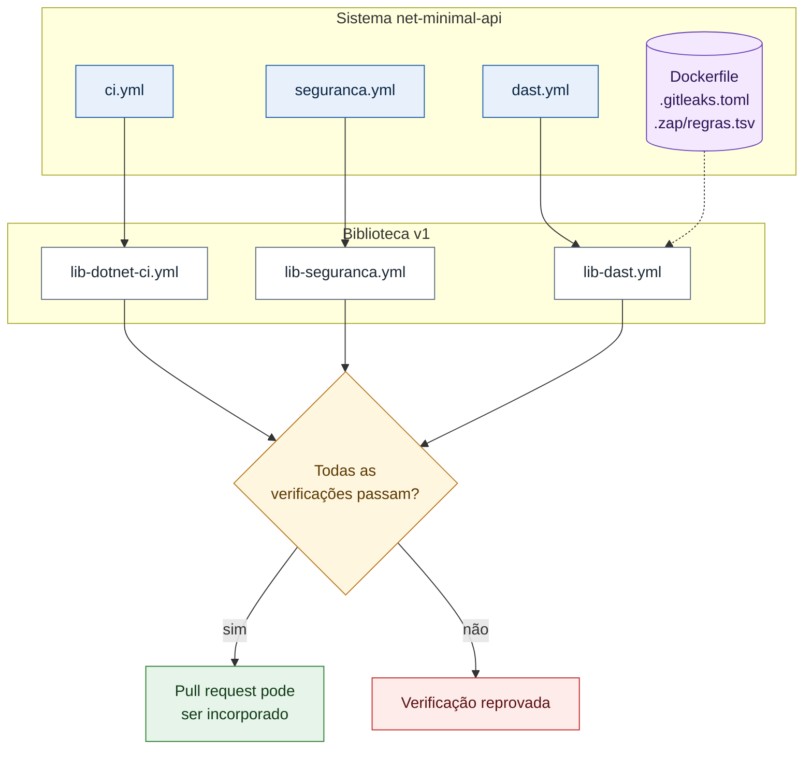

# Aplicação da biblioteca a um sistema existente

## Problema que a prática resolve

Um sistema que já existe raramente tem esteira. O código está em um repositório e os testes rodam na máquina de quem os escreveu, enquanto a segurança depende de revisão manual. Escrever uma esteira do zero para ele repete o trabalho dos cenários anteriores. Copiar os arquivos de outro repositório reproduz o problema descrito no [cenário 12](../../docs/cenarios/12.md), em que cada cópia passa a evoluir por conta própria. A biblioteca publicada na versão `v1` resolve a cópia, porque o sistema chama os *workflows* reutilizáveis sem duplicá-los. Falta conhecer o que muda no próprio sistema para que a chamada funcione. O cenário registra essas mudanças e as decisões tomadas em cada uma, com o *pull request* correspondente como evidência.

O cenário aplica a biblioteca ao `net-minimal-api`, uma API REST em .NET 10 com Minimal API. O repositório tem uma solução `ProdutosAPI.slnx` com três projetos de testes, dos quais apenas dois compilam. Ele é público e pertence à mesma organização da biblioteca. A aplicação foi escrita sem esteira e o escopo da mudança ficou restrito a esteira, contêiner e teste dinâmico, de modo que o código da aplicação permaneceu como estava. O resultado é um *pull request* com três *workflows* chamadores, um `Dockerfile` e os arquivos de configuração das ferramentas. O *pull request* está em https://github.com/arkhibr/net-minimal-api/pull/1 e a decisão de incorporá-lo cabe ao dono do repositório.

## Workflow do cenário

Três ferramentas aparecem nos chamadores. O CodeQL analisa o código-fonte em busca de padrões de vulnerabilidade, o Gitleaks procura segredos no código e no histórico do repositório. O ZAP *baseline* é uma varredura dinâmica que consulta a aplicação em execução e aponta falhas visíveis nas respostas HTTP. Um *pull request* é a proposta de incorporar uma *branch* à `main`. As verificações dos três chamadores aparecem na página desse *pull request*, que reúne os resultados antes da decisão de incorporar o código.

Os arquivos do cenário ficam no repositório do sistema e não neste. Eles pertencem ao [*pull request* 1 do `net-minimal-api`](https://github.com/arkhibr/net-minimal-api/pull/1), da ramificação `devops/esteira-c3dm`. Essa ramificação ainda não foi incorporada à `main` daquele repositório. A decisão cabe ao dono dele, razão pela qual os *links* dos trechos apontam para a ramificação. Cada chamador declara o endereço da biblioteca na versão `v1` e informa as entradas na chave `with`, conforme a tabela a seguir.

| Arquivo no sistema | Biblioteca chamada | Entradas informadas |
| --- | --- | --- |
| `.github/workflows/ci.yml` | `lib-dotnet-ci.yml@v1` | `solucao: ProdutosAPI.ci.slnf`, `cobertura-minima: 60` e `incluir-cobertura` com os assemblies da aplicação |
| `.github/workflows/seguranca.yml` | `lib-seguranca.yml@v1` | `linguagens: '["csharp"]'` |
| `.github/workflows/dast.yml` | `lib-dast.yml@v1` | `contexto-docker: .`, `alvo: http://localhost:8080/health`, `regras-zap: .zap/regras.tsv` |



### Chamador de CI e entradas de cobertura

O chamador `ci.yml` dispara em `pull_request` e em `push` na `main` e declara `permissions: contents: read` no nível superior.

Arquivo completo na ramificação do *pull request*: [`.github/workflows/ci.yml`, linhas 4 a 22](https://github.com/arkhibr/net-minimal-api/blob/devops/esteira-c3dm/.github/workflows/ci.yml#L4-L22).

```yaml
on:
  pull_request:
  push:
    branches: [main]

permissions:
  contents: read

concurrency:
  group: ci-${{ github.ref }}
  cancel-in-progress: true

jobs:
  ci:
    uses: arkhibr/devops-fluxos-c3dm/.github/workflows/lib-dotnet-ci.yml@v1
    with:
      solucao: ProdutosAPI.ci.slnf
      cobertura-minima: 60
      incluir-cobertura: "[ProdutosAPI]*,[Catalogo.*]*,[Pix.*]*"
```

O grupo de *concurrency* `ci-${{ github.ref }}` com `cancel-in-progress: true` cancela a execução anterior da mesma ramificação quando chega um novo *commit*. A entrada `solucao` aponta para o filtro `ProdutosAPI.ci.slnf`, que exclui o projeto `Pedidos.Tests` por não compilar antes da adoção da esteira. A entrada `cobertura-minima: 60` fica abaixo das duas métricas globais de cobertura do sistema. A entrada `incluir-cobertura` restringe a medição aos *assemblies* da aplicação ProdutosAPI.

### Chamador de segurança estática

Arquivo completo na ramificação do *pull request*: [`.github/workflows/seguranca.yml`, linhas 16 a 23](https://github.com/arkhibr/net-minimal-api/blob/devops/esteira-c3dm/.github/workflows/seguranca.yml#L16-L23).

```yaml
jobs:
  seguranca:
    permissions:
      contents: read
      security-events: write
    uses: arkhibr/devops-fluxos-c3dm/.github/workflows/lib-seguranca.yml@v1
    with:
      linguagens: '["csharp"]'
```

O chamador concede `security-events: write` ao *job* que chama a biblioteca, porque a biblioteca de segurança exige essa permissão para publicar resultados. Um *workflow* chamado nunca recebe mais permissões do que o chamador possui. Sem a concessão, o CodeQL não consegue gravar os alertas na aba de segurança do repositório. A entrada `linguagens` é uma lista JSON em texto, com uma única linguagem.

### Chamador de segurança dinâmica

Arquivo completo na ramificação do *pull request*: [`.github/workflows/dast.yml`, linhas 16 a 22](https://github.com/arkhibr/net-minimal-api/blob/devops/esteira-c3dm/.github/workflows/dast.yml#L16-L22).

```yaml
jobs:
  dast:
    uses: arkhibr/devops-fluxos-c3dm/.github/workflows/lib-dast.yml@v1
    with:
      contexto-docker: .
      alvo: http://localhost:8080/health
      regras-zap: .zap/regras.tsv
```

A entrada `contexto-docker: .` indica a pasta que contém o `Dockerfile`, o `alvo` é o endereço que o ZAP varre e `regras-zap` aponta para o arquivo de regras do próprio sistema.

### Dockerfile

O `Dockerfile` publica `ProdutosAPI.csproj` em uma imagem do ASP.NET e a biblioteca de DAST o constrói a partir do contexto informado.

Arquivo completo na ramificação do *pull request*: [`Dockerfile`, linhas 1 a 18](https://github.com/arkhibr/net-minimal-api/blob/devops/esteira-c3dm/Dockerfile#L1-L18).

```dockerfile
# Imagem usada pela esteira de DAST (.github/workflows/dast.yml).
# Ambiente Staging: o Program.cs só ativa UseHttpsRedirection em Production, e a esteira
# acessa a aplicação por HTTP em localhost.
FROM mcr.microsoft.com/dotnet/sdk:10.0 AS build
WORKDIR /src
COPY . .
RUN dotnet publish ProdutosAPI.csproj --configuration Release --output /app/publish

FROM mcr.microsoft.com/dotnet/aspnet:10.0 AS final
WORKDIR /app
ENV ASPNETCORE_ENVIRONMENT=Staging \
    ASPNETCORE_HTTP_PORTS=8080
COPY --from=build /app/publish .
# O banco SQLite e os logs são gravados em /app, então o usuário sem privilégios precisa de escrita nela.
RUN chown -R app:app /app
USER app
EXPOSE 8080
ENTRYPOINT ["dotnet", "ProdutosAPI.dll"]
```

A imagem usa duas etapas, uma com o SDK para publicar e outra com o ambiente de execução. As variáveis `ASPNETCORE_ENVIRONMENT=Staging` e `ASPNETCORE_HTTP_PORTS=8080` configuram o ambiente e a porta. O ambiente `Staging` é necessário porque o `Program.cs` só ativa o redirecionamento para HTTPS em `Production` e a esteira acessa a aplicação por HTTP em `localhost`. O comando `chown` dá ao usuário `app` escrita em `/app`, onde o banco SQLite grava os dados. A instrução `USER app` executa o processo sem privilégios. O arquivo `.dockerignore` exclui `bin`, `obj`, o histórico e os testes do contexto de construção da imagem.

### Exceções do Gitleaks

O arquivo `.gitleaks.toml` registra exceções justificadas, cada uma por valor exato e restrita ao arquivo em que o valor aparece.

Arquivo completo na ramificação do *pull request*: [`.gitleaks.toml`, linhas 7 a 28](https://github.com/arkhibr/net-minimal-api/blob/devops/esteira-c3dm/.gitleaks.toml#L7-L28).

```toml
[extend]
useDefault = true
# ...
[[allowlists]]
description = "Chave JWT de demonstração de appsettings.json"
# valor de demonstração presente em appsettings.json e em Program.cs, não documentado no README
condition = "AND"
paths = ['''^appsettings\.json$''']
regexes = ['''^MinhaChaveSuperSecretaDePeloMenos32BytesAki123!$''']

[[allowlists]]
description = "Senha de administrador de demonstração de appsettings.json"
# valor de demonstração presente em appsettings.json e documentado no README
condition = "AND"
paths = ['''^appsettings\.json$''']
regexes = ['''^senha123$''']
```

A chave `useDefault = true` mantém as regras padrão do Gitleaks. Cada exceção restringe o arquivo por caminho e informa o valor completo por expressão regular. A condição `AND` exige que as duas casem juntas, de modo que o mesmo valor em outro arquivo voltaria a ser acusado. Um comentário ao lado de cada exceção registra a justificativa de uso do valor. O arquivo traz 5 exceções no total, todas com valores de demonstração.

### Regras do ZAP

O arquivo `.zap/regras.tsv` marca com `IGNORE` as 3 regras do ZAP que emitiram aviso. Cada linha traz o identificador, a ação e a justificativa, separados por tabulação.

Arquivo completo na ramificação do *pull request*: [`.zap/regras.tsv`, linhas 1 a 3](https://github.com/arkhibr/net-minimal-api/blob/devops/esteira-c3dm/.zap/regras.tsv#L1-L3).

```tsv
# Regras do ZAP baseline. Formato: id, ação e comentário separados por tabulação. Cada regra traz a justificativa na mesma linha.
10021	IGNORE	(X-Content-Type-Options Header Missing) pendência de aplicação: cabeçalho a ser adicionado pela equipe em middleware, fora do escopo desta esteira
10049	IGNORE	(Storable and Cacheable Content) pendência de aplicação: definir Cache-Control em /health, fora do escopo desta esteira
```

A biblioteca roda o ZAP com `fail_action: true` e nesse modo um aviso reprova a execução. A linha `IGNORE` faz o aviso deixar de aparecer no resultado da esteira. A correção pertence ao código da aplicação e consta no *pull request* como pendência para a equipe responsável pelo ProdutosAPI.

### Arquivos do cenário

| Arquivo | Papel |
| --- | --- |
| [`.github/workflows/ci.yml`](https://github.com/arkhibr/net-minimal-api/blob/devops/esteira-c3dm/.github/workflows/ci.yml) | Chamador de CI com cobertura. |
| [`.github/workflows/seguranca.yml`](https://github.com/arkhibr/net-minimal-api/blob/devops/esteira-c3dm/.github/workflows/seguranca.yml) | Chamador de CodeQL e Gitleaks. |
| [`.github/workflows/dast.yml`](https://github.com/arkhibr/net-minimal-api/blob/devops/esteira-c3dm/.github/workflows/dast.yml) | Chamador do ZAP *baseline*. |
| [`Dockerfile`](https://github.com/arkhibr/net-minimal-api/blob/devops/esteira-c3dm/Dockerfile) | Imagem usada pela varredura dinâmica. |
| [`.dockerignore`](https://github.com/arkhibr/net-minimal-api/blob/devops/esteira-c3dm/.dockerignore) | Exclusões do contexto de construção. |
| [`.gitleaks.toml`](https://github.com/arkhibr/net-minimal-api/blob/devops/esteira-c3dm/.gitleaks.toml) | Exceções justificadas do Gitleaks. |
| [`.zap/regras.tsv`](https://github.com/arkhibr/net-minimal-api/blob/devops/esteira-c3dm/.zap/regras.tsv) | Regras do ZAP marcadas com `IGNORE`. |
| [`ProdutosAPI.ci.slnf`](https://github.com/arkhibr/net-minimal-api/blob/devops/esteira-c3dm/ProdutosAPI.ci.slnf) | Filtro de solução sem o projeto que não compila. |
| [*Pull request* 1](https://github.com/arkhibr/net-minimal-api/pull/1) | Proposta que reúne todos os arquivos, ainda aberta. |

## Como executar

1. Clone o sistema, crie a *branch* com `git switch -c devops/esteira-c3dm` e rode os testes antes de qualquer mudança com `dotnet test ProdutosAPI.slnx`. Registre quantos testes passam, pois esse número é a linha de base. No `net-minimal-api` a compilação de `Pedidos.Tests` falha, de modo que esse comando reprova antes de executar qualquer teste. Com um filtro de solução sem esse projeto, descrito adiante, passam 143 testes em `ProdutosAPI.Tests` e 7 em `Pix.MockServer.Tests`.
2. Rode `gitleaks detect --source . --redact` sem configuração e registre as ocorrências. A varredura percorre o histórico inteiro, de modo que um valor removido há meses ainda aparece. O resultado esperado é uma lista de arquivos, linhas e regras.
3. Crie o `.gitleaks.toml` com `useDefault = true` e uma exceção `[[allowlists]]` por valor exato. Cada exceção usa `paths` para restringir o arquivo, `regexes` com o valor completo e `condition = "AND"`, de modo que o valor só é aceito no arquivo indicado. Um comentário ao lado de cada exceção registra a justificativa. Rode a varredura de novo e confirme a mensagem de nenhuma ocorrência.
4. Escreva o `Dockerfile` e o `.dockerignore`, construa a imagem com `docker build -t produtos-api .`, suba o contêiner com `docker run -d -p 8080:8080 produtos-api` e confira `curl -fsS localhost:8080/health`. O resultado esperado é `{"status":"healthy"}`. Remova o contêiner e a imagem ao terminar.
5. Escreva os três chamadores, faça o *commit* com `ci: esteira de CI, segurança e DAST pela biblioteca devops-fluxos-c3dm@v1`, envie a *branch* e abra o *pull request* com `gh pr create`. Acompanhe com `gh pr checks --watch`.
6. Se o ZAP emitir alertas, mantenha o código da aplicação intacto e confira primeiro como a biblioteca trata um aviso (*WARN*). Com `fail_action: true`, o `zaproxy/action-baseline` sai com código 2 em qualquer aviso, o que reprova a execução. Nesse caso a única saída sem alterar a aplicação é uma linha em `.zap/regras.tsv` com o identificador, a ação `IGNORE` e a justificativa na mesma linha. Prefira corrigir a causa. Use `IGNORE` apenas com justificativa, sobretudo para um falso positivo confirmado, porque ele esconde o aviso das execuções seguintes. Liste cada alerta na descrição do *pull request* como pendência para a equipe responsável pelo código. Apague a linha quando a correção for implantada.

### Ajustes que o sistema exigiu

A execução revelou quatro diferenças entre o sistema e as premissas da biblioteca. Todas foram tratadas sem alterar a aplicação.

O primeiro ajuste foi a solução de testes. Em um clone limpo o projeto `Pedidos.Tests` não compila, porque referencia `src/Produtos/Produtos.Domain`, uma pasta sem arquivos versionados. A esteira não pode reprovar no primeiro dia por um defeito anterior à adoção. O chamador usa por isso o filtro de solução `ProdutosAPI.ci.slnf`, que lista os dez projetos restantes de `ProdutosAPI.slnx` sem o projeto quebrado. A correção de `Pedidos.Tests` ficou como pendência registrada no *pull request*. Concluída a correção, a entrada `solucao` do `ci.yml` pode voltar a apontar para `ProdutosAPI.slnx`. A esteira passa então a executar 150 testes dos dois projetos que compilam, sendo 143 mais 7.

O segundo foi a cobertura, pois a biblioteca exige o pacote `coverlet.collector` em cada projeto de testes e o `ProdutosAPI.Tests` não o tinha. A referência na versão 6.0.4 foi acrescentada a esse projeto e o fato consta da descrição do *pull request*. A medição foi restrita aos assemblies da aplicação pela entrada `incluir-cobertura`. O valor `[ProdutosAPI]*,[Catalogo.*]*,[Pix.*]*` exclui os assemblies de teste e de terceiros da medição. Nesse repositório o resultado foi o mesmo com e sem o filtro, porque o coletor já deixava de fora os assemblies de teste. Quatro números descrevem a cobertura e nenhum deles coincide com outro. O projeto principal é o `ProdutosAPI.Tests` e cobre 46,5% das linhas, o que equivale a 1669 de 3590. O `Pix.MockServer.Tests` cobre 85,0% das linhas, o que equivale a 1776 de 2090. A soma das linhas dos dois relatórios dá 60,7%, o que equivale a 3445 de 5680 linhas cobertas. A ação de resumo usa a média das taxas de cada arquivo de cobertura, que dá 65,7% e aparece como 66% no resumo. Essa média dá o mesmo peso a um projeto pequeno e a um grande. Por isso ela superestima o conjunto. O limite `cobertura-minima: 60` fica abaixo das duas métricas globais, de modo que a aprovação da execução não depende de qual das duas a ação use na comparação. O limite deve subir conforme a equipe cobrir mais código. A cobertura do projeto principal é a que mais pede atenção, com apenas 46,5%.

O terceiro foi o Gitleaks. A varredura padrão do histórico, com 74 *commits*, acusou 7 ocorrências em documentação. Todas tinham valores de exemplo, como o marcador `SEU_TOKEN` e identificadores fictícios de idempotência. A chave JWT e a senha de administrador de `appsettings.json` não disparam as regras padrão por terem entropia baixa e receberam exceção preventiva. As demais ocorrências receberam exceção restrita ao arquivo em que aparecem, de modo que o mesmo valor em outro arquivo voltaria a ser acusado.

O quarto foi o ZAP. O *baseline* varreu apenas `/health` e as páginas que o *spider* alcançou a partir dessa rota, de modo que a abrangência da varredura é pequena. Ele emitiu três avisos e nenhuma falha. Os avisos correspondem à ausência do cabeçalho `X-Content-Type-Options`, ao conteúdo armazenável em cache e à ausência do cabeçalho `Cross-Origin-Resource-Policy`. Uma execução sem arquivo de regras reprovou, porque o aviso também reprova quando `fail_action` está ativo. Por isso `.zap/regras.tsv` traz uma linha `IGNORE` por regra, cada uma com justificativa. Esse arquivo faz os avisos deixarem de aparecer no resultado da esteira. A correção pertence ao código da aplicação e foi listada no *pull request* com a mudança sugerida para cada regra. A biblioteca poderia oferecer uma entrada que torne os avisos não bloqueantes sem escondê-los.

### Autoavaliação antes e depois

A tabela aplica a [autoavaliação](../../docs/autoavaliacao.md) ao sistema antes e depois do *pull request*. Os domínios de inteligência e de planejamento não têm evidência observável no repositório e ficaram fora.

| Domínio | Antes | Depois |
| --- | --- | --- |
| Integração contínua | Fundacional, pois o código está em um repositório central e a compilação é manual | Intermediário, pois cada *commit* e cada *pull request* dispara a compilação |
| Teste contínuo | Fundacional, pois os 150 testes dos dois projetos que compilam existem e rodam à mão | Intermediário, pois os testes de unidade e de integração rodam na esteira com cobertura, ao lado da segurança estática e dinâmica |
| Implantação contínua | Sem evidência | Sem evidência, pois a imagem existe e nenhuma implantação foi criada |

Duas lacunas impedem o nível seguinte em teste. A `main` do sistema não tem proteção de ramo, de modo que a falha da esteira não impede a incorporação do código. Também não há testes de aceitação separados dos testes de integração, que o modelo exige no nível Avançado.

## Como levar a prática a um sistema existente

1. Meça antes de mudar. O número de testes que passam, a cobertura por projeto e as ocorrências do Gitleaks definem a linha de base e evitam que a esteira reprove no primeiro dia por defeitos anteriores a ela.
2. Verifique as premissas da biblioteca na documentação de cada entrada. Para a CI .NET isso significa conferir se cada projeto de testes referencia `coverlet.collector`, se a solução compila em um clone limpo e se o SDK é o da entrada `dotnet-version`.
3. Trate exceções de ferramenta por valor e por arquivo. Uma exceção que ignora um arquivo ou um *commit* inteiro apaga a proteção sem deixar registro do motivo.
4. Não altere a aplicação para satisfazer a esteira quando o escopo for apenas a esteira. Registre cada alerta como pendência com a correção sugerida e deixe a decisão com a equipe.
5. Peça a proteção de ramo e a exigência das verificações como passo seguinte. Sem elas a esteira informa o problema sem impedir a incorporação do código.

## Nível C3DM e fontes

O repositório agrupa o cenário no nível Especialista, o último estágio do roteiro. O nome do nível não indica o uso de inteligência artificial que o modelo C3DM associa a ele, como explica a página da [trilha](../../docs/trilha.md). O cenário reúne as práticas de integração e de teste dos níveis anteriores e as aplica por reaproveitamento.

As fontes são a documentação do GitHub sobre *workflows* reutilizáveis, em https://docs.github.com/en/actions/sharing-automations/reusing-workflows, e a do Gitleaks sobre a configuração de exceções, no repositório https://github.com/gitleaks/gitleaks. A referência do ZAP sobre o arquivo de regras do *baseline* está em https://www.zaproxy.org/docs/docker/baseline-scan/.
