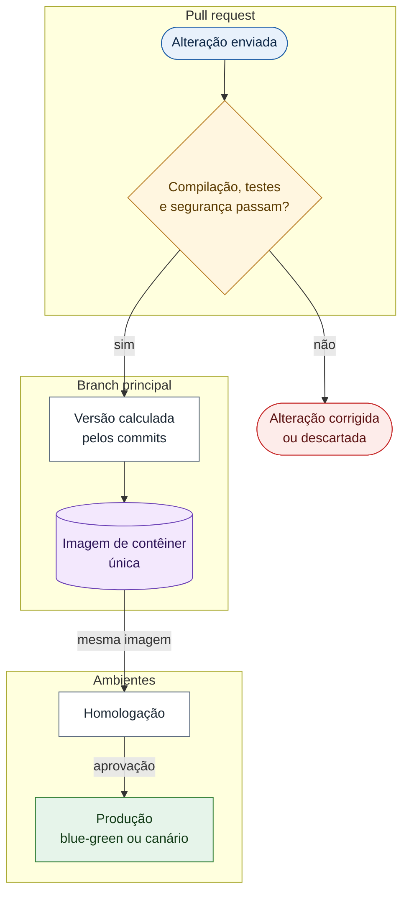

# Fluxos de CI/CD pelo modelo C3DM

Este portal documenta um roteiro executável de práticas de *CI/CD*, sigla de integração contínua e entrega contínua. O roteiro também cobre *DevOps*, a abordagem em que desenvolvimento e operação compartilham a responsabilidade pela entrega de software. O repositório que o acompanha contém uma aplicação de exemplo com API e interface web. Cada cenário acrescenta a essa aplicação uma prática de esteira, que é a sequência automatizada de compilação, teste e implantação. A prática é descrita em um *workflow* do GitHub Actions, um fluxo de automação escrito em YAML que o próprio GitHub executa a cada evento do repositório.

## Objetivo

O roteiro permite que uma equipe observe cada prática funcionando sobre um código real. Em seguida a equipe executa o cenário no próprio repositório. Por fim avalia como levar a mesma prática ao seu sistema. Os cenários seguem o C3DM, sigla em inglês para o modelo de maturidade de entrega contínua que organiza o conjunto em cinco níveis, do Fundacional ao Especialista. A página [Modelo de maturidade C3DM](modelo-c3dm.md) explica o modelo em detalhe. A página [Trilha de adoção](trilha.md) relaciona cada nível aos cenários.

O diagrama mostra o caminho que uma alteração percorre nos cenários do repositório, do envio do código à produção.

## Público e pré-requisitos

O material se destina a equipes de desenvolvimento que adotam ou pretendem adotar *CI/CD*, assim como a quem coordena essa adoção. A execução dos cenários exige as ferramentas abaixo.

- Git e uma conta no GitHub.
- Docker.
- .NET 10 SDK, para a API.
- Node 24, para a interface web.
- Python 3.13, para os testes da própria esteira e para o portal.

Nenhum cenário depende de conta em provedor de nuvem nem de segredo criado fora do script de configuração do próprio cenário.

## Como percorrer o material

A leitura pode seguir a ordem dos cenários, que cresce em complexidade. Também pode partir da [Autoavaliação](autoavaliacao.md), que situa o sistema da equipe em cada domínio do modelo e recomenda os cenários que elevam um nível. As páginas de referência reúnem o [glossário](referencia/glossario.md), as [métricas](referencia/metricas.md), o [catálogo de ferramentas](referencia/ferramentas.md) e a [bibliografia](referencia/bibliografia.md).

Todo cenário segue a mesma estrutura de cinco seções.

- O problema que a prática resolve.
- O *workflow* do cenário.
- O modo de executá-lo.
- A aplicação da prática a um sistema existente.
- O nível do modelo e as fontes consultadas.

## Mapa dos cenários

A tabela relaciona os quatorze cenários ao nível do C3DM em que cada um se enquadra. As páginas individuais de cada cenário ficam na seção [Cenários](cenarios/index.md) do portal. O nível de cada cenário é uma escolha deste repositório. A página [Trilha de adoção](trilha.md) explica como essa escolha se relaciona com os níveis que o modelo define para cada domínio.

| Nº | Cenário | Nível |
| --- | --- | --- |
| [01](cenarios/01.md) | Mensagens de *commit* convencionais e versionamento semântico automático | Fundacional |
| [02](cenarios/02.md) | Estratégia de *branches* e *rulesets* de proteção versionados | Fundacional |
| [03](cenarios/03.md) | Compilação e teste da API .NET com cobertura | Novato |
| [04](cenarios/04.md) | Compilação e teste da aplicação React com *lint* e cobertura | Novato |
| [05](cenarios/05.md) | Teste da própria esteira com `actionlint`, `yamllint` e `pytest` | Novato |
| [06](cenarios/06.md) | Análise estática, análise de dependências e varredura de segredos | Intermediário |
| [07](cenarios/07.md) | Análise dinâmica de segurança com OWASP ZAP | Intermediário |
| [08](cenarios/08.md) | Artefato único em imagem de contêiner promovida sem recompilação | Intermediário |
| [09](cenarios/09.md) | Ambientes de homologação e produção | Intermediário |
| [10](cenarios/10.md) | Implantação *blue-green* | Avançado |
| [11](cenarios/11.md) | Implantação canário | Avançado |
| [12](cenarios/12.md) | Biblioteca de *workflows* reutilizáveis e *composite actions* | Avançado |
| [13](cenarios/13.md) | Métricas DORA e métricas de esteira | Avançado |
| [14](cenarios/14.md) | Aplicação da biblioteca a um sistema existente | Especialista |

## Licença

O conteúdo do repositório é distribuído sob a licença MIT, cujo texto integral está no arquivo `LICENSE`.
