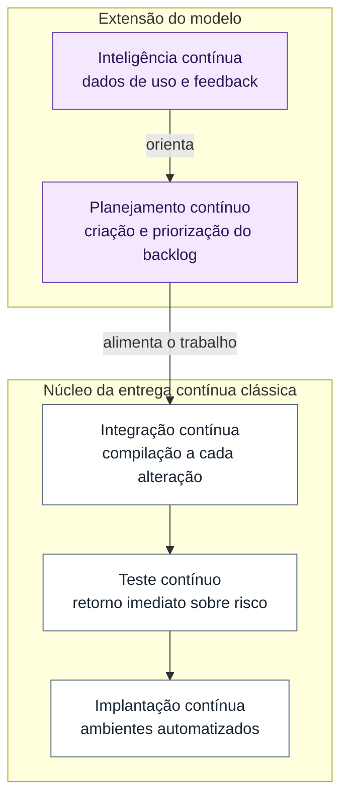
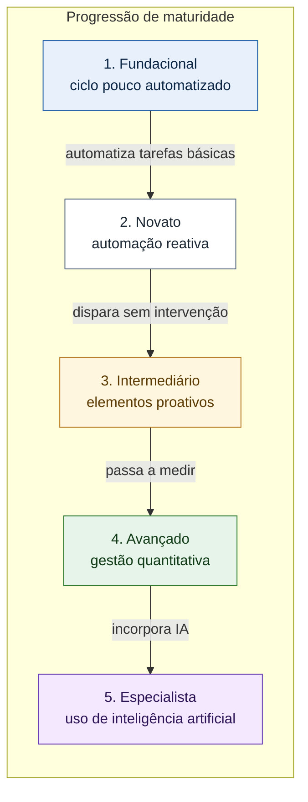
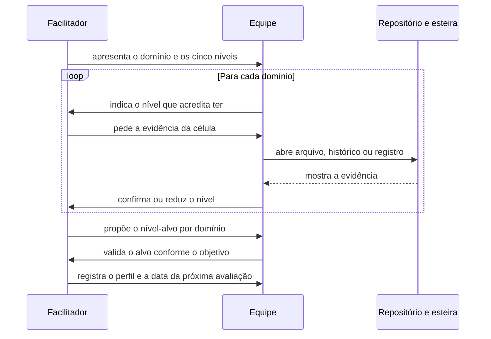

# Modelo de maturidade C3DM

O C3DM é um modelo de maturidade de entrega contínua. Um modelo de maturidade descreve, em níveis ordenados, o que uma organização faz em cada área de uma prática. A descrição permite avaliar o estágio atual de um sistema, compará-lo com outros e escolher a próxima melhoria. Esta página apresenta o modelo, explica como aplicá-lo e delimita o que o repositório acrescenta a ele. A sigla *CI/CD* designa a integração contínua e a entrega contínua. A esteira é a sequência automatizada de compilação, teste e implantação que leva uma alteração do código até o ambiente de execução.

## Origem e nome

O modelo foi publicado pelo NISI, o instituto holandês da indústria de software, com o título *Continuous Delivery 3.0 Maturity Model*. A página original é assinada por Jan Vlietland e traz a data de publicação de 14/06/2019 nos metadados. A fonte abrevia o título como CD3M. Este repositório usa a forma C3DM, a mesma do material didático que o originou. As duas siglas designam o mesmo modelo. A grafia CD3M aparece nas citações da fonte e a grafia C3DM nas demais páginas do portal.

O objetivo declarado pela fonte é orientar a melhoria das esteiras de entrega contínua e dos processos de desenvolvimento de software em uma organização. Na prática o modelo cumpre três usos. A avaliação situa o sistema em um nível por domínio. A comparação põe lado a lado sistemas ou equipes de uma mesma organização. A melhoria usa a diferença entre o nível atual e o desejado para definir o que fazer a seguir.

## Contexto da entrega contínua 3.0

A entrega contínua, descrita por Humble e Farley, mantém o software sempre pronto para ser entregue. Para isso usa uma esteira que automatiza a compilação, o teste e a implantação de cada alteração feita no código. O nome *Continuous Delivery 3.0* indica uma etapa posterior a essa prática clássica. A fonte não define a numeração das versões. O que a fonte mostra é a extensão do escopo da automação em duas direções.

- A primeira direção é a inteligência contínua, que automatiza a coleta e a análise de dados de uso do software pelos clientes, de modo que o que se desenvolve seja decidido por evidência.
- A segunda direção é o planejamento contínuo, que automatiza a criação, a priorização e o acompanhamento dos itens de trabalho da equipe.

Os outros três domínios correspondem ao núcleo da entrega contínua clássica, que reúne integração, teste e implantação. O diagrama mostra os cinco domínios agrupados por essa distinção e a relação de fornecimento entre eles. O ciclo se fecha porque o software implantado gera os dados de uso que a inteligência contínua analisa.

## Níveis de maturidade

Os níveis formam uma escala em que cada degrau acrescenta automação e controle sobre o anterior. Um mesmo sistema pode estar em níveis diferentes conforme o domínio avaliado, tema da seção seguinte.

| Nível | Definição segundo a fonte | Características observáveis |
| --- | --- | --- |
| 1. Fundacional | O desenvolvimento ocorre sobre uma plataforma de entrega contínua, porém o ciclo é pouco automatizado. | As ferramentas existem e são centralizadas, mas as etapas dependem de pessoas para iniciar. |
| 2. Novato | Há automação básica, em nível reativo. | A automação executa tarefas repetitivas, e a equipe age depois que uma falha aparece. |
| 3. Intermediário | O ciclo usa tecnologias de entrega contínua com elementos proativos. | A esteira dispara sozinha após eventos como um *commit*, que é o registro de uma alteração no controle de versão. |
| 4. Avançado | O ciclo usa tecnologia avançada e é gerenciado quantitativamente. | Decisões se apoiam em medições, e práticas como implantação sem parada estão presentes. |
| 5. Especialista | O ciclo emprega inteligência artificial de forma crescente para se aprimorar. | Coleta, priorização e escalabilidade ocorrem de forma automática e adaptativa. |

A coluna de características resume o padrão que se repete nas células da matriz e não constitui uma definição da fonte. O diagrama representa a progressão entre os níveis, do ciclo pouco automatizado ao uso de inteligência artificial.

## Domínios de avaliação

A fonte organiza as práticas em cinco categorias, chamadas neste repositório de domínios. Cada domínio descreve uma área que pode ser automatizada.

**Inteligência contínua.** Automatiza o rastreamento do uso do software pelos clientes e o tratamento do retorno que eles dão, para que a equipe desenvolva as funcionalidades de maior valor. A fonte cita o teste A/B como exemplo, técnica que compara duas versões de uma funcionalidade apresentadas a grupos distintos de usuários.

**Planejamento contínuo.** Automatiza o processo de planejamento ágil sobre os itens do *backlog*, que formam a lista ordenada de trabalho da equipe. A automação abrange priorização, refinamento, alocação e relatórios. Nos níveis mais altos a fonte associa aprendizado de máquina à criação e à priorização automáticas dos itens. A fonte afirma ainda que o domínio é fortemente apoiado pela inteligência contínua, que lhe fornece os dados de uso dos clientes sobre os quais as prioridades são definidas.

**Integração contínua.** Integra o código novo ou alterado ao sistema a cada registro de alteração, sem etapas manuais, por meio de um orquestrador de fluxos de trabalho que executa a esteira configurada. A fonte recomenda uma única compilação utilizável em todos os ambientes e uma arquitetura de microsserviços, isto é, de serviços pequenos e independentes. No limite ideal, os serviços de integração aumentam e diminuem de capacidade conforme o uso que recebem.

**Teste contínuo.** Executa testes automatizados como parte da esteira para obter retorno imediato sobre o risco de negócio de uma versão candidata a lançamento. O domínio abrange testes unitários, de aceitação, de segurança e de desempenho. Inclui também os testes de regressão, que verificam se o que já funcionava continua funcionando após uma mudança no sistema.

**Implantação contínua.** Prepara os ambientes e instala as versões de forma automática. Em uma esteira básica, a compilação bem-sucedida segue sozinha para o ambiente de teste, onde a equipe verifica a versão. Em estágio mais avançado, a instalação automática alcança os ambientes de aceitação e de produção. O objetivo final descrito pela fonte é a implantação de ponta a ponta sem nenhuma parada do serviço para os usuários que o utilizam.

## Matriz de níveis e domínios

A tabela reúne as 25 células do modelo. O texto de cada célula reproduz o sentido da descrição da fonte, em tradução livre.

| Domínio | Fundacional | Novato | Intermediário | Avançado | Especialista |
| --- | --- | --- | --- | --- | --- |
| Inteligência contínua | Rastreamento do comportamento do cliente em um servidor, com recebimento de retorno | Monitoramento básico do uso da aplicação e tratamento do retorno dos clientes | Monitoramento avançado de clientes e testes A/B em uso | Recebimento de métricas e relatórios predefinidos, com decisões baseadas em análise detalhada | Coleta, análise e relatórios de dados em tempo real com inteligência artificial |
| Planejamento contínuo | Gestão de todo o *backlog* em um servidor centralizado | Gestão de todo o trabalho por meio de um *backlog* digital | Criação automática de itens do *backlog* | Recebimento automático de sugestões de priorização do *backlog* | Criação e priorização automáticas de itens do *backlog* por inteligência artificial |
| Integração contínua | Controle de versão centralizado e servidor de compilação centralizado | Orquestrador de fluxos de trabalho com relatórios, executando compilações fora do expediente | Compilação disparada após o registro de cada nova funcionalidade | Integração sobre arquitetura de microsserviços escaláveis, com compilação apenas do código alterado | Escalabilidade automática dos serviços de integração contínua |
| Teste contínuo | Servidor centralizado de testes unitários, iniciados manualmente | Testes unitários na esteira e testes de integração automatizados iniciados manualmente | Testes de integração disparados pela esteira e testes de aceitação automatizados iniciados manualmente | Testes de aceitação disparados pela esteira e testes de segurança e de desempenho automatizados iniciados manualmente | Testes de regressão de ponta a ponta disparados pela esteira |
| Implantação contínua | Servidor centralizado de implantação | *Scripts* básicos de implantação e implantação automática em servidor de teste após compilação bem-sucedida | Implantação automática no servidor de produção por meio da esteira | Implantação automática sem indisponibilidade | Implantação automática em plataformas escaláveis sem limite prático |

Duas leituras da matriz merecem atenção. Na linha de teste contínuo, cada nível passa a disparar uma categoria de teste pela esteira e deixa a categoria seguinte ainda iniciada à mão, de modo que a automação avança em degraus. Na linha de integração contínua, o nível Novato menciona compilações fora do expediente, o que indica automação que ainda não responde a cada alteração individual.

## Como conduzir uma avaliação

A avaliação produz um perfil com um nível atual e um nível-alvo para cada domínio. O procedimento a seguir é proposto por este repositório e a [autoavaliação](autoavaliacao.md) fornece as evidências observáveis de cada célula.

1. Reunir duas ou três pessoas que conheçam o código, a esteira e a operação em produção. Pessoas de áreas diferentes reduzem o risco de uma visão parcial.
2. Percorrer os domínios um a um. Para cada domínio, ler as células da matriz do nível mais baixo ao mais alto.
3. Exigir uma evidência para cada célula. A evidência pode ser um arquivo no repositório, o histórico de execuções da esteira ou um registro de implantação. Declaração sem evidência não conta.
4. Registrar como nível atual o mais alto cuja célula e as dos níveis anteriores estão todas evidenciadas.
5. Definir o nível-alvo de cada domínio com base no objetivo da equipe, sem exigir o mesmo alvo em todos.
6. Registrar o perfil em uma tabela de cinco linhas e repetir a avaliação após a adoção de novas práticas.

O perfil é mantido por domínio porque os domínios evoluem de forma independente. Um sistema pode ter implantação sem parada e, ao mesmo tempo, um *backlog* gerido à mão. Uma nota única, como uma média, esconderia essa diferença e impediria apontar onde está o gargalo da entrega. O diagrama mostra a sequência de uma sessão de avaliação, com o facilitador, a equipe e as evidências do repositório.

## Como ler o resultado e escolher melhorias

O perfil resultante tem a forma de cinco níveis, um por domínio. A leitura recomendada começa pelo domínio de menor nível, pois ele tende a limitar o benefício dos demais. Uma esteira de implantação sem parada, por exemplo, produz pouco retorno se os testes que a antecedem são manuais.

As dependências entre domínios também orientam a ordem. A fonte afirma que o planejamento contínuo é fortemente apoiado pela inteligência contínua, de modo que subir o nível de planejamento sem dados de uso tem alcance limitado. Teste e implantação dependem de uma integração que já compile de forma automática. A escolha da melhoria seguinte considera então o domínio mais baixo e as precedências entre domínios.

## O que o repositório acrescenta ao modelo

As seções anteriores descrevem o modelo conforme a fonte. As informações a seguir são contribuição deste repositório.

- Cada um dos quatorze cenários recebe um único nível, escolha didática que ordena o estudo. A [trilha de adoção](trilha.md) explica onde essa escolha coincide com o modelo e onde diverge.
- A [autoavaliação](autoavaliacao.md) traduz cada célula da matriz em uma evidência observável e relaciona os cenários a cada domínio.
- Os domínios de inteligência contínua e de planejamento contínuo não têm cenário dedicado, porque dependem de dados de uso real e da gestão de um *backlog*, algo que um repositório de exemplo não demonstra.
- O nível Especialista do repositório indica o último estágio do roteiro. Ele não implica o uso de inteligência artificial que o modelo associa ao mesmo nome.
- O procedimento de avaliação da seção anterior é uma proposta do repositório e não consta da fonte.

## Limitações do modelo

- O modelo não atribui pesos. Todas as células têm o mesmo valor formal, embora o impacto de cada prática varie com o contexto.
- A avaliação depende de julgamento de quem a conduz. Uma equipe tende a superestimar o próprio nível quando não exige evidências, o que justifica o critério de evidência descrito acima.
- O nível Especialista está vinculado ao uso de inteligência artificial. Para sistemas em que esse uso não faz sentido, o nível máximo alcançável na prática é o Avançado.
- A fonte descreve cada célula em uma frase. Os critérios de passagem entre níveis não são detalhados. Cabe à equipe interpretá-los de forma consistente entre as avaliações.
- A fonte não apresenta validação empírica do modelo. Não há, na página consultada, dados que relacionem o nível de maturidade a resultados de negócio.

## Fontes

- NISI. *Continuous Delivery 3.0 Maturity Model*. Página original: https://nisi.nl/continuousdelivery/articles/maturity-model. A página original retorna erro 404 na data de consulta. O conteúdo foi conferido na cópia do Internet Archive de 02/11/2024: https://web.archive.org/web/20241102224537/https://nisi.nl/continuousdelivery/articles/maturity-model
- Jez Humble e David Farley. *Continuous Delivery: Reliable Software Releases through Build, Test, and Deployment Automation*. Addison-Wesley, 2010.

A página de [bibliografia](referencia/bibliografia.md) lista as demais referências do portal.
