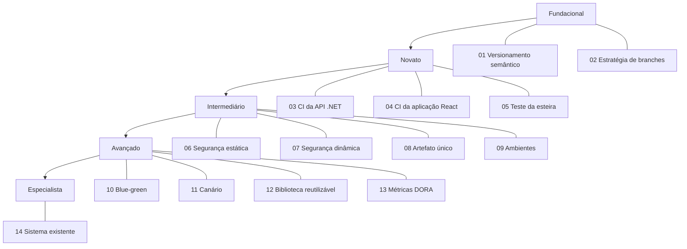

# Trilha de adoção pelo modelo C3DM

O C3DM é um modelo de maturidade de entrega contínua, publicado pela entidade holandesa NISI com o nome *Continuous Delivery 3.0 Maturity Model*. Um modelo de maturidade descreve em níveis ordenados o que uma organização faz em cada área de uma prática. Isso permite situar um sistema na escala, comparar sistemas entre si e escolher a próxima melhoria. Este repositório usa a sigla C3DM, adotada no material didático que o originou, enquanto a fonte original abrevia o mesmo modelo como CD3M.

## Níveis de maturidade

Os níveis formam uma escala de automação crescente. Um sistema pode estar em níveis diferentes conforme o domínio avaliado.

| Nível | Descrição |
| --- | --- |
| Fundacional | A equipe trabalha sobre uma plataforma de entrega contínua, porém o ciclo é pouco automatizado. |
| Novato | Há automação básica, ainda em nível reativo, em que a equipe age depois que o problema aparece. |
| Intermediário | O ciclo usa tecnologias de entrega contínua com elementos proativos, como disparo automático após cada *commit*. |
| Avançado | A tecnologia é de ponta e o processo é gerenciado quantitativamente, isto é, por medições. |
| Especialista | A equipe emprega inteligência artificial de forma crescente para melhorar o ciclo de desenvolvimento. |

## Domínios de avaliação

O modelo avalia cinco domínios, cada um descrito pelo que se automatiza nele.

| Domínio | O que automatiza |
| --- | --- |
| Inteligência contínua | A coleta de dados de uso e de comentários dos clientes para orientar o que se desenvolve, como em testes A/B, que comparam duas versões de uma funcionalidade com grupos distintos de usuários. |
| Planejamento contínuo | A criação e a priorização dos itens do *backlog*, que é a lista ordenada de trabalho da equipe, com apoio da inteligência contínua. |
| Integração contínua | A integração do código novo ao existente a cada alteração, sem etapas manuais. |
| Teste contínuo | A execução de testes unitários, de integração, de aceitação, de segurança e de desempenho para obter retorno imediato. |
| Implantação contínua | A instalação automática das versões nos ambientes de teste, de aceitação e de produção, idealmente sem parada do serviço. |

## Nível de cada domínio

A tabela resume o que o modelo espera em cada combinação de domínio e nível. A página de [Autoavaliação](autoavaliacao.md) transforma essas descrições em evidências observáveis.

| Domínio | Fundacional | Novato | Intermediário | Avançado | Especialista |
| --- | --- | --- | --- | --- | --- |
| Inteligência | Rastreamento básico do comportamento do cliente | Monitoramento básico do uso e tratamento dos comentários | Monitoramento avançado e testes A/B | Métricas detalhadas e decisões baseadas em análise | Coleta em tempo real e relatórios com inteligência artificial |
| Planejamento | *Backlog* gerenciado manualmente em servidor central | Todo o trabalho em *backlog* digital | Itens criados automaticamente pelos servidores de CI/CD | Sugestões automáticas de prioridade a partir de testes A/B | Criação e priorização automáticas por inteligência artificial |
| Integração | Controle de versão centralizado e servidor de compilação acionado manualmente | Orquestrador de fluxos executa compilações automaticamente | Compilação disparada após cada *commit* | Integração sobre arquitetura de microsserviços escaláveis | Escalabilidade automática dos serviços de integração |
| Teste | Testes unitários executados manualmente em servidor central | Testes unitários automatizados na esteira | Testes de integração disparados automaticamente | Testes de aceitação e de segurança automáticos | Testes de regressão ponta a ponta contínuos |
| Implantação | Servidor central e *scripts* manuais básicos | Implantação automática em servidor de teste após a compilação | Implantação automática em produção pela esteira | Implantação em produção sem parada | Implantação automática em plataformas escaláveis sob demanda |

## Cenários por nível

Cada cenário do repositório trabalha uma prática que o modelo associa a um nível. O diagrama mostra a sequência de níveis e os cenários que sustentam cada um.

Os cenários 01 e 02 estabelecem a base de controle de versão e de ramificação sobre a qual a automação opera. Os cenários 03 a 05 colocam compilação e testes unitários na esteira, o que corresponde ao nível Novato nos domínios de integração e de teste. Os cenários 06 a 09 acrescentam verificações de segurança, um artefato promovido entre ambientes e a implantação automática, características do nível Intermediário. Os cenários 10 a 13 tratam de implantação sem parada, de reaproveitamento da esteira e de medição, que o modelo situa no nível Avançado. O cenário 14 leva a biblioteca construída ao longo da trilha a um sistema existente e fecha o roteiro.

Os domínios de inteligência e de planejamento dependem de dados de uso real e da gestão do *backlog*, o que extrapola o escopo de um repositório de exemplo. Os cenários concentram-se por isso nos domínios de integração, de teste e de implantação. A [autoavaliação](autoavaliacao.md) cobre os cinco domínios, com uma tabela de evidências para cada um.

## Fontes

A descrição dos níveis e dos domínios segue a publicação original do NISI, *Continuous Delivery 3.0 Maturity Model*, disponível em https://nisi.nl/continuousdelivery/articles/maturity-model. A página [Bibliografia](referencia/bibliografia.md) lista as demais referências.
