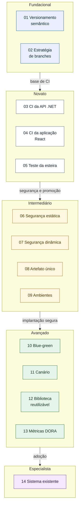

# Trilha de adoção pelo modelo C3DM

Esta página relaciona os cenários do repositório aos níveis do modelo C3DM. As definições do modelo estão na página [Modelo de maturidade C3DM](modelo-c3dm.md), que reúne níveis, domínios, matriz e fontes. A página [Autoavaliação](autoavaliacao.md) transforma cada célula da matriz em uma evidência observável. A esteira é a sequência automatizada de compilação, teste e implantação que leva uma alteração do código até o ambiente de execução.

## Cenários por nível do repositório

O modelo atribui níveis a cada domínio, ao passo que o repositório atribui um único nível a cada cenário, o que constitui uma escolha didática do roteiro. O diagrama agrupa os cenários pelo nível do repositório e mostra a sequência de estudo entre os grupos.

A relação entre o agrupamento do repositório e os níveis do modelo varia conforme o cenário. Os cenários [01](cenarios/01.md) e [02](cenarios/02.md) tratam de mensagens de *commit*, versionamento e ramificação. O modelo cita apenas o controle de versão centralizado, no nível Fundacional de integração. Os cenários [03](cenarios/03.md) e [04](cenarios/04.md) e o [cenário 05](cenarios/05.md) colocam compilação e testes automatizados na esteira, o que coincide com o nível Novato de integração e de teste. Os [cenários 06](cenarios/06.md) e [07](cenarios/07.md) executam verificações de segurança. O modelo situa os testes de segurança no nível Avançado do domínio de teste. O repositório os agrupa no nível Intermediário por derivarem dos tópicos sobre ferramentas de segurança no ciclo de desenvolvimento e sobre gestão de segredos, que o roteiro situa nessa etapa. O [cenário 08](cenarios/08.md) e o [cenário 09](cenarios/09.md) tratam do artefato único e dos ambientes, relacionados à implantação automática do nível Intermediário. O [cenário 10](cenarios/10.md) e o [cenário 11](cenarios/11.md) tratam de implantação sem parada, que coincide com o nível Avançado de implantação.

Os cenários 12 e 13 não têm correspondente direto nos domínios do modelo. O [cenário 12](cenarios/12.md) reaproveita a esteira entre sistemas. O [cenário 13](cenarios/13.md) mede a própria esteira, o que difere da inteligência contínua do modelo, voltada ao comportamento dos clientes. O [cenário 14](cenarios/14.md) aplica a biblioteca a um sistema existente. O nível Especialista do repositório indica o último estágio do roteiro e não se refere ao uso de inteligência artificial que o modelo associa ao mesmo nome.

Os domínios de inteligência e de planejamento dependem de dados de uso real e da gestão do *backlog*, que ficam fora do que um repositório de exemplo consegue demonstrar. Nenhum cenário os trabalha diretamente. A [autoavaliação](autoavaliacao.md) cobre os cinco domínios, com uma tabela de evidências para cada um.

## Fontes

A descrição dos níveis e dos domínios segue a publicação original do NISI, citada na página [Modelo de maturidade C3DM](modelo-c3dm.md#fontes). A página [Bibliografia](referencia/bibliografia.md) lista as demais referências.
