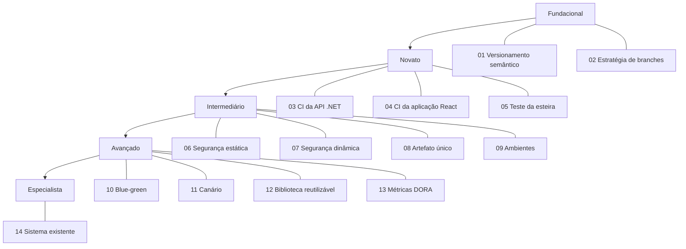

# Trilha de adoção pelo modelo C3DM

O C3DM é um modelo de maturidade de entrega contínua, publicado pela entidade holandesa NISI com o nome *Continuous Delivery 3.0 Maturity Model*. Um modelo de maturidade descreve em níveis ordenados o que uma organização faz em cada área de uma prática. Isso permite situar um sistema na escala, comparar sistemas entre si e escolher a próxima melhoria. Este repositório usa a sigla C3DM, adotada no material didático que o originou, enquanto a fonte original abrevia o mesmo modelo como CD3M.

## Níveis de maturidade

Os níveis formam uma escala de automação crescente ao longo do ciclo de entrega. Um sistema pode estar em níveis diferentes conforme o domínio avaliado. Nas tabelas desta página a sigla *CI/CD* designa a integração e a entrega contínuas. A esteira é a sequência automatizada de compilação, teste e implantação que leva uma alteração do código até o ambiente de execução.

| Nível | Descrição |
| --- | --- |
| Fundacional | A equipe trabalha sobre uma plataforma de entrega contínua, porém o ciclo é pouco automatizado. |
| Novato | Há automação básica, ainda em nível reativo, em que a equipe age depois que o problema aparece. |
| Intermediário | O ciclo usa tecnologias de entrega contínua com elementos proativos, como disparo automático após cada *commit*. |
| Avançado | Há tecnologia de entrega contínua avançada e o processo é gerenciado quantitativamente, isto é, por medições. |
| Especialista | A equipe emprega inteligência artificial de forma crescente para melhorar o ciclo de desenvolvimento. |

## Domínios de avaliação

O modelo avalia cinco domínios, cada um descrito pelo que se automatiza nele.

| Domínio | O que automatiza |
| --- | --- |
| Inteligência contínua | A coleta de dados de uso e de comentários dos clientes para orientar o que se desenvolve, como em testes A/B, que comparam duas versões de uma funcionalidade com grupos distintos de usuários. |
| Planejamento contínuo | A criação e a priorização dos itens do *backlog*, que é a lista ordenada de trabalho da equipe, com apoio da inteligência contínua. |
| Integração contínua | A integração do código novo ao existente a cada alteração, sem etapas manuais. |
| Teste contínuo | A execução de testes unitários, de integração, de aceitação, de segurança e de desempenho para obter retorno imediato. |
| Implantação contínua | A instalação automática das versões nos ambientes de teste, de aceitação e de produção, idealmente sem parada do serviço. |

## Nível de cada domínio

A tabela resume o que o modelo espera em cada combinação de domínio e nível. A página de [Autoavaliação](autoavaliacao.md) transforma essas descrições em evidências observáveis.

| Domínio | Fundacional | Novato | Intermediário | Avançado | Especialista |
| --- | --- | --- | --- | --- | --- |
| Inteligência | Rastreamento básico do comportamento do cliente | Monitoramento básico do uso e tratamento dos comentários | Monitoramento avançado e testes A/B | Métricas detalhadas e decisões baseadas em análise | Coleta em tempo real e relatórios com inteligência artificial |
| Planejamento | *Backlog* gerenciado manualmente em servidor central | Todo o trabalho em *backlog* digital | Itens criados automaticamente pelos servidores de CI/CD | Sugestões automáticas de prioridade a partir de testes A/B | Criação e priorização automáticas por inteligência artificial |
| Integração | Controle de versão centralizado e servidor de compilação acionado manualmente | Orquestrador de fluxos executa compilações automaticamente | Compilação disparada após cada *commit* | Integração sobre arquitetura de microsserviços escaláveis, isto é, de serviços pequenos e independentes que crescem em capacidade conforme a demanda | Escalabilidade automática dos serviços de integração |
| Teste | Testes unitários executados manualmente em servidor central | Testes unitários automatizados na esteira | Testes de integração disparados automaticamente | Testes de aceitação e de segurança automáticos | Testes de regressão ponta a ponta contínuos |
| Implantação | Servidor central e *scripts* manuais básicos | Implantação automática em servidor de teste após a compilação | Implantação automática em produção pela esteira | Implantação em produção sem parada | Implantação automática em plataformas escaláveis sob demanda |

## Cenários por nível do repositório

O modelo atribui níveis a cada domínio, ao passo que o repositório atribui um único nível a cada cenário, o que constitui uma escolha didática do roteiro. O diagrama mostra a sequência de níveis do repositório com os cenários de cada um.

A relação entre o agrupamento do repositório e os níveis do modelo varia conforme o cenário. Os cenários [01](cenarios/01.md) e [02](cenarios/02.md) tratam de mensagens de *commit*, versionamento e ramificação. O modelo cita apenas o controle de versão centralizado, no nível Fundacional de integração. Os cenários [03](cenarios/03.md) e [04](cenarios/04.md) e o [cenário 05](cenarios/05.md) colocam compilação e testes automatizados na esteira, o que coincide com o nível Novato de integração e de teste. Os cenários 06 e 07 executam verificações de segurança. O modelo situa os testes de segurança no nível Avançado do domínio de teste. O repositório os agrupa no nível Intermediário por derivarem dos tópicos sobre ferramentas de segurança no ciclo de desenvolvimento e sobre gestão de segredos, que o roteiro situa nessa etapa. Os cenários 08 e 09 tratam do artefato único e dos ambientes, relacionados à implantação automática do nível Intermediário. Os cenários 10 e 11 tratam de implantação sem parada, que coincide com o nível Avançado de implantação.

Os cenários 12 e 13 não têm correspondente direto nos domínios do modelo. O cenário 12 reaproveita a esteira entre sistemas. O cenário 13 mede a própria esteira, o que difere da inteligência contínua do modelo, voltada ao comportamento dos clientes. O cenário 14 aplica a biblioteca a um sistema existente. O nível Especialista do repositório indica o último estágio do roteiro e não se refere ao uso de inteligência artificial que o modelo associa ao mesmo nome.

Os domínios de inteligência e de planejamento dependem de dados de uso real e da gestão do *backlog*, que ficam fora do que um repositório de exemplo consegue demonstrar. Nenhum cenário os trabalha diretamente. A [autoavaliação](autoavaliacao.md) cobre os cinco domínios, com uma tabela de evidências para cada um.

## Fontes

A descrição dos níveis e dos domínios segue a publicação original do NISI, *Continuous Delivery 3.0 Maturity Model*, disponível em https://nisi.nl/continuousdelivery/articles/maturity-model. A página [Bibliografia](referencia/bibliografia.md) lista as demais referências.
